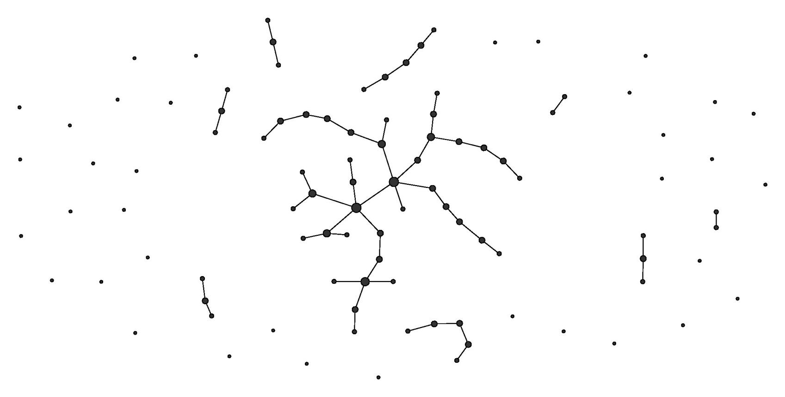
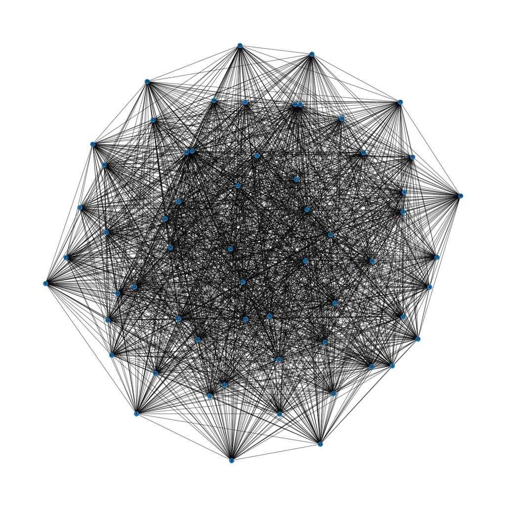

# Алгоритмы и структуры данных

> Нет структуры данных, которая была бы лучшей для **всех** операций. *Приходится* чем-то жертвовать. Каждая структура представляет собой компромисс между скоростью поиска, вставки и удаления, расходом памяти, упорядоченностью данных и другими характеристиками. Выбор зависит от конкретной задачи.

В языках программирования/библиотеках уже есть реализации структур данных, так что в первую очередь, имеет смысл **освоить их применение** т.е. хорошо понимать сильные и слабые стороны и применимость к задаче. Реализовывать очередной linked list *не имеет смылса*, так как это не дает понимание его применения. Когда будет понимание поведения основных струтур данных, тогда можно реализовывать собственные структуры, комбинируя нужные свойства стандарных струтур данных. 

Для практики важнее научиться узнавать профиль нагрузки и выбирать структуру под него.

```
 
Массивы
   ↓
Связные списки
   ↓
Stack / Queue / Deque
   ↓
Hash Table
   ↓
Trees
   ├── Binary Tree
   ├── BST
   ├── AVL / Red-Black
   └── B-Tree
   ↓
Heap / Priority Queue
   ↓
Graph
   ↓
Trie
   ↓
Специализированные структуры
    ├── Union-Find
    ├── Segment Tree
    ├── Fenwick Tree
    └── Bloom Filter
```

---

## Array

[Визуализация работы Array](https://visualgo.net/en/array?slide=1)

Массив — как абстрактная модель, это последовательность однородных элементов с индексированным произвольным доступом.

Конкретные реализации модели массива: Static Array, Dynamic Array, Multidimensional Array  

<details>
<summary>Array ознакомление</summary>

#### Сильные стороны
* Мгновенный доступ: Доступ к абсолютно любому элементу по целочисленному индексу за константное время $O(1)$
* Очень быстрый последовательный обход из-за меньшего обращения к RAM и простого расчета индекса следующего элемента `address = base_address + index * type_size`
* Кэш-локальность (Spatial Locality): Элементы расположены подряд, что обеспечивает максимальную эффективность L1/L2/L3 кэшей процессора
* Низкий Memory Overhead: Нет затрат на хранение дополнительных указателей

#### Слабые стороны
* Дорогие вставки и удаления: Любое изменение структуры внутри массива требует сдвига всей последующей последовательности $O(n)$
* Фрагментация памяти: Требуется непрерывный фрагмент памяти. При выделении огромных массивов системный аллокатор может вернуть ошибку, даже если суммарный объем свободной памяти достаточен
* Избыточное выделение: При геометрическом изменении размера (например, $2\times$) часть памяти остается незадействованной
* Поиск за $O(n)$
* Обычный статический массив требует заранее известного размера
* Плохо подходит, если основной способ доступа — не индекс, а произвольный ключ

#### Сложность операций

| Операция                     | Среднее | Худшее | Почему                       |
| --------                     | ------: | ----:  | ---------------------------- |
| Доступ                       |    O(1) |  O(1)  | адрес вычисляется по индексу |
| Поиск                        |    O(n) |  O(n)  | последовательный просмотр    |
| Добавление в начало/середину |    O(n) |  O(n)  | требуется сдвиг              |
| Добавление в конец           |    -    |    -   | O(1) для динамического массива |
| Удаление                     |    O(n) |  O(n)  | требуется сдвиг              |


#### Память

* Нет затрат на хранение дополнительных указателей
* Элементы расположены последовательно.
* Почти нет дополнительной памяти на связи между элементами.
* Dynamic array обычно резервирует свободную ёмкость.

#### Когда использовать
* Порядок элементов важен
* Размер коллекции известен заранее или меняется редко.
* Преобладают операции чтения и случайного доступа.
* Требуется максимальная производительность по скорости прохода (iteration speed).
* Частый доступ по позиции.
 

#### Когда не использовать
* Необходимы частые вставки и удаления в произвольные места коллекции
* Точный размер данных заранее неизвестен, а выделять память с запасом недопустимо из-за жестких ограничений по RAM
* Нужны быстрые range-запросы при постоянных изменениях данных

#### Алгоритмы, связанные с массивом

```
Linear Search
Binary Search
Two Pointers
Sliding Window
Prefix Sum
Sorting
```

#### Задачи
 
Насколько массив подходит, где возникнут проблемы, какие его свойства используются:
* **index access** — доступ по индексу. Если нужен 1000-й элемент, массив позволяет обратиться к нему напрямую: `array[999]`. Обычно это $O(1)$
* **contiguous memory** — непрерывное размещение в памяти. Элементы массива лежат рядом друг с другом: [A][B][C][D]. Это позволяет быстро вычислять адрес элемента по индексу
* **cache locality** — хорошая локальность данных. Поскольку элементы лежат рядом, процессор часто загружает сразу несколько соседних элементов в кэш. Поэтому последовательный обход массива обычно очень быстрый
* **fixed size** — фиксированный размер. Обычный массив создаётся на определённое число элементов, и сам по себе увеличиться не может
* **dynamic resizing** — динамическое расширение. Dynamic array (Vec, vector, ArrayList) при нехватке места создаёт новый более крупный массив и переносит туда элементы
* **amortized complexity** — амортизированная сложность. Отдельная операция иногда может быть дорогой, но если смотреть на длинную серию операций, средняя стоимость остаётся маленькой. Например `push` в dynamic array обычно считается $O(1)$ amortized, хотя иногда когда dynamic array заполнен и ему нужно расшириться resize стоит $O(n)$
* **shifting** — сдвиг элементов. Если вставить или удалить элемент в середине массива и нужно сохранить порядок, остальные элементы приходится перемещать
* **ordered deletion** — удаление с сохранением порядка
* **unordered deletion** — удаление без сохранения порядка. Если порядок не важен, удаляемый элемент можно заменить последним
* **linear search** — линейный поиск. Идём по элементам один за другим, пока не найдём нужный
* **sorted array + binary search** — отсортированный массив + бинарный поиск
* **sparse indexes** — разреженные индексы. Возможные значения очень далеко друг от друга
* **dense indexes** — плотные индексы. Значения индексов идут почти подряд
* **memory overhead** — дополнительная память, которую структура тратит помимо самих данных. У массива overhead обычно небольшой. Например для int в основном хранятся сами числа


> [!INFO]
> Какие операции над данными нужны и насколько часто они выполняются?

---

> [!EXAMPLE]
> **№1 ключ и индекс** 

Есть массив из 10 миллионов пользователей.

У каждого пользователя есть: id, name, email

Программа выполняет два типа запросов:
* получить пользователя № 5000000
* получить пользователя с id = 87342873

Порядковый номер пользователя и id никак не связаны.
 

<details>
<summary>Подходит ли массив?</summary>

* Для получения пользователя по номеру, массив подходит
* Для получения пользователя по полю id придется выполнять поиск по значению, это плохо подходит массиву. Для поиска по id логичнее добавить hash table или другой индекс.

</details>
<br>


> [!EXAMPLE]
> **№2 последовательность**

Есть список из миллиона песен.

Пользователь постоянно удаляет песни из разных мест плейлиста.

Оставшиеся песни должны сохранить исходный порядок.

<details>
<summary>Подходит ли массив?</summary>

* Если бы порядок был неважен, то мы могли бы заменять дыры последовательности последним элементом, но в данном случае массив неподходит из-за дорогой операции смещения всех  элементов после удаления
 
</details>
<br>


> [!EXAMPLE]
> **№3 последовательность**

Есть массив игровых объектов.

Порядок объектов не важен.

Нужно очень часто удалять произвольный объект.

<details>
<summary>Подходит ли массив?</summary>

* Можно избежать сдвига элементов после удаления если переместить последний элемент на освободившееся место, тогда удаление может быть за $O(1)$ и мы можем использовать массив.  
 
</details>
<br>


> [!EXAMPLE]
> **№4 cache locality**

Есть два варианта хранения 100 миллионов чисел:
* одно непрерывное хранилище
* списком (элементы разбросаны по памяти и связаны указателями)

Основная операция - суммирование всех элементов

<details>
<summary>Подходит ли массив?</summary>

* Для суммирования элементов необходимо проходить весь массив, тут хорошо подходит массив. Список будет иметь накладные расходы на прыжок по ссылке.

CPU загружает память блоками cache line. Поэтому последовательный обход массива обычно очень эффективен.

</details>
<br>


> [!EXAMPLE]
> **№5 бинарный поиск**

Есть миллион отсортированных чисел. Новые элементы почти никогда не добавляются.

Нужно очень часто проверять: есть ли число X?

<details>
<summary>Подходит ли массив?</summary>

* Да. Поскольку массив отсортирован, можно использовать binary search за $O(log n)$

</details>
<br>


> [!EXAMPLE]
> **№6 цена поддержания сортировки**

Есть миллион отсортированных чисел.
 
Каждую секунду:
* 1000 раз вставить новое число
* 100 раз выполнить поиск

Массив должен постоянно оставаться отсортированным.

<details>
<summary>Подходит ли массив?</summary>

* Нет. Поиск мы можем выполнить быстро за $O(log n)$ используя binary search, но частое добавление в массив потребует новой сортировки    

</details>
<br>

> [!EXAMPLE]
> **№7 неизвестный размер** 

Программа получает данные из сети. Количество элементов неизвестно.

Нужно сохранять каждый полученный элемент.

<details>
<summary>Подходит ли массив?</summary>

* Статический массив (static) не подходит, а динамичсекий (dynamic) подходит 

</details>
<br>


> [!EXAMPLE]
> **№8 разреженый индекс**

В системе хранятся 50 миллионов объектов. Для каждого объекта известен уникальный идентификатор.

Основная операция программы:

> получить объект по его идентификатору.

Идентификаторы выглядят примерно так:

```text
1847293847
51
98237 
7349283
...
```

<details>
<summary>Можно ли использовать id непосредственно как индекс массива?</summary>

* Технически иногда можно, но здесь получится огромный разреженный массив с множеством пустых ячеек. Это плохое использование памяти. Hash table значительно естественнее подходит 

</details>
<br>


> [!EXAMPLE]
> **№9 range query**

Есть 20 миллионов отсортированных цен.

Очень часто выполняется: найти все цены от 50 до 100

Изменения происходят редко.

<details>
<summary>Подходит ли массив?</summary>

* Да, в отсортированном массиве можно использовать бинарный поиск и редкие изменения (удаления) так же на пользу массиву. 

</details>
<br>


> [!EXAMPLE]
> **№10** 

Нужно хранить 500 миллионов int32

Рассматриваются две структуры:
* array
* linked list

В обеих полный обход занимает $O(n)$
VSRfr
<details>
<summary>Значит ли это, что они примерно одинаковы?</summary>

Нет. 

* Память. Массив хранит примерно $4 bytes × N$, а Linked list кроме самого значения обычно хранит как минимум указатель, а также возможен padding и узлы списка могут быть разбросаны по памяти.

* Доступ. У массива адрес элемента вычисляется напрямую: $address = base + index × sizeof(element)$. Поэтому `array[500]` → сразу переход к 500-му элементу: $O(1)$. У односвязного списка нет возможности вычислить адрес 500-го элемента по его индексу, ему нужно последовательно дойти до него за $O(n)$. У списка нет cache locality, каждый переход требует загрузки следующего адреса

</details>
<br>

---

#### Упражнения 

**Пример с двумерным массивом на C**


[example from ideone.com](https://ideone.com/cPFVxW)

```c
#include <stdio.h>
#include <stdlib.h> // EXIT_SUCCESS

#define COLS 9

void variant_a(int (*arr)[COLS], size_t n ){
    printf("variant_a:\n");
    for (size_t i=0; i < n; i++){
        printf("Ряд %ld:    ",i);  
        for (size_t j=0; j < COLS; j++){
            if(j>=i) printf("0 "); 
            else printf("%d ", arr[i][j]);
        }
        printf("\n");
    }
    printf("\n");
}

void fill_out(int (*arr)[COLS], size_t n, int fill){
    for (size_t i=0; i < n; i++){
        for (size_t j=0; j < COLS; j++){
            arr[i][j]=fill;//rand()%10-5;// от -5 до +5
        }
    }
}

int main(void) { 
    const size_t n=9;
    int arr[n][COLS]; 
    fill_out(arr, n, 1);
    variant_a(arr, n);
   
    return EXIT_SUCCESS;
}
```

---

**Примеры с двумерным массивом на Rust**

**A:**

```rust,editable

const COLS: usize = 9;

fn variant_a(arr: &[[i32; COLS]], n: usize) {
    println!("variant_a:");

    for i in 0..n {
        print!("Ряд {:<4}", i);

        for j in 0..COLS {
            if j >= i {
                print!("0 ");
            } else {
                print!("{} ", arr[i][j]);
            }
        }
        println!();
    }
    println!();
}
fn fill_out(arr: &mut [[i32; COLS]], n: usize, fill: i32) {
    for i in 0..n {
        for j in 0..COLS {
            arr[i][j] = fill;
        }
    }
}
fn main() {
    let n = 9;
    let mut arr = [[0i32; COLS]; 9];
    fill_out(&mut arr, n, 1);
    variant_a(&arr, n);
}
```

**B:**

```rust,editable

const COLS: usize = 9;

fn variant_b(arr: &[[i32; COLS]], n: usize) {
    println!("variant_b:");

    for i in 0..n {
        print!("Ряд {:<4}", i);

        for j in 0..COLS {
            if j <= i {
                print!("0 ");
            } else {
                print!("{} ", arr[i][j]);
            }
        }
        println!();
    }
    println!();
}
fn fill_out(arr: &mut [[i32; COLS]], n: usize, fill: i32) {
    for i in 0..n {
        for j in 0..COLS {
            arr[i][j] = fill;
        }
    }
}
fn main() {
    let n = 9;
    let mut arr = [[0i32; COLS]; 9];
    fill_out(&mut arr, n, 1);
    variant_b(&arr, n);
}
```

**C:**

```rust,editable

const COLS: usize = 9;

fn variant_c(arr: &[[i32; COLS]], n: usize) {
    println!("variant_c:");

    for i in 0..n {
        print!("Ряд {:<4}", i);

        for j in 0..COLS {
            if j >= i && j < n - i && i <= n / 2 {
                print!("0 ");
            } else {
                print!("{} ", arr[i][j]);
            }

            // Альтернативный вариант:
            // if j >= i && j < n - i {
            //     print!("0 ");
            // } else {
            //     print!("{} ", arr[i][j]);
            // }
        }
        println!();
    }
    println!();
}
fn fill_out(arr: &mut [[i32; COLS]], n: usize, fill: i32) {
    for i in 0..n {
        for j in 0..COLS {
            arr[i][j] = fill;
        }
    }
}
fn main() {
    let n = 9;
    let mut arr = [[0i32; COLS]; 9];
    fill_out(&mut arr, n, 1);
    variant_c(&arr, n);
}
```

**D:**

```rust,editable

const COLS: usize = 9;

fn variant_d(arr: &[[i32; COLS]], n: usize) {
    println!("variant_d:");

    for i in 0..n {
        print!("Ряд {:<4}", i);

        for j in 0..COLS {
            if j <= i && j >= n - i - 1 && i >= n / 2 {
                print!("0 ");
            } else {
                print!("{} ", arr[i][j]);
            }
        }
        println!();
    }
    println!();
}
fn fill_out(arr: &mut [[i32; COLS]], n: usize, fill: i32) {
    for i in 0..n {
        for j in 0..COLS {
            arr[i][j] = fill;
        }
    }
}
fn main() {
    let n = 9;
    let mut arr = [[0i32; COLS]; 9];
    fill_out(&mut arr, n, 1);
    variant_d(&arr, n);
}
```


**E:**

```rust,editable

const COLS: usize = 9;

fn variant_e(arr: &[[i32; COLS]], n: usize) {
    println!("variant_e:");

    for i in 0..n {
        print!("Ряд {:<4}", i);

        for j in 0..COLS {
            if (j >= i && j < n - i && i <= n / 2)
                || (j <= i && j >= n - i - 1 && i >= n / 2)
            {
                print!("0 ");
            } else {
                print!("{} ", arr[i][j]);
            }

            // Альтернативный вариант:
            // if (j >= i && j < n - i)
            //     || (j <= i && j >= n - i - 1)
            // {
            //     print!("0 ");
            // } else {
            //     print!("{} ", arr[i][j]);
            // }
        }
        println!();
    }
    println!();
}
fn fill_out(arr: &mut [[i32; COLS]], n: usize, fill: i32) {
    for i in 0..n {
        for j in 0..COLS {
            arr[i][j] = fill;
        }
    }
}
fn main() {
    let n = 9;
    let mut arr = [[0i32; COLS]; 9];
    fill_out(&mut arr, n, 1);
    variant_e(&arr, n);
}
```

**F:**

```rust,editable

const COLS: usize = 9;

fn variant_f(arr: &[[i32; COLS]], n: usize) {
    println!("variant_f:");

    for i in 0..n {
        print!("Ряд {:<4}", i);

        for j in 0..COLS {
            if ((j < n - i && i >= n / 2)
                || (j <= i && i <= n / 2))
                || ((j >= i && i >= n / 2)
                    || (j >= n - i - 1 && i <= n / 2))
            {
                print!("0 ");
            } else {
                print!("{} ", arr[i][j]);
            }

            // Альтернативный вариант:
            // if (j <= i && j < n - i)
            //     || (j >= i && j >= n - i - 1)
            // {
            //     print!("0 ");
            // } else {
            //     print!("{} ", arr[i][j]);
            // }
        }
        println!();
    }
    println!();
}
fn fill_out(arr: &mut [[i32; COLS]], n: usize, fill: i32) {
    for i in 0..n {
        for j in 0..COLS {
            arr[i][j] = fill;
        }
    }
}
fn main() {
    let n = 9;
    let mut arr = [[0i32; COLS]; 9];
    fill_out(&mut arr, n, 1);
    variant_f(&arr, n);
}
```

**G:**

```rust,editable

const COLS: usize = 9;

fn variant_g(arr: &[[i32; COLS]], n: usize) {
    println!("variant_g:");

    for i in 0..n {
        print!("Ряд {:<4}", i);

        for j in 0..COLS {
            if (j < n - i && i >= n / 2)
                || (j <= i && i <= n / 2)
            {
                print!("0 ");
            } else {
                print!("{} ", arr[i][j]);
            }
        }
        println!();
    }
    println!();
}
fn fill_out(arr: &mut [[i32; COLS]], n: usize, fill: i32) {
    for i in 0..n {
        for j in 0..COLS {
            arr[i][j] = fill;
        }
    }
}
fn main() {
    let n = 9;
    let mut arr = [[0i32; COLS]; 9];
    fill_out(&mut arr, n, 1);
    variant_g(&arr, n);
}
```

**H:**

```rust,editable

const COLS: usize = 9;

fn variant_h(arr: &[[i32; COLS]], n: usize) {
    println!("variant_h:");

    for i in 0..n {
        print!("Ряд {:<4}", i);

        for j in 0..COLS {
            if (j >= i && i >= n / 2)
                || (j >= n - i - 1 && i <= n / 2)
            {
                print!("0 ");
            } else {
                print!("{} ", arr[i][j]);
            }
        }
        println!();
    }
    println!();
}
fn fill_out(arr: &mut [[i32; COLS]], n: usize, fill: i32) {
    for i in 0..n {
        for j in 0..COLS {
            arr[i][j] = fill;
        }
    }
}
fn main() {
    let n = 9;
    let mut arr = [[0i32; COLS]; 9];
    fill_out(&mut arr, n, 1);
    variant_h(&arr, n);
}
```

**I:**

```rust,editable

const COLS: usize = 9;

fn variant_i(arr: &[[i32; COLS]], n: usize) {
    println!("variant_i:");

    for i in 0..n {
        print!("Ряд {:<4}", i);

        for j in 0..COLS {
            if j < n - i {
                print!("0 ");
            } else {
                print!("{} ", arr[i][j]);
            }
        }
        println!();
    }
    println!();
}
fn fill_out(arr: &mut [[i32; COLS]], n: usize, fill: i32) {
    for i in 0..n {
        for j in 0..COLS {
            arr[i][j] = fill;
        }
    }
}
fn main() {
    let n = 9;
    let mut arr = [[0i32; COLS]; 9];
    fill_out(&mut arr, n, 1);
    variant_i(&arr, n);
}
```

**J:**

```rust,editable

const COLS: usize = 9;

fn variant_j(arr: &[[i32; COLS]], n: usize) {
    println!("variant_j:");

    for i in 0..n {
        print!("Ряд {:<4}", i);

        for j in 0..COLS {
            if j >= n - i {
                print!("0 ");
            } else {
                print!("{} ", arr[i][j]);
            }
        }
        println!();
    }
    println!();
}
fn fill_out(arr: &mut [[i32; COLS]], n: usize, fill: i32) {
    for i in 0..n {
        for j in 0..COLS {
            arr[i][j] = fill;
        }
    }
}
fn main() {
    let n = 9;
    let mut arr = [[0i32; COLS]; 9];
    fill_out(&mut arr, n, 1);
    variant_j(&arr, n);
}
```

</details>
<br>

---

## Linked List

[Визуализация работы Linked List](https://visualgo.net/en/list?slide=1)

Linked List — связный список, это последовательность элементов, где каждый элемент хранится в отдельном узле и содержит ссылку на следующий элемент.

Конкретные реализации: Singly Linked List, Doubly Linked List, Circular Linked List

<details>
<summary>Linked List ознакомление</summary>

#### Сильные стороны

* Быстрая вставка и удаление уже найденного узла без сдвига остальных элементов
* Размер структуры может динамически изменяться
* Не требуется непрерывный участок памяти
* Можно эффективно добавлять элементы в начало списка
* В Doubly Linked List можно эффективно удалять узел и двигаться в обе стороны

#### Слабые стороны

* Нет произвольного доступа по индексу: чтобы получить элемент №1000, нужно пройти предыдущие 999 элементов
* Плохая cache locality: узлы могут находиться в разных местах памяти
* Дополнительные затраты памяти на указатели next, а в Doubly Linked List ещё и prev
* Последовательный обход обычно медленнее массива
* Binary Search практически теряет смысл, потому что невозможно быстро получить элемент в середине
* Чтобы удалить элемент, его сначала обычно нужно найти

#### Сложность операций

| Операция                                      | Среднее | Худшее  | Почему                          |
|---                                            |---:     |---:     |---                              |
| Доступ по индексу                             | O(n)    | O(n)    | необходимо пройти список        |
| Поиск значения                                | O(n)    | O(n)    | последовательный просмотр       |
| Добавление в начало                           | O(1)    | O(1)    | меняется только `head`          |
| Добавление после известного узла              | O(1)    | O(1)    | меняется несколько ссылок       |
| Добавление в конец                            | O(1)*   | O(1)*   | если хранится `tail`            |
| Удаление после известного узла                | O(1)    | O(1)    | меняется ссылка                 |
| Удаление известного узла в Doubly Linked List | O(1)    | O(1)    | доступны `prev` и `next`        |
| Поиск + удаление                              | O(n)    | O(n)    | сначала нужно найти узел        |

> * Если tail не хранится, добавление в конец Singly Linked List требует обхода и будет O(n).


#### Память

Каждый элемент хранится не только вместе со значением, но и с дополнительными ссылками

Singly Linked List: `[data | next]`

Doubly Linked List: `[prev | data | next]`

Узлы могут быть расположены в памяти независимо друг от друга.

#### Когда использовать

* Часто вставляются и удаляются элементы внутри последовательности
* Уже имеется ссылка на место вставки или удаления
* Не требуется частый доступ по индексу
* Размер коллекции постоянно меняется
* Нельзя или нежелательно требовать непрерывный участок памяти
* Нужно часто добавлять элементы в начало
* Нужно реализовать структуру, основанную на последовательном переходе между элементами

#### Когда не использовать

* Нужен частый доступ к элементам по индексу
* Основная операция — последовательный полный обход большой коллекции
* Важна cache locality
* Важен минимальный Memory Overhead
* Требуется Binary Search
* Вставки и удаления редкие, а чтение и обход происходят постоянно

#### Алгоритмы и структуры, связанные с Linked List

```
Linked List Traversal
Insertion / Deletion
Reverse Linked List
Fast & Slow Pointers
Cycle Detection
Merge Two Sorted Lists
Stack
Queue
LRU Cache
```

#### Задачи

Насколько Linked List подходит, где возникнут проблемы, какие его свойства используются:
* **pointer traversal** — следующий элемент определяется ссылкой next, а не вычислением адреса
* **sequential access** — доступ к элементам только последовательный
* **no contiguous memory** — узлы не обязаны лежать рядом в памяти
* **node insertion** — вставка рядом с известным узлом требует только изменения ссылок
* **node deletion** — удаление известного узла не требует сдвига остальных элементов
* **head / tail** — ссылки на первый и последний элементы списка
* **memory overhead** — каждый узел дополнительно хранит указатели
* **poor cache locality** — соседние логические элементы могут находиться далеко друг от друга в памяти
* **singly vs doubly linked** — в односвязном списке есть только next, в двусвязном next и prev
* **search before modification** — операция изменения может быть O(1), но поиск нужного места остаётся O(n)
* **pointer stability** — добавление других узлов обычно не перемещает уже существующие узлы
* **fast/slow pointers** — два указателя могут двигаться по списку с разной скоростью

> [!INFO]
> Какие операции над данными нужны и насколько часто они выполняются?


> [!IMPORTANT]
> Linked List не «быстро вставляет и удаляет».
> 
> Linked List быстро вставляет и удаляет, если нужное место **уже** найдено.
 


---

> [!EXAMPLE]
> **№1 доступ по индексу**
 
Есть список из 10 миллионов объектов.

Программа очень часто выполняет:

```text
получить объект №5
получить объект №500000
получить объект №9000000
```

<details>
<summary>Подходит ли Linked List?</summary>

* Нет. Linked List не имеет прямого доступа по индексу.
* Чтобы получить элемент №500000, нужно последовательно пройти предыдущие элементы.
* Доступ по позиции занимает O(n).
* Здесь массив подходит значительно лучше.

</details>
<br>

 

> [!EXAMPLE]
> **№2 вставка после известного элемента**

Есть последовательность элементов.

Программа уже имеет ссылку на узел:

```text
A → B → C → D
        ↑
      current
```

Нужно вставить `X` после `C`.

<details>
<summary>Подходит ли Linked List?</summary>

* Да.
* Не нужно перемещать `D` или другие элементы.
* Достаточно изменить ссылки:

```text
C.next = X
X.next = D
```

* Вставка после уже известного узла выполняется за O(1).

</details>
<br>

 

> [!EXAMPLE]
> **№3 поиск + удаление**

Есть Linked List из миллиона пользователей.

Нужно удалить пользователя с:

```text
id = 87342873
```

Ссылки на узел заранее нет.

<details>
<summary>Удаление будет O(1)?</summary>

Нет. Само изменение ссылок может занимать O(1), но сначала нужно найти нужный узел: `head → ... → ... → target`
 
Поиск занимает O(n).

Поэтому вся операция: `find + delete = O(n)`
 

Это важное ограничение утверждения:

> «Linked List быстро удаляет элементы».

Он быстро удаляет **уже найденный** элемент.

</details>
<br>
 

> [!EXAMPLE]
> **№4 частые вставки в начало**

Программа постоянно получает новые события.

Новое событие всегда нужно добавлять в начало коллекции:

```text
new → old_head → ...
```

Операция происходит миллионы раз.

<details>
<summary>Подходит ли Linked List?</summary>

* Да.
* Новый узел указывает на старый `head`.
* После этого `head` заменяется новым узлом.
* Не нужно перемещать остальные элементы.

```text
new.next = head
head = new
```

Сложность O(1).

</details>
<br>


> [!EXAMPLE]
> **№5 последовательный обход**

Нужно хранить 100 миллионов чисел.

Главная операция:

```text
for each element:
    sum += element
```

Рассматриваются: Array и Linked List, обе структуры выполняют поиск за $O(n)$.

<details>
<summary>Одинаково ли хорошо подходит Linked List?</summary>

Нет. У массива элементы лежат последовательно:

```text
[A][B][C][D]
```

У Linked List:

```text
A → B → C → D
```

логическая последовательность не означает физическую последовательность в памяти.

Каждый переход требует:

1. прочитать `next`;
2. перейти по новому адресу;
3. возможно загрузить новую область памяти в CPU cache.

Поэтому Linked List имеет худшую cache locality и обычно значительно хуже подходит для массового последовательного обхода.

</details>
<br>

> [!EXAMPLE]
> **№6 размер постоянно меняется**

Количество объектов заранее неизвестно.

В течение работы программа постоянно: добавляет и удаляет элементы

Позиционный доступ практически не используется.

<details>
<summary>Подходит ли Linked List?</summary>

Может подходить.

Linked List не требует заранее задавать capacity и не выполняет resize всей коллекции.

Каждый новый элемент создаётся как отдельный узел.

Но этого требования самого по себе недостаточно, чтобы выбрать Linked List: dynamic array тоже умеет эффективно изменять размер.

Нужно смотреть на характер вставок и удалений:

* если они происходят в известных местах списка — Linked List может быть удобен;
* если элементы в основном добавляются в конец — `Vec` часто будет быстрее;
* если нужен частый полный обход — массив обычно выгоднее.

</details>
<br>


> [!EXAMPLE]
> **№7 удаление известного узла**

Есть Doubly Linked List:

```text
A ⇄ B ⇄ C ⇄ D
```

Программа уже имеет ссылку на `C`.

Нужно удалить `C`.

<details>
<summary>Насколько это дорого?</summary>

Удаление можно сделать за O(1).

У `C` есть:

```text
C.prev = B
C.next = D
```

Можно изменить ссылки:

```text
B.next = D
D.prev = B
```

Получаем:

```text
A ⇄ B ⇄ D
```

Не требуется ни сдвиг элементов, ни обход списка.

</details>
<br>


> [!EXAMPLE]
> **№8 Singly против Doubly Linked List**

Есть Singly Linked List:

```text
A → B → C → D
```

Программа имеет только ссылку на *C*.

Нужно удалить именно *C*.

<details>
<summary>Можно ли сделать это так же просто, как в Doubly Linked List?</summary>

Не совсем.

Чтобы удалить *C* обычным способом, нужно изменить:

```text
B.next = D
```

Но из *C* нельзя напрямую получить *B*, потому что Singly Linked List хранит только:

```text
C.next
```

Поэтому обычно нужно либо:

* заранее иметь ссылку на предыдущий узел;
* либо найти *B*, начиная с `head`.

Это одна из причин, почему Doubly Linked List хранит `prev`.

</details>
<br>

> [!EXAMPLE]
> **№9 память**

Нужно хранить 100 миллионов `int64`

Рассматриваются:

```text
Array
Singly Linked List
Doubly Linked List
```

<details>
<summary>Какая структура имеет больший Memory Overhead?</summary>
 
В массиве каждый элемент в основном содержит только данные, т.е. нет Memory Overhead:

```text
[value][value][value]
```

Singly Linked List уже содержит дополнительно ссылку next:

```text
[value | next]
```

Doubly Linked List имеет самый большой Memory Overhead, к каждому значению добавляются две ссылки:

```text
[prev | value | next]
```

То есть к каждому значению добавляются указатели.

Для маленьких значений вроде `int64` размер указателей может составлять значительную долю общей памяти.

Кроме того, отдельное выделение каждого узла может иметь дополнительные расходы allocator.

</details>
<br>


> [!EXAMPLE]
> **№10 Binary Search**

Есть отсортированный Linked List из миллиона чисел.

Нужно часто проверять:

```text
есть ли число X?
```

Можно ли использовать Binary Search за $O(log\ n)$?

<details>
<summary>Подходит ли Binary Search?</summary>

Практически нет.

Binary Search требует быстро получать средний элемент: `middle`
 

В Array `array[mid]` это $O(1)$, а в Linked List, чтобы получить `mid`, нужно пройти до него по ссылкам это за $O(n)$
  
Поэтому главное преимущество Binary Search теряется.

Для частого поиска отсортированный массив или дерево обычно подходят лучше.

</details>
<br>


> [!EXAMPLE]
> **№11 очередь**

Нужно реализовать очередь:

```text
добавить элемент в конец - push_back
забрать элемент из начала - pop_front
```

<details>
<summary>Подходит ли Linked List?</summary>

Да, если хранить:

```text
head
tail
```

Добавление за $O(1)$:

```text
tail.next = new
tail = new
```
  
Удаление первого за $O(1)$:

```text
head = head.next
```
  
Linked List естественно подходит для реализации Queue.

Хотя на практике ring buffer / deque на основе массива часто может быть быстрее из-за cache locality.

</details>
<br>

> [!EXAMPLE]
> **№12 стабильность адресов**

Есть коллекция объектов.

Другие части программы хранят ссылки на отдельные элементы коллекции.

Новые элементы постоянно добавляются.

Важно, чтобы добавление новых элементов не перемещало уже существующие объекты.

<details>
<summary>Как здесь ведёт себя Linked List?</summary>

Это сильная сторона Linked List.

Каждый узел выделен отдельно:

```text
A at 1000
B at 8000
C at 15000
```

Добавление `D` не требует переносить `A`, `B`, `C`.

Их адреса остаются прежними.

У dynamic array при resize элементы могут быть перенесены в новый участок памяти.

Поэтому в некоторых задачах **стабильность адресов элементов** важнее скорости обхода.

</details>
<br>


> [!EXAMPLE]
> **№13 поиск по ID**

Есть 10 миллионов объектов.

Основная операция: `найти объект по id`

ID произвольные:

```text
92713
4
81726342
...
```

<details>
<summary>Подходит ли Linked List?</summary>

Нет.

Linked List не имеет быстрого поиска по ключу.

Чтобы найти нужный `id`, придётся последовательно проходить узлы за $O(n)$
 
Hash Table подходит значительно лучше.

Linked List может использоваться вместе с Hash Table, если нужны другие свойства списка.

</details>
<br>


> [!EXAMPLE]
> **№14 LRU Cache**

Нужно реализовать cache фиксированного размера.

Когда элемент используется, он должен становиться самым «свежим».

Когда cache заполнен, нужно быстро удалить самый давно неиспользуемый элемент.

Требования:

```text
найти элемент по key      быстро
переместить элемент       быстро
удалить старейший         быстро
```

<details>
<summary>Подходит ли Linked List?</summary>

Один Linked List — нет, потому что поиск по *key* будет $O(n)$.

Но хорошо работает комбинация:

```text
HashMap + Doubly Linked List
```

HashMap даёт поиск $за O(1)$ в среднем:

```text
key → node
```

Doubly Linked List позволяет за O(1):

```text
удалить node из текущего места
переместить его в начало
удалить последний элемент
```

Это классический пример того, что структуры данных часто используются совместно.

</details>
<br>


> [!EXAMPLE]
> **№15 cycle**

Из-за ошибки список получился таким:

```text
A → B → C → D
        ↑     |
        └─────┘
```

То есть `D.next` снова указывает на `C`

Обычный обход никогда не завершится:

```text
while node != null
```

Можно ли обнаружить цикл без хранения всех посещённых узлов?

<details>
<summary>Как?</summary>

Да. Алгоритм Floyd's Cycle Detection, используется для определения, есть ли цикл в связном списке.

Используются два указателя:

```text
slow → двигается на 1 узел
fast → двигается на 2 узла т.е. не останавливается на первом
```

Если цикла нет, `fast` достигнет `null`.

Если цикл есть, в какой-то момент `slow` окажется в зацикленности вместе с `fast` и догонит его, иначе бы `slow` не смог бы догнать `fast`.

Это классическое применение техники: `fast & slow pointers`
  
</details>
<br>

 
> [!EXAMPLE]
> **№16 вставка в середину, но позиция задана индексом**

Есть Linked List из миллиона элементов.

Нужно вставить новый элемент: `на позицию №750000`
 
<details>
<summary>Будет ли вставка O(1)?</summary>

Нет. После того как нужный узел найден, изменение ссылок действительно O(1).

Но сначала необходимо дойти до позиции №750000 за $O(n)$
 
Поэтому:

```text
найти позицию + вставить = O(n)
```

Linked List особенно выгоден тогда, когда место изменения **уже известно через ссылку на узел**, а не задано индексом.

</details>
<br>


> [!EXAMPLE]
> **№17 вставка миллиона элементов между двумя известными позициями**

Есть известный узел `A` и нужно последовательно добавить после него миллион новых элементов.

Сравниваются: Array и Linked List
  
<details>
<summary>Где Linked List получает преимущество?</summary>

Если каждый новый элемент вставляется внутрь существующей последовательности массива, массиву приходится постоянно сдвигать элементы.

У Linked List можно создавать узлы и менять ссылки без перемещения остальных элементов.

Однако если задача допускает заранее собрать все новые элементы и использовать один большой непрерывный массив, преимущество может исчезнуть. Мы можем использовать эффективное блочное копирование памяти вроде `memcpy` что бы скопировать левую часть исходного массива и вставить ее в подготовленный пустой массив с заранее выделенным обьемом памяти и после вставить новый миллион элементов избегая многократного перераспределения памяти и повторных сдвигов, и завершить оставшейся частью исходного массива. Но старые элементы всё равно нужно скопировать в новый массив, поэтому общая стоимость остаётся порядка $O(n + k)$, где `n` — размер исходного массива, а `k` — количество новых элементов.

То есть важна не только операция «вставка», но и способ организации всей задачи.

</details>
<br>

> [!EXAMPLE]
> **№18 список маленьких объектов**

Нужно хранить миллионы значений размером всего 1–4 байта.

Выбирают Linked List, потому что «он гибкий и легко растёт».

<details>
<summary>Есть ли проблема?</summary>

Да Linked List даст лишний Memory Overhead.

Если значение занимает, например, 4 байта, а указатель — 8 байт, узел Singly Linked List уже логически содержит:

```text
4 bytes data
8 bytes next
```

плюс возможный padding и расходы allocator.

То есть служебных данных может оказаться больше, чем полезных.

Для огромного количества маленьких объектов массив часто намного эффективнее по памяти.

</details>
<br>

---

#### Упражнения

**Пример на С. Реализация Singly Linked List**

[example from ideone.com](https://ideone.com/NLmJ3T)

```c
#include <stdio.h>
#include <stdlib.h>

typedef struct Node {
    int value;
    struct Node *next;
} Node;


// Поиск узла по значению
// Возвращает найденный узел, а через prev записываеем предыдущий
Node *find_node(Node *head, int value, Node **prev){
    Node *current = head;
    *prev = NULL;
    while (current != NULL) {
        if (current->value == value) {
            return current;
        }
        *prev = current;
        current = current->next;
    }
    return NULL;
}

// Удаление узла из односвязного списка
void remove_node(Node **head, Node *node, Node *prev){
    if (node == NULL) {
        return;
    }
    if (prev == NULL) {
        // удаляем первый узел
        *head = node->next;
    } else {
        // перепрыгиваем через удаляемый узел
        prev->next = node->next;
    }
    free(node);
}

int main(void){
    Node *head = malloc(sizeof(Node));
    Node *second = malloc(sizeof(Node));
    Node *third = malloc(sizeof(Node));

    head->value = 10;
    head->next = second;

    second->value = 20;
    second->next = third;

    third->value = 30;
    third->next = NULL;

    // Создаём новый узел
    Node *new_node = malloc(sizeof(Node));
    new_node->value = 25;
    //   вставляем его между second и third
    new_node->next = second->next;
    second->next = new_node;

    // Удаление из середины
    //   находим узел 20
    Node *prev = NULL; // prev необходим что бы связать предыдущий узел со следующим
    Node *node = find_node(head, 20, &prev);
    //   удаляем найденный узел
    if (node != NULL) {
        remove_node(&head, node, prev);
    }

    // Проходим по списку
    Node *current = head;
    while (current != NULL) {
        printf("%d\n", current->value);// 10 25 30
        current = current->next;
    }

    // Освобождаем оставшиеся узлы
    current = head;
    while (current != NULL) {
        Node *next = current->next;
        free(current);
        current = next;
    }

    return 0;
}
```

---

**Пример на С. Реализация Doubly Linked List**

[example from ideone.com](https://ideone.com/Zlywaw)
 

```c
#include <stdio.h>
#include <stdlib.h>

typedef struct Node {
    int value;

    struct Node *prev;
    struct Node *next;
} Node;

typedef struct {
    Node *head;
    Node *tail;
} List;

// Создание нового узла
Node *create_node(int value){
    Node *node = malloc(sizeof(Node));
    if (node == NULL) {
        return NULL;
    }
    node->value = value;
    node->prev = NULL;
    node->next = NULL;
    return node;
}

// Добавление в конец
void push_back(List *list, int value){
    Node *node = create_node(value);
    if (node == NULL) {
        return;
    }
    if (list->tail == NULL) {
        // Список пуст
        list->head = node;
        list->tail = node;
        return;
    }
    node->prev = list->tail;
    list->tail->next = node;
    list->tail = node;
}

// Вывод слева направо
void print_forward(const List *list){
    Node *current = list->head;
    while (current != NULL) {
        printf("%d ", current->value);
        current = current->next;
    }
    printf("\n");
}

// Вывод справа налево
void print_backward(const List *list){
    Node *current = list->tail;
    while (current != NULL) {
        printf("%d ", current->value);
        current = current->prev;
    }
    printf("\n");
}

// Удаление узла
void remove_node(List *list, Node *node){
    if (node == NULL) {
        return;
    }
    // Если есть предыдущий узел,
    // связываем его со следующим.
    if (node->prev != NULL) {
        node->prev->next = node->next;
    } else {
        // Удаляется head
        list->head = node->next;
    }
    // Если есть следующий узел,
    // связываем его с предыдущим.
    if (node->next != NULL) {
        node->next->prev = node->prev;
    } else {
        // Удаляется tail
        list->tail = node->prev;
    }
    free(node);
}

// Поиск узла
Node *find_node(const List *list, int value){
    Node *current = list->head;
    while (current != NULL) {
        if (current->value == value) {
            return current;
        }
        current = current->next;
    }
    return NULL;
}

// Освобождение списка
void free_list(List *list){
    Node *current = list->head;
    while (current != NULL) {
        Node *next = current->next;
        free(current);
        current = next;
    }
    list->head = NULL;
    list->tail = NULL;
}

int main(void){
    List list = {
        .head = NULL,
        .tail = NULL
    };

    push_back(&list, 10);
    push_back(&list, 20);
    push_back(&list, 30);
    push_back(&list, 40);

    printf("Forward:  ");
    print_forward(&list);
    
    // Удаление узла из середины
    //   находим узел 30
    Node *node = find_node(&list, 30);
    //   удаляем его
    remove_node(&list, node);

    printf("Backward: ");
    print_backward(&list);

    free_list(&list);

    return 0;
}
```


---

**Пример на Rust. Алгоритм Floyd's Cycle Detection**

Rust гарантирует *memory safety* но не гарантирует отсутствие *memory leaks*. Через `Rc`-циклы утечки памяти вполне возможны. Проблема возникает, если цикл образован именно *strong reference count* (`Rc<T>`).

Rust на этапе компиляции хорошо ловит проблемы с временем жизни ссылок, ownership и borrow rules, но `Rc` — это *strong reference counting*. Он просто считает, сколько *strong* ссылок существует на объект. Если `A` держит `Rc` на `B`, а `B` держит `Rc` на `A`, то счётчик ссылок у обоих никогда не станет нулём. Даже если внешние переменные уже исчезли, они всё ещё держат друг друга. Поэтому Rust не освобождает эту память автоматически.

Именно поэтому для обратных ссылок часто используют *weak reference count* (`Weak<T>`). Weak не увеличивает *strong reference count*, и цикл не удерживает объекты в памяти.

Но в `Singly Linked List` у каждого узла есть только ссылка `next` на следующий узел, обратной ссылки `prev` нет, поэтому обычному списку `Weak` не нужен. Weak понадобился бы, если бы была связь назад, например в `doubly linked list`, чтобы не получить цикл сильных `Rc`-ссылок (потому что strong Rc увеличивает счётчик владения, и если узлы держат друг друга через Rc, их strong_count никогда не станет 0, поэтому память не освободится).


```rust, editable
use std::cell::RefCell;
use std::rc::Rc;

type Link = Option<Rc<RefCell<Node>>>;

#[derive(Debug)]
struct Node {
    value: char,
    next: Link,
}
impl Node {
    fn new(value: char) -> Rc<RefCell<Node>> {
        Rc::new(RefCell::new(Node {
            value,
            next: None,
        }))
    }
}
fn has_cycle(head: Link) -> bool {
    let mut slow = head.clone();
    let mut fast = head;

    loop {
        slow = match slow {
            Some(ref node) => node.borrow().next.clone(),
            None => return false,
        };
        fast = match fast {
            Some(ref node) => {
                let next = node.borrow().next.clone();

                match next {
                    Some(ref next_node) => next_node.borrow().next.clone(),
                    None => return false,
                }
            }
            None => return false,
        };
        match (&slow, &fast) {
            (Some(s), Some(f)) if Rc::ptr_eq(s, f) => {
                return true;
            }
            _ => {}
        }
    }
}
fn main() {
    let a = Node::new('A');
    let b = Node::new('B');
    let c = Node::new('C');
    let d = Node::new('D');

    // A -> B -> C -> D
    a.borrow_mut().next = Some(b.clone());
    b.borrow_mut().next = Some(c.clone());
    c.borrow_mut().next = Some(d.clone());

    println!(
        "Before. Cycle Detection: {}",
        has_cycle(Some(a.clone()))
    );

    // D -> B
    //
    // A -> B -> C -> D
    //      ^         |
    //      |_________|
    d.borrow_mut().next = Some(b.clone());

    println!(
        "After. Cycle Detection: {}",
        has_cycle(Some(a.clone()))
    );
}
```

<br>

---

**Пример на Rust. Реализация Doubly Linked List**

```rust, editable
use std::cell::RefCell;
use std::rc::{Rc, Weak};

type Link = Option<Rc<RefCell<Node>>>;
type WeakLink = Option<Weak<RefCell<Node>>>;

#[derive(Debug)]
struct Node {
    value: i32,
    prev: WeakLink,
    next: Link,
}

#[derive(Debug)]
struct List {
    head: Link,
    tail: Link,
}
impl Node {
    fn new(value: i32) -> Rc<RefCell<Node>> {
        Rc::new(RefCell::new(Node {
            value,
            prev: None,
            next: None,
        }))
    }
}
impl List {
    fn new() -> Self {
        Self {
            head: None,
            tail: None,
        }
    }
    // Добавление в конец
    fn push_back(&mut self, value: i32) {
        let node = Node::new(value);
        match self.tail.take() {
            None => {
                // Список пуст
                self.head = Some(node.clone());
                self.tail = Some(node);
            }
            Some(old_tail) => {
                node.borrow_mut().prev = Some(Rc::downgrade(&old_tail));
                old_tail.borrow_mut().next = Some(node.clone());
                self.tail = Some(node);
            }
        }
    }
    // Вывод слева направо
    fn print_forward(&self) {
        let mut current = self.head.clone();
        while let Some(node) = current {
            print!("{} ", node.borrow().value);
            current = node.borrow().next.clone();
        }
        println!();
    }
    // Вывод справа налево
    fn print_backward(&self) {
        let mut current = self.tail.clone();
        while let Some(node) = current {
            print!("{} ", node.borrow().value);

            current = node
                .borrow()
                .prev
                .as_ref()
                .and_then(|prev| prev.upgrade());
        }
        println!();
    }
    // Поиск узла
    fn find_node(&self, value: i32) -> Link {
        let mut current = self.head.clone();
        while let Some(node) = current {
            if node.borrow().value == value {
                return Some(node);
            }
            current = node.borrow().next.clone();
        }
        None
    }
    // Удаление узла
    fn remove_node(&mut self, node: Rc<RefCell<Node>>) {
        let prev = node
            .borrow()
            .prev
            .as_ref()
            .and_then(|prev| prev.upgrade());

        let next = node.borrow().next.clone();
        // Обновляем предыдущий узел
        match &prev {
            Some(prev_node) => {
                prev_node.borrow_mut().next = next.clone();
            }
            None => {
                // Удаляем head
                self.head = next.clone();
            }
        }
        // Обновляем следующий узел
        match &next {
            Some(next_node) => {
                next_node.borrow_mut().prev =
                    prev.as_ref().map(Rc::downgrade);
            }
            None => {
                // Удаляем tail
                self.tail = prev.clone();
            }
        }
        // Отсоединяем сам узел
        node.borrow_mut().prev = None;
        node.borrow_mut().next = None;
    }
    // Очистка списка
    fn clear(&mut self) {
        self.head = None;
        self.tail = None;
    }
}
fn main() {
    let mut list = List::new();
    list.push_back(10);
    list.push_back(20);
    list.push_back(30);
    list.push_back(40);
    print!("Forward:  ");
    list.print_forward();
    // Удаление узла 30
    if let Some(node) = list.find_node(30) {
        list.remove_node(node);
    }
    print!("Backward: ");
    list.print_backward();
    list.clear();
}
```

</details>
<br>


---

## Stack  

Stack — структура данных, которая работает по принципу: *LIFO — Last In, First Out* т.е. последний добавленный элемент извлекается первым, так как добавление и удаление происходит в одно место - *TOP* списка. Для реализации на массиве *TOP* это конец массива, а для реализация через односвязный список *TOP* это первый элемент `head`.

[Визуализация работы Stack](https://www.cs.usfca.edu/~galles/visualization/StackArray.html)

<details>
<summary>Stack ознакомление</summary>

Стек — это в первую очередь **модель доступа к данным, а не конкретный способ хранения**, он может быть реализован через:
* Array / Dynamic Array
* Singly Linked List

 
#### Сильные стороны

* `push` и `pop` обычно выполняются за $O(1)$
* Очень простая модель доступа к данным
* Хорошо подходит для задач, где нужно отменять последние действия
* Естественно поддерживает вложенность
* Удобен для алгоритмов, где нужно временно запоминать предыдущие состояния
* Хорошо подходит для обхода структур в глубину
* При реализации через динамический массив имеет хорошую *cache locality*
* Часто позволяет избежать рекурсии

#### Слабые стороны  

Stack как *ADT* задаёт только правила доступа: `push, pop, peek`:
* Ограниченный интерфейс доступа: основная работа идёт только с `top` элементом
* Нет стандартной операции произвольного доступа или удаления из середины
* Поиск по значению не является сильной стороной Stack и обычно требует $O(n)$
* Порядок извлечения фиксирован как *LIFO*; если задача требует *FIFO* (элементы в порядке их поступления это уже `Queue`), абстракция Stack ей не соответствует


#### Сложность операций

| Операция                        | Среднее | Худшее | Почему |
|---                              |---:     |--- :   |---|
| `push`                          | O(1)    | O(n)*  | resize динамического массива |
| `pop`                           | O(1)    | O(1)   | работа только с верхним элементом |
| `peek` / `top`                  | O(1)    | O(1)   | верхний элемент уже известен |
| Поиск                           | O(n)    | O(n)   | нужно просматривать элементы |
| Доступ к произвольному элементу | O(n)**  | O(n)** | стек логически этого не предоставляет |
| Проверка `isEmpty`              | O(1)    | O(1)   | достаточно проверить размер |

\* Для реализации через dynamic array. Амортизированная сложность `push` — O(1).

\** Конкретная реализация через массив технически может позволять индексированный доступ, но если использовать структуру именно как Stack, такой доступ нарушает её абстракцию.


#### Память

Если Stack реализован через dynamic array: хорошая cache locality

Если через Linked List: не нужен resize

Т.е. свойства памяти зависят от реализации, а поведение LIFO остаётся тем же.

#### Когда использовать

* Нужно обрабатывать элементы в обратном порядке их поступления
* Нужна история последних действий
* Нужно реализовать Undo (механизм отмены последнего действия)
* Есть вложенные конструкции
* Нужно проверять парные скобки
* Нужно выполнять Depth-First Search
* Нужно заменить рекурсивный алгоритм итеративным
* Нужно хранить промежуточные состояния алгоритма
* Нужно вычислять выражения или преобразовывать их форму
* Нужно отслеживать контекст вызовов

#### Когда не использовать

* Нужно обрабатывать элементы в порядке поступления — лучше Queue
* Нужен доступ к элементам по индексу
* Нужен поиск по ключу
* Нужно удалять произвольные элементы
* Нужно получать минимум/максимум без дополнительной структуры
* Нужно часто обходить всю коллекцию
* Порядок LIFO не соответствует логике задачи

#### Алгоритмы и задачи, связанные со Stack

```text
Balanced Parentheses
Expression Evaluation
Infix → Postfix
Postfix Evaluation
Depth-First Search
Iterative Tree Traversal
Backtracking
Undo / Redo
Monotonic Stack
Next Greater Element
Previous Smaller Element
Browser History
Call Stack
```

---

#### Задачи
 
Насколько Stack подходит, где возникнут проблемы, какие его свойства используются:
* **LIFO** — последний добавленный элемент извлекается первым
* **top** — единственная основная точка доступа
* **push / pop** — основные операции стека
* **restricted access** — произвольный доступ логически запрещён
* **reverse order** — стек естественно разворачивает порядок
* **nested structure** — стек хорошо отражает вложенность
* **state history** — стек хранит историю состояний
* **call stack** — вызовы функций естественно образуют стек
* **explicit stack** — собственный Stack может заменить рекурсию
* **stack overflow** — слишком глубокий call stack может закончить доступную память
* **monotonic stack** — стек, элементы которого поддерживаются в возрастающем или убывающем порядке
* **implementation independence** — Stack можно реализовать через разные структуры данных

> [!INFO]
> Главный вопрос: нужен ли задаче именно порядок `Last In — First Out`?

> [!IMPORTANT]
> Stack / Queue / Deque в первую очередь описывают правила доступа к данным
>
> Stack — это не «контейнер, где элементы лежат вертикально»
>
> Stack — это ограничение доступа:
> * добавлять можно сверху
> * удалять можно сверху
> * смотреть тоже можно, но в первую очередь сверху

---

> [!EXAMPLE]
> **№1 Undo**

Текстовый редактор хранит действия пользователя:

```text
ввод "A"
ввод "B"
удалить символ
вставить "C"
```

Пользователь нажимает: Undo
 
Нужно отменить самое последнее действие.

<details>
<summary>Подходит ли Stack?</summary>

Да. Последнее выполненное действие должно быть отменено первым.

Это точно соответствует:

```text
Last In → First Out
```

</details>
<br>

> [!EXAMPLE]
> **№2 обработка задач по порядку поступления**


Сервер получает запросы:

```text
Request A
Request B
Request C
```

Обрабатывать нужно строго в том порядке, в котором они пришли:

```text
A → B → C
```

<details>
<summary>Подходит ли Stack?</summary>

Нет. Stack вернёт:

```text
C → B → A
```

потому что работает по LIFO.

Здесь логика задачи соответствует Queue: `FIFO — First In, First Out`
 
</details>
<br>

> [!EXAMPLE]
> **№3 проверка скобок/тегов**

Нужно проверить выражение:

```text
{ [ (a + b) * c ] + d }
```

Корректно ли закрываются скобки?

Либо проверить корректность HTML/XML-подобных тегов
 
```text
<a>
    <b>
        <c>
        </c>
    </b>
</a>
```

<details>
<summary>Почему здесь подходит Stack?</summary>

Стек здесь нужен потому, что закрывающий тег/скобка, должна соответствовать последней незакрытой открывающей тегу/скобке. Это как раз LIFO.

По мере заполнения стэка у нас на вершине всегда последняя скобка, как только мы обнаруживаем закрытую скобку мы тут же сравниваем что сечас в стеке т.е. какая была последняя скобка, если последняя скобка была того же типа что и обнаруженная закрывающая скобка значит ошибки нет, иначе несоответвие порядку. После успешного совпадения мы делаем pop, чтобы убрать соответствующую открытую скобку из стека.

</details>
<br>

> [!EXAMPLE]
> **№4 обратный порядок**
 
Получена последовательность: `A B C D E`
 
Нужно вывести: `E D C B A`
 
<details>
<summary>Подходит ли Stack?</summary>

Да. Добавляем:

```text
push A
push B
push C
push D
push E
```

Затем последовательно выполняем `pop`:

```text
E
D
C
B
A
```

Stack естественным образом переворачивает порядок элементов.

</details>
<br>

> [!EXAMPLE]
> **№5 доступ к 500-му элементу**
 
В Stack находится миллион элементов.

Программа постоянно выполняет запрос: `получить элемент №500000`
 
<details>
<summary>Подходит ли Stack?</summary>

Нет. Stack предназначен для работы с: `top`, а не с произвольной позицией.

Даже если конкретная реализация использует массив и технически может обратиться по индексу, это уже использование массива, а не абстракции Stack.

</details>
<br>

> [!EXAMPLE]
> **№6 вызовы функций**

Программа выполняет:

```text
main()
  → functionA()
      → functionB()
          → functionC()
```

После завершения `functionC` нужно вернуться в `functionB`, затем в `functionA`, затем в `main`.

<details>
<summary>Почему здесь естественно возникает Stack?</summary>

Каждый новый вызов функции добавляет frame:

```text
functionC   ← top
functionB
functionA
main
```

Когда функция завершается: `pop`, удаляется последний вызов.

Это и есть *call stack*.

Но если ф-ция с глубокой рекурсией. Каждый рекурсивный вызов создаёт новый *stack frame* и память выделенная под *call stack* может закончиться, тогда произойдет исключение *stack overflow*. В такой ситуации рекурсивный алгоритм иногда заменяют на собственный Stack, размещённый в heap.

Проверить склько места выделнно ОС под *stack frame*:
```bash
ulimit -s
# 8192 KiB
```


```rust
extern crate libc;
use libc::{getrlimit, rlimit, RLIMIT_STACK};

fn main() {
    let mut limit = rlimit {
        rlim_cur: 0,
        rlim_max: 0,
    };

    unsafe {
        getrlimit(RLIMIT_STACK, &mut limit);
    }

    println!("Stack limit: {} KiB", limit.rlim_cur / 1024);
}
```

</details>
<br>

> [!EXAMPLE]
> **№7 DFS без рекурсии**


Нужно обойти граф в глубину.

Обычно алгоритм пишут рекурсивно:

```text
visit(node)
    visit(child)
```

<details>
<summary>Можно ли сделать это без рекурсии?</summary>

Да. Создаём Stack вручную.

Stack хранит вершины, к которым алгоритм должен вернуться.

Это *explicit stack* вместо *call stack*.

</details>
<br>

> [!EXAMPLE]
> **№8 история браузера**

Пользователь открывает:

```text
google.com
github.com
rust-lang.org
stackoverflow.com
```

После этого несколько раз нажимает:

```text
Back
```

<details>
<summary>Подходит ли один Stack?</summary>

Для простого движения назад — да.

История:

```text
stackoverflow.com ← top
rust-lang.org
github.com
google.com
```

Нажатие Back снимает верхний элемент.

Но если нужны одновременно:

```text
Back
Forward
```

обычно используют два Stack:

```text
back_stack
forward_stack
```

</details>
<br>

> [!EXAMPLE]
> **№9 поиск по ID**

Stack содержит 10 миллионов объектов.

Основная операция: `найти объект с id = 817234`
 
<details>
<summary>Подходит ли Stack?</summary>

Нет. Stack не предоставляет поиска по ключу.

Для поиска придётся просматривать элементы: $O(n)$
 
Если поиск по `id` — главная операция, лучше Hash Table.

</details>
<br>

> [!EXAMPLE]
> **№10 Stack через Dynamic Array**

Stack реализован через Dynamic Array.

Capacity уже заполнена:

```text
[A][B][C][D]
           ↑
          top
```

Выполняется добавление нового элемента: `push(E)`

<details>
<summary>Всегда ли push O(1)?</summary>

Нет. Конкретный `push` может стоить $O(n)$,так как при геометрическом увеличении capacity необходимо учитывать *amortized* 

Если свободной capacity нет, dynamic array должен:
1. выделить новый участок памяти
2. скопировать старые элементы
3. добавить новый элемент

</details>
<br>

> [!EXAMPLE]
> **№11 минимальный элемент**

В Stack лежат числа, нужно поддерживать операции за $O(1)$:

```text
push
pop
getMin
```

<details>
<summary>Обычного Stack достаточно?</summary>

Можно использовать второй Stack:

```text
data_stack
min_stack
```

`min_stack` хранит текущие минимумы.

Например:

```text
push 8
min = 8

push 5
min = 5

push 7
min = 5

push 2
min = 2
```

Получаем Min Stack.

Это пример того, как дополнительная структура позволяет расширить возможности Stack.

</details>
<br>


> [!EXAMPLE]
> **№12 последовательность температур**
 
Есть температуры по дням:

```text
День:         0   1   2   3   4   5   6   7   
Температура: 73  74  75  71  69  72  76  73
``` 

Для каждого дня нужно определить, через сколько дней после него появится более высокая температура. Например для первого дня (индекс 0) - уже на следующем дне теплее т.е. для него значение будет равно 1, как и для второго дня. Для третьего дня - через 4 дня станет теплее (76 градусов). Для 7 и 8-го дня еще нет такого дня с более темлой температурой, поэтому сохраняем 0. И все эти результаты мы должны хранить `[1,1,4,...,0,0]`

<details>
<summary>Можно ли решить это через Stack?</summary>

Да — через Monotonic Stack.

В Stack можно хранить индексы дней, для которых более высокая температура ещё не найдена.

Индексы мы сохраняем чтобы знать какой это день, тогда мы сможем его вычесть из индекса дня с более высокой температурой и так получи количество дней до нее.

Так каждый элемент добавляется и удаляется из стека максимум один раз.

Общая сложность: $O(n)$
 
Это классический пример Monotonic Stack.

</details>
<br>

> [!EXAMPLE]
> **№13 Backtracking**


Алгоритм исследует варианты:

```text
A
├── B
│   ├── D
│   └── E
└── C
```

Нужно пойти глубоко по одному пути, а если он не подходит — вернуться назад.

<details>
<summary>Где здесь Stack?</summary>

Stack хранит предыдущие состояния или точки возврата.

Например:

```text
A
A → B
A → B → D
```

Если `D` не подходит `pop D` и возвращаемся к `B`.

Именно поэтому Stack часто связан с:

```text
DFS
Backtracking
Undo
```

Все эти задачи используют одну идею:

> последнее сохранённое состояние обрабатывается первым

</details>
<br>


---

#### Упражнения

**Реализация логики - обратный порядок слова**

```rust,editable
#![allow(unused)]

use stack::Stack;
pub mod stack{
    pub struct Stack<T> {
        items: Vec<T>,
    }
    impl<T> Stack<T> {
        pub fn new() -> Self {
            Self {
                items: Vec::new(),
            }
        }
        pub fn push(&mut self, value: T) {
            self.items.push(value);
        }
        pub fn pop(&mut self) -> Option<T> {
            self.items.pop()
        }
        pub fn peek(&self) -> Option<&T> {
            self.items.last()
        }
        pub fn is_empty(&self) -> bool {
            self.items.is_empty()
        }
        pub fn len(&self) -> usize {
            self.items.len()
        }
    }
}
 
fn reverse_word(word: &str) -> String {
    let mut stack = Stack::new();
    for ch in word.chars() {
        stack.push(ch);
    }
    let mut result = String::new();
    while let Some(ch) = stack.pop() {
        result.push(ch);
    }
    result
}

fn main() {
    let word = "hello";
    let reversed = reverse_word(word);
    println!("{}", reversed);
}
 
```

---

**Реализация логики возврат из ф-ций**

```rust,editable
use stack::Stack;
pub mod stack{
    pub struct Stack<T> {
        items: Vec<T>,
    }
    impl<T> Stack<T> {
        pub fn new() -> Self {
            Self {
                items: Vec::new(),
            }
        }
        pub fn push(&mut self, value: T) {
            self.items.push(value);
        }
        pub fn pop(&mut self) -> Option<T> {
            self.items.pop()
        }
        pub fn peek(&self) -> Option<&T> {
            self.items.last()
        }
        pub fn is_empty(&self) -> bool {
            self.items.is_empty()
        }
        pub fn len(&self) -> usize {
            self.items.len()
        }
    }
}

#[derive(Debug)]
enum Function {
    Main,
    A,
    B,
    C,
}

#[derive(Debug)]
struct Frame {
    function: Function,
}

fn main() {
    let mut call_stack: Stack<Frame> = Stack::new();

    // main
    call_stack.push(Frame { function: Function::Main });

    // main -> functionA
    call_stack.push(Frame { function: Function::A });

    // main -> functionA -> functionB
    call_stack.push(Frame { function: Function::B });

    // main -> functionA -> functionB -> functionC
    call_stack.push(Frame { function: Function::C });

    println!("Глубина стека: {}", call_stack.len());
    println!("Текущая функция: {:?}", call_stack.peek());
    while let Some(frame) = call_stack.pop() {
        println!("Завершилась {:?}", frame.function);
        match call_stack.peek() {
            Some(previous) => {
                println!("Возвращаемся в {:?}", previous.function);
            }
            None => {
                println!("Программа завершена");
            }
        }
        println!();
    }
}
```

---

**Реализация логики проверки скобок и тегов**

```rust,editable
use stack::Stack;
pub mod stack{
    pub struct Stack<T> {
        items: Vec<T>,
    }
    impl<T> Stack<T> {
        pub fn new() -> Self {
            Self {
                items: Vec::new(),
            }
        }
        pub fn push(&mut self, value: T) {
            self.items.push(value);
        }
        pub fn pop(&mut self) -> Option<T> {
            self.items.pop()
        }
        pub fn peek(&self) -> Option<&T> {
            self.items.last()
        }
        pub fn is_empty(&self) -> bool {
            self.items.is_empty()
        }
        pub fn len(&self) -> usize {
            self.items.len()
        }
    }
}
fn is_brackets_valid(expression: &str) -> bool {
    let mut stack = Stack::new();

    for ch in expression.chars() {
        match ch {
            '(' | '[' | '{' => {
            // при обнаружении открывающей скобки мы просто добавляем ее
                stack.push(ch);
            }
            ')' | ']' | '}' => {
            // при обнаружении закрывающей скобки мы сравниваем предыдущую, 
            //она должна быть того же типа что и закрывающая но открывающая 
                let Some(open) = stack.pop() else {
                    return false;
                };
                let matches = match (open, ch) {
                    ('(', ')') => true,
                    ('[', ']') => true,
                    ('{', '}') => true,
                    _ => false,
                };
                if !matches {
                    return false;
                }
            }
            _ => {}
        }
    }
    stack.is_empty()
}
fn is_tags_valid(input: &str) -> bool {
    let mut stack = Stack::new();

    for line in input.lines() {
        let tag = line.trim();

        // открывающий тег
        if tag.starts_with('<')
            && !tag.starts_with("</")
            && tag.ends_with('>')
        {
            let name = tag
                .trim_start_matches('<')
                .trim_end_matches('>');

            stack.push(name.to_string());
        }

        // закрывающий тег
        else if tag.starts_with("</") && tag.ends_with('>') {
            let name = tag
                .trim_start_matches("</")
                .trim_end_matches('>');

            let Some(open) = stack.pop() else {
                return false;
            };

            if open != name {
                return false;
            }
        }
    }
    stack.is_empty()
}
fn main() {
    let mut stack = Stack::new();
    stack.push(10);
    stack.push(20);
    stack.push(30);
    while !stack.is_empty() {
        println!("top:{:?}", stack.peek().unwrap());
        stack.pop();
    }
 
    //-------------------------------------------------
    // Expression check
    let expression = "{[ (a+b) * c ] + d }";
    println!("Expression check: {}", is_brackets_valid(expression));
    
    let expression = "{[ (a+b) * c + d }";
    println!("Expression check: {}", is_brackets_valid(expression));
    //-------------------------------------------------
    // Tag check
        let html = r#"
<a>
    <b>
        <c>
        </c>
    </b>
</a>
"#;

    println!("Tag check:{}", is_tags_valid(html));
}
```

---

**Реализация логики Back/Forward посещенных сайтов**

Для Back/Forward удобно использовать два стека и отдельно хранить текущую страницу.


```rust,editable
use stack::Stack;
pub mod stack{
    pub struct Stack<T> {
        items: Vec<T>,
    }
    impl<T> Stack<T> {
        pub fn new() -> Self {
            Self {
                items: Vec::new(),
            }
        }
        pub fn push(&mut self, value: T) {
            self.items.push(value);
        }
        pub fn pop(&mut self) -> Option<T> {
            self.items.pop()
        }
        pub fn peek(&self) -> Option<&T> {
            self.items.last()
        }
        pub fn is_empty(&self) -> bool {
            self.items.is_empty()
        }
        pub fn len(&self) -> usize {
            self.items.len()
        }
    }
}
  
struct BrowserHistory {
    back_stack: Stack<String>,
    forward_stack: Stack<String>,
    current: String,
}

impl BrowserHistory {
    fn new(start_page: &str) -> Self {
        Self {
            back_stack: Stack::new(),
            forward_stack: Stack::new(),
            current: start_page.to_string(),
        }
    }

    fn visit(&mut self, page: &str) {
        // Текущая страница становится частью истории Back
        self.back_stack.push(self.current.clone());

        // Переходим на новую страницу
        self.current = page.to_string();

        // После нового перехода история Forward больше неактуальна
        //, потому что пользователь пошёл по новой ветке истории. 
        // Очишаем весь стек переходов Forward
        while !self.forward_stack.is_empty() {
            self.forward_stack.pop();
        }
    }

    fn back(&mut self) {
        let Some(previous) = self.back_stack.pop() else {
            return;
        };

        // Текущую страницу сохраняем для Forward
        self.forward_stack.push(self.current.clone());

        self.current = previous;
    }

    fn forward(&mut self) {
        let Some(next) = self.forward_stack.pop() else {
            return;
        };

        // Текущая страница снова становится частью Back
        self.back_stack.push(self.current.clone());

        self.current = next;
    }

    fn current(&self) -> &str {
        &self.current
    }
}
fn main() {
    // google.com -> github.com -> rust-lang.org -> stackoverflow.com
    let mut browser = BrowserHistory::new("google.com");
    browser.visit("github.com");
    browser.visit("rust-lang.org");
    browser.visit("stackoverflow.com");

    println!("Current: {}", browser.current());// stackoverflow.com
    
    browser.back();
    println!("Back: {}", browser.current());// rust-lang.org
    
    browser.back();
    println!("Back: {}", browser.current());// github.com
    
    browser.forward();
    println!("Forward: {}", browser.current());// rust-lang.org
    
}
```

---
  
**Реализация логики сохранения минимума**

Что бы хранить текущий минимум того что хранится в стеке нужен всторой стек, так как при удалении элемента со стека мы не знаем какой сейчас минимум в оставшемся стеке есть.

```rust,editable
#![allow(unused)]

use stack::Stack;
pub mod stack{
    pub struct Stack<T> {
        items: Vec<T>,
    }
    impl<T> Stack<T> {
        pub fn new() -> Self {
            Self {
                items: Vec::new(),
            }
        }
        pub fn push(&mut self, value: T) {
            self.items.push(value);
        }
        pub fn pop(&mut self) -> Option<T> {
            self.items.pop()
        }
        pub fn peek(&self) -> Option<&T> {
            self.items.last()
        }
        pub fn is_empty(&self) -> bool {
            self.items.is_empty()
        }
        pub fn len(&self) -> usize {
            self.items.len()
        }
    }
}

struct MinStack {
    data_stack: Stack<i32>,// все значения
    min_stack: Stack<i32>,// текущие минимумы
}
impl MinStack {
    fn new() -> Self {
        Self {
            data_stack: Stack::new(),
            min_stack: Stack::new(),
        }
    }
    fn push(&mut self, value: i32) {
        self.data_stack.push(value);
        // в min_stack попадет элемент если он меньше чем предыдущий или равен ему
        match self.min_stack.peek() {
            Some(&current_min) if value > current_min => {}
            _ => self.min_stack.push(value),
        }
    }
    fn pop(&mut self) -> Option<i32> {
        let value = self.data_stack.pop()?;

        if self.min_stack.peek() == Some(&value) {
            self.min_stack.pop();
        }

        Some(value)
    }
    fn peek(&self) -> Option<&i32> {
        self.data_stack.peek()
    }
    fn get_min(&self) -> Option<&i32> {
        self.min_stack.peek()
    }
}

fn main() {
    let mut stack = MinStack::new();

    stack.push(8);
    stack.push(5);
    stack.push(7);// это не попадет в min_stack
    stack.push(5);
    stack.push(2);

    while let Some(_) = stack.peek(){
        stack.pop();
        println!("min = {:?}", stack.get_min());// 5 5 5 8 None
    }
}
```

---

**Реализация логики Monotonic Stack**

Есть температуры по дням:

```text
День:         0   1   2   3   4   5   6   7   
Температура: 73  74  75  71  69  72  76  73
``` 

Для каждого дня нужно определить, через сколько дней после него появится более высокая температура. Например для первого дня (индекс 0) - уже на следующем дне теплее т.е. для него значение будет равно 1, как и для второго дня. Для третьего дня - через 4 дня станет теплее (76 градусов). Для 7 и 8-го дня еще нет такого дня с более темлой температурой, поэтому сохраняем 0. И все эти результаты мы должны хранить `[1,1,4,...,0,0]`

В Stack можно хранить индексы дней, для которых более высокая температура ещё не найдена.

Индексы мы сохраняем чтобы знать какой это день, тогда мы сможем его вычесть из индекса дня с более высокой температурой и так получи количество дней до нее.


```rust,editable
#![allow(unused)]

use stack::Stack;
pub mod stack{
    pub struct Stack<T> {
        items: Vec<T>,
    }
    impl<T> Stack<T> {
        pub fn new() -> Self {
            Self {
                items: Vec::new(),
            }
        }
        pub fn push(&mut self, value: T) {
            self.items.push(value);
        }
        pub fn pop(&mut self) -> Option<T> {
            self.items.pop()
        }
        pub fn peek(&self) -> Option<&T> {
            self.items.last()
        }
        pub fn is_empty(&self) -> bool {
            self.items.is_empty()
        }
        pub fn len(&self) -> usize {
            self.items.len()
        }
    }
}
 
fn daily_temperatures(temperatures: &[i32]) -> Vec<usize> {
    let mut result = vec![0; temperatures.len()];
    let mut stack: Stack<usize> = Stack::new();

    for i in 0..temperatures.len() {
        while let Some(&last_index) = stack.peek() {
            if temperatures[i] <= temperatures[last_index] {
                break;
            }
            let previous_index = stack.pop().unwrap();
            result[previous_index] = i - previous_index;
        }
        stack.push(i);
    }

    result
}

fn main() {
    let temperatures = vec![73, 74, 75, 71, 69, 72, 76, 73];

    let result = daily_temperatures(&temperatures);

    println!("{:?}", result);
}
```

---

**Пример обход графа рекурсивно и итеративно используя Stack**

```text
A
├── B
│   ├── D
│   └── E
└── C
    └── F
```

```rust,editable
 
use std::collections::{HashMap, HashSet};

fn build_graph() -> HashMap<&'static str, Vec<&'static str>> {
    HashMap::from([
        ("A", vec!["B", "C"]),
        ("B", vec!["D", "E"]),
        ("C", vec!["F"]),
        ("D", vec![]),
        ("E", vec![]),
        ("F", vec![]),
    ])
}


fn dfs_recursive(
    graph: &HashMap<&str, Vec<&str>>,
    node: &str,
    visited: &mut HashSet<String>,
) {
    if visited.contains(node) {
        return;
    }

    visited.insert(node.to_string());

    println!("{}", node);

    if let Some(neighbors) = graph.get(node) {
        for &neighbor in neighbors {
            dfs_recursive(graph, neighbor, visited);
        }
    }
}


use stack::Stack;
pub mod stack{
    pub struct Stack<T> {
        items: Vec<T>,
    }
    impl<T> Stack<T> {
        pub fn new() -> Self {
            Self {
                items: Vec::new(),
            }
        }
        pub fn push(&mut self, value: T) {
            self.items.push(value);
        }
        pub fn pop(&mut self) -> Option<T> {
            self.items.pop()
        }
        pub fn peek(&self) -> Option<&T> {
            self.items.last()
        }
        pub fn is_empty(&self) -> bool {
            self.items.is_empty()
        }
        pub fn len(&self) -> usize {
            self.items.len()
        }
    }
}
// Стартуем с головы, добавляем ее в stack
// В цикле просто достаем из стека узел проверяем посещали ли мы его ранее иначе печатаем, 
// далее смотрим его детей и добавляем их в стек
fn dfs_iterative(
    graph: &HashMap<&str, Vec<&str>>,
    start: &str,
) {
    let mut visited = HashSet::new();
    let mut stack = Stack::new();

    stack.push(start.to_string());

    while let Some(node) = stack.pop() {
        if visited.contains(&node) {
            continue;
        }

        visited.insert(node.clone());

        println!("{}", node);

        if let Some(neighbors) = graph.get(node.as_str()) {
            for &neighbor in neighbors.iter().rev() {
                stack.push(neighbor.to_string());
            }
        }
    }
}

fn main() {
    let graph = HashMap::from([
        ("A", vec!["B", "C"]),
        ("B", vec!["D", "E"]),
        ("C", vec!["F"]),
        ("D", vec![]),
        ("E", vec![]),
        ("F", vec![]),
    ]);

    let mut visited = HashSet::new();
    println!("\nUse recursive:");
    dfs_recursive(&graph, "A", &mut visited);
    println!("\nUse iterative (Stack):");
    dfs_iterative(&graph, "A");
}
```


**Реализация Stack на языке C**

[example from ideone.com](https://ideone.com/9Gv8Xu)

```c
#include <stdio.h>
#include <stdlib.h>
#include <stdbool.h>

typedef struct {
    int *items;
    size_t len;
    size_t capacity;
} Stack;

Stack stack_new(void)
{
    Stack stack = {
        .items = NULL,
        .len = 0,
        .capacity = 0
    };

    return stack;
}

void stack_push(Stack *stack, int value)
{
    if (stack->len == stack->capacity) {
        size_t new_capacity = stack->capacity == 0
            ? 4
            : stack->capacity * 2;

        int *new_items = realloc(
            stack->items,
            new_capacity * sizeof(int)
        );

        if (new_items == NULL) {
            exit(EXIT_FAILURE);
        }

        stack->items = new_items;
        stack->capacity = new_capacity;
    }

    stack->items[stack->len] = value;
    stack->len++;
}

bool stack_pop(Stack *stack, int *value)
{
    if (stack->len == 0) {
        return false;
    }

    stack->len--;
    *value = stack->items[stack->len];

    return true;
}

bool stack_peek(const Stack *stack, int *value)
{
    if (stack->len == 0) {
        return false;
    }

    *value = stack->items[stack->len - 1];

    return true;
}

bool stack_is_empty(const Stack *stack)
{
    return stack->len == 0;
}

size_t stack_len(const Stack *stack)
{
    return stack->len;
}

void stack_free(Stack *stack)
{
    free(stack->items);

    stack->items = NULL;
    stack->len = 0;
    stack->capacity = 0;
}

int main(void)
{
    Stack stack = stack_new();

    stack_push(&stack, 10);
    stack_push(&stack, 20);
    stack_push(&stack, 30);

    printf("len = %zu\n", stack_len(&stack));

    int value;

    if (stack_peek(&stack, &value)) {
        printf("peek = %d\n", value);
    }

    if (stack_pop(&stack, &value)) {
        printf("pop = %d\n", value);
    }

    if (stack_pop(&stack, &value)) {
        printf("pop = %d\n", value);
    }

    printf("len = %zu\n", stack_len(&stack));
    printf("empty = %s\n",
           stack_is_empty(&stack) ? "true" : "false");

    stack_free(&stack);

    return 0;
}
```

</details>
<br>

---


## Queue / Deque


**`Queue`** — очередь, структура данных, которая работает по принципу: `FIFO — First In, First Out`

[Визуализация работы Queue](https://www.cs.usfca.edu/~galles/visualization/QueueArray.html)

Первый добавленный элемент извлекается первым, т.е. новые элементы добавляются в конец, а удаляются из начала.
  
Основные операции Queue:
* enqueue   — добавить элемент в конец
* dequeue   — удалить элемент из начала
* peek      — посмотреть первый элемент

<details>
<summary>Queue / Deque ознакомление</summary>

Если реализовать Queue через массив, то при удалении из начала мы получим сдвиг всех элементов, это дорогая операция $O(n)$. Именно поэтому эффективная реализация использует кольцевой буфер (Ring buffer - это массив с укзателями на начало и конец очереди `head` и `tail` т.е. они могут указывать на элементы массива в его середине), тогда удаление станет быстрой операцией $O(1)$.

**`Deque`** (Double-Ended Queue) — это очередь, в которой можно добавлять и удалять элементы с **обоих концов**:
* push_front
* push_back
* pop_front
* pop_back


То есть Deque умеет работать и как Queue, и как Stack.

По аналогии со стеком, очередь так же — это в первую очередь **модель доступа к данным, а не конкретный способ хранения**, она может быть реализована через:
* Ring Buffer
* Doubly Linked List (но памяти занимает больше и плохая cache locality)

#### Ring Buffer

Одна из важных особенностей динамического Ring Buffer, когда `head` и `tail` уже завернулись через конец массива: при resize он «распрямляет» кольцо в обычный последовательный массив, нужно перестроить расположение элементов так, чтобы они снова шли подряд от head. Мы копируем элементы не в физическом порядке старого массива, а в логическом порядке очереди.

Для Queue, добавление в конец куда указывает `tail`, и удаление из начала куда указывает `head`

<details>
<summary>Простой случая выделения большей емкости</summary>

```text

Ring Buffer: capacity 4 
len = 0
+----+----+----+----+
|  0 |  0 |  0 |  0 |
+----+----+----+----+
 head
 tail

1. Operation: enqueue 1 (т.е. добавление)
len = 1
+----+----+----+----+
|  1 |  0 |  0 |  0 |
+----+----+----+----+
 head tail

2. Operation: enqueue 2
len = 2
+----+----+----+----+
|  1 |  2 |  0 |  0 |
+----+----+----+----+
 head      tail

3. Operation: enqueue 3
len = 3
+----+----+----+----+
|  1 |  2 |  3 |  0 |
+----+----+----+----+
 head           tail

4. Operation: enqueue 4
len = 4
+----+----+----+----+
|  1 |  2 |  3 |  4 |
+----+----+----+----+
 head           

5. Operation: enqueue 5
Нам нужно увеличить capacity +4, так как уже нет места
Выделяем новый массив и переносим логическую последовательность

capacity 8  
len = 5
+----+----+----+----+----+----+----+----+
|  1 |  2 |  3 |  4 |  5 |  0 |  0 |  0 |
+----+----+----+----+----+----+----+----+
 head                     tail

```

</details>
<br>


<details>
<summary>Случай выделения большей емкости с необходимостью «распрямления» кольца</summary>

```text

Ring Buffer: capacity 4 
len = 3
+----+----+----+----+
|  1 |  2 |  3 |  0 |
+----+----+----+----+
 head           tail

1. Operation: dequeue (т.е. удаление)
len = 2
+----+----+----+----+
| 1* |  2 |  3 |  0 |
+----+----+----+----+
      head      tail     

1* что бы избежать сдвига элементов мы его не удаляем, т.е. удаляемые элементы остаются физически в массиве, 
мы их просто перезаписываем новыми значениями, когда до них дойдет tail 

2. Operation: enqueue 4 (т.е. добавление)
len = 3
+----+----+----+----+
| 1* |  2 |  3 |  4 |
+----+----+----+----+
 tail head        

т.е. tail переместился в начало массива, на свободное место помеченное как удаленное

3. Operation: dequeue (т.е. удаление)
len = 2
+----+----+----+----+
| 1* | 2* |  3 |  4 |
+----+----+----+----+
 tail      head         


3. Operation: enqueue 5 (т.е. добавление)
len = 3
+----+----+----+----+
| 5  | 2* |  3 |  4 |
+----+----+----+----+
      tail head  

4. Operation: enqueue 6 (т.е. добавление)
len = 4
+----+----+----+----+
| 5  | 6  |  3 |  4 |
+----+----+----+----+
           head  
закольцевались!

5. Operation: enqueue 7 (т.е. добавление)
Логический порядок сейчас такой, начиная с head: 3 -> 4 -> 5 -> 6 
Но tail уже некуда двигаться, чтобы добавить новый элемент и к тому же конец очереди находится в середине массива!
Мы не можем просто выделить новый массив и скопировать туда текущий заполненный массив, 
 так как нам по прежнему некуда будет продолжать очередь.
Поэтому мы не копируем массив, а согласно порядку очереди добавляем элементы в новый массив, 
 так чтобы последний элемент был последним в новом массиве.
Т.е. мы разворачиваем в линию образовавшееся кольцо нашей очереди в массиве.


capacity 8 
len = 4
+----+----+----+----+----+----+----+----+
|  3 |  4 |  5 |  6 |  0 |  0 |  0 |  0 |
+----+----+----+----+----+----+----+----+
 head                tail

и добавляем новый элемент
len = 5
+----+----+----+----+----+----+----+----+
|  3 |  4 |  5 |  6 |  7 |  0 |  0 |  0 |
+----+----+----+----+----+----+----+----+
 head                     tail

```

</details>
<br>


#### Сильные стороны Queue
* Быстрое добавление в конец
* Быстрое удаление из начала
* Хорошо подходит для обработки задач в порядке поступления
* Удобна для `BFS` (для графа поиск в ширину - обрабатывает вершины в том порядке, в котором они были обнаружены)
* Удобна для буферизации данных
* Хорошо подходит для producer/consumer сценариев
    * Producer создаёт задачи/данные и кладёт их в очередь
    * Consumer забирает их в том порядке, в котором они поступили
* Позволяет ограничить обработку старых и новых событий по порядку
 
#### Сильные стороны Deque
* Добавление и удаление с обоих концов за $O(1)$
* Может работать как `Queue`
* Может работать как `Stack`
* Подходит для `Sliding Window` (скользящее окно)
* Хорошо подходит для `Monotonic Queue` (очередь с дополнительным правилом: элементы внутри поддерживаются в монотонном порядке - например, от большего к меньшему)
 
#### Слабые стороны Queue/Deque
* Deque более сложная структура, чем Queue
* Не предназначена для произвольного доступа, работает с концами  
* Не подходит для произвольного удаления из середины (особенно реализация на обычном массиве)
* Поиск по значению обычно $O(n)$
 
#### Сложность операций Queue

| Операция | Среднее | Худшее | Почему |
|---|---:|---:|---|
| enqueue | O(1) | O(1)* | добавление в конец |
| dequeue | O(1) | O(1) | удаление из начала |
| peek | O(1) | O(1) | начало очереди известно |
| поиск | O(n) | O(n) | последовательный просмотр |
| isEmpty | O(1) | O(1) | проверка размера |

\* При реализации через динамический массив возможен resize, тогда отдельный `enqueue` может быть $O(n)$, но амортизированно $O(1)$.

#### Сложность операций Deque

| Операция | Среднее | Худшее |
|---|---:|---:|
| push_front | O(1) | O(1) |
| push_back | O(1) | O(1) |
| pop_front | O(1) | O(1) |
| pop_back | O(1) | O(1) |
| peek_front | O(1) | O(1) |
| peek_back | O(1) | O(1) |
| поиск | O(n) | O(n) |


#### Память

Queue и Deque — это в первую очередь абстракции поведения.

При реализации через `Ring Buffer`, после удаления начала не нужно сдвигать элементы, индексы просто двигаются по кругу.

#### Когда использовать Queue
* Нужно реализовать очередь задач
* Обработка и буферизация потоков данных в порядке поступления (`FIFO`)
* Есть producer/consumer модель
* Нужен `BFS`
* Нужно распределять задания между воркерами

#### Когда использовать Deque
* Нужно работать с обоими концами последовательности
* Нужно реализовать Stack и Queue одной структурой
* Нужен `Sliding Window`
* Нужна `Monotonic Queue`
* Нужно быстро удалять устаревшие элементы слева и добавлять новые справа
* Нужно выполнять `BFS` с разными приоритетами типа `0-1 BFS`
 
#### Когда не использовать Queue/Deque
* Нужен быстрый поиск по ключу
* Нужен частый доступ к произвольному индексу
* Нужны частые операции в середине структуры
* Нужно хранить данные отсортированными
* Нужен `LIFO` (тогда Stack проще), а не `FIFO` 

#### Алгоритмы и задачи, связанные с Queue

```text
Breadth-First Search
Level Order Traversal
Producer / Consumer
Task Scheduling
Message Queue
Ring Buffer
Sliding Window
Monotonic Queue
Sliding Window Maximum
0-1 BFS
Round Robin
```

---


#### Задачи

Свойства очереди:
* **FIFO** — первый вошёл, первый вышел
* **front** — начало очереди
* **back** — конец очереди
* **enqueue / dequeue** — базовые операции Queue
* **double-ended access** — Deque работает с обоими концами
* **ring buffer** — эффективная реализация очереди без сдвигов
* **no shifting** — правильная Queue не должна каждый раз сдвигать массив
* **bounded queue** — очередь может иметь фиксированную ёмкость
* **producer / consumer** — один добавляет, другой извлекает
* **BFS** — очередь хранит вершины по слоям
* **sliding window** — Deque удобно хранит только актуальные элементы окна
* **monotonic deque** — Deque может поддерживать возрастающий/убывающий порядок

> [!INFO]
> Главный вопрос: в каком порядке данные должны покидать структуру?


---

> [!EXAMPLE]
> **№1** обработка запросов в порядке поступления 

Сервер получает запросы:

```text
A
B
C
D
```

Обрабатывать их нужно строго в порядке поступления.

<details>
<summary>Подходит ли Queue?</summary>

Да. Первый пришедший запрос будет обработан первым. 
Queue обеспечивает `FIFO`: `A → B → C → D`

Если нужен порядок `LIFO` т.е. наоборот `D → C → B → A` тогда нужен Stack
</details>
<br>


> [!EXAMPLE]
**№2** очередь через обычный массив

Есть массив: `arr[A B C D]`
 
Удаление происходит из начала: `arr[0]`
 
<details>
<summary>В чём проблема?</summary>

После удаления `A`, происходит сдвиг `[B][C][D][_]`, а это дорогая операция $O(n)$
 
</details>
<br>


> [!EXAMPLE]
> **№3** BFS

Есть граф:

```text
        A
      /   \
     B     C
    / \     \
   D   E     F
```

Нужно обходить граф по уровням:

```text
сначала вершину:
A

потом все вершины на расстоянии 1 ребро от A:
B C 

потом вершины на расстоянии 2 ребра:
D E F
```

<details>
<summary>Почему здесь Queue?</summary>

`BFS` использует Queue потому, что вершины, найденные раньше, должны быть обработаны раньше.

Т.е. вершины обрабатываются в порядке обнаружения.

Это и даёт обход по уровням.

</details>
<br>

 
> [!EXAMPLE]
> **№4** producer / consumer

Один поток создаёт задачи:

```text
Task1
Task2
Task3
```

Другой поток их выполняет.

<details>
<summary>Почему Queue естественна?</summary>

Producer добавляет задачу: `enqueue(task)`
 
Consumer забирает задачу: `dequeue()`
 
Задачи обрабатываются в том порядке, в котором поступили т.е. порядок `FIFO`.

На практике между потоками понадобится синхронизация. Потому что producer и consumer могут одновременно обращаться к одной и той же Queue.

</details>
<br>
 
> [!EXAMPLE]
> **№5** очередь печати

Пользователи отправляют документы на принтер:

```text
doc1
doc2
doc3
```

<details>
<summary>Подходит ли Queue?</summary>

Да. Первый отправленный документ обычно должен печататься первым.

Это классический FIFO.

</details>
<br>
 
> [!EXAMPLE]
> **№6** доступ к элементу

В Queue миллион элементов.

Очень часто нужно: `получить элемент №500000`
 
<details>
<summary>Подходит ли Queue?</summary>

Нет. Queue предоставляет в основном:

```text
front
back
```

Если произвольный доступ — основная операция, лучше использовать другую структуру.

</details>
<br>

> [!EXAMPLE]
> **№7** Deque как Stack и Queue

Есть Deque.
 
<details>
<summary>Можно ли использовать его как Stack и как Queue?</summary>

Да. Как Stack например только через правый конец:

```text
push_back
pop_back
```

Получаем LIFO.

Как Queue, например:

```text
push_back
pop_front
```

Получаем FIFO.

</details>
<br>


> [!EXAMPLE]
> **№8** Sliding Window

Есть массив: `arr[1 3 -1 -3 5 3 6 7]`
 

Размер окна:

```text
k = 3
```

Окна:

```text
[1 3 -1]
  [3 -1 -3]
    [-1 -3 5]
...
```

Нужно быстро находить максимум в каждом окне.

<details>
<summary>Почему здесь нужен Deque?</summary>

Deque позволяет:

* добавлять новый элемент справа
* удалять устаревшие элементы слева
* удалять справа элементы, которые уже не могут быть максимумом

Так можно поддерживать только полезных кандидатов на максимум.

Это Monotonic Deque.

</details>
<br>

 
> [!EXAMPLE]
> **№9** Monotonic Queue

Пусть текущий Deque хранит значения:

```text
9 7 5
```

Приходит новое значение:

```text
8
```

<details>
<summary>Что происходит?</summary>

Значения меньше `8` справа больше не нужны как кандидаты на максимум.

Удаляем:

```text
5
7
```

Получаем:

```text
9
```

Добавляем `8`:

```text
9 8
```

Deque остаётся монотонно убывающим.

</details>
<br>

 
> [!EXAMPLE]
> **№10** ограниченный буфер

Есть устройство, которое может хранить только последние 1000 событий.

Приходит 1001-е событие.

<details>
<summary>Подходит ли Queue / Deque?</summary>

Да. Можно использовать `bounded queue`.

Если буфер заполнен:

```text
pop_front()
push_back(new_event)
```

Самое старое событие удаляется, новое добавляется.

</details>
<br>

> [!EXAMPLE]
> **№11** последние N элементов

Нужно всегда хранить последние 5 запросов пользователя.

Приходят:

```text
A B C D E F G
```

<details>
<summary>Как использовать Deque?</summary>

Добавляем справа:

```text
push_back
```

Если размер > 5:

```text
pop_front
```

В итоге останется:

```text
C D E F G
```

</details>
<br>

 
> [!EXAMPLE]
> **№12** задача с двумя концами

Есть последовательность задач.

Иногда нужно взять самую старую: `pop_front`, а иногда самую новую: `pop_back`

<details>
<summary>Что использовать?</summary>

Использовать Deque. Обычная Queue позволяет эффективно работать только с FIFO.

Deque предоставляет оба конца.

</details>
<br>

 
> [!EXAMPLE]
> **№13** *0-1 BFS*

В графе веса рёбер только:

```text
0
1
```

Если переход имеет вес `0`, вершину нужно обработать раньше.

Если вес `1` — позже.

<details>
<summary>Почему подходит Deque?</summary>

Можно делать:

```text
weight = 0 → push_front
weight = 1 → push_back
```

Таким образом более дешёвые переходы автоматически получают приоритет.

Это алгоритм `0-1 BFS`.

</details>
<br>

 
> [!EXAMPLE]
**№14** Round Robin

Есть процессы:

```text
P1
P2
P3
```

Каждый получает небольшой квант времени.

После выполнения кванта незавершённый процесс возвращается в конец очереди.

<details>
<summary>Почему Queue?</summary>

Например:

```text
P1 P2 P3
```

После работы P1:

```text
P2 P3 P1
```

После P2:

```text
P3 P1 P2
```

Это естественная FIFO-ротация.

</details>
<br>

 
> [!EXAMPLE]
> **№15** почему Deque не заменяет всё

Если Deque умеет и Stack, и Queue, зачем вообще отдельно говорить про них?

<details>
<summary>Потому что важна абстракция.</summary>

Deque технически мощнее: оба конца доступны
 
Но если задача требует только: `FIFO` — Queue лучше выражает намерение.

Если только: `LIFO` — Stack лучше выражает намерение.

Т.е. более универсальная структура не всегда делает код *понятнее*.

</details>
<br>

---

#### Упражнения

**Реализация динамической Queue через RingBuffer**

```rust,editable
use ring_buffer::RingBuffer;
pub mod ring_buffer{
    pub struct RingBuffer<T> {
        buffer: Vec<Option<T>>,
        head: usize,
        tail: usize,
        len: usize,
    }
    
    impl<T> RingBuffer<T> {
        pub fn new() -> Self {
            Self::with_capacity(4)
        }
        pub fn with_capacity(capacity: usize) -> Self {
            assert!(capacity > 0);
    
            let mut buffer = Vec::with_capacity(capacity);
            buffer.resize_with(capacity, || None);
    
            Self {
                buffer,
                head: 0,
                tail: 0,
                len: 0,
            }
        }
        pub fn enqueue(&mut self, value: T) {
            if self.len == self.buffer.len() {
                self.grow();
            }
    
            self.buffer[self.tail] = Some(value);
            self.tail = (self.tail + 1) % self.buffer.len();
            self.len += 1;
        }
        pub fn dequeue(&mut self) -> Option<T> {
            if self.is_empty() {
                return None;
            }
    
            let value = self.buffer[self.head].take();
            // остаток от деления на размер коллекции, дает возможность кругового обхода
            self.head = (self.head + 1) % self.buffer.len();
            self.len -= 1;
    
            value
        }
        pub fn peek(&self) -> Option<&T> {
            if self.is_empty() {
                return None;
            }
    
            self.buffer[self.head].as_ref()
        }
        pub fn len(&self) -> usize {
            self.len
        }
        pub fn capacity(&self) -> usize {
            self.buffer.len()
        }
        pub fn is_empty(&self) -> bool {
            self.len == 0
        }
        fn grow(&mut self) {
            println!("необходимо дополнительно выделить capacity");
            let old_capacity = self.buffer.len();
            let new_capacity = old_capacity * 2;
    
            let mut new_buffer = Vec::with_capacity(new_capacity);
            new_buffer.resize_with(new_capacity, || None);
    
            for i in 0..self.len {
                let old_index = (self.head + i) % old_capacity;
    
                new_buffer[i] = self.buffer[old_index].take();
            }
    
            self.buffer = new_buffer;
    
            self.head = 0;
            self.tail = self.len;
        }
    }
}
fn main() {
    let mut queue = RingBuffer::with_capacity(4);
    queue.enqueue("1");
    queue.enqueue("2");
    queue.enqueue("3");
    queue.dequeue();
    queue.enqueue("4");
    queue.dequeue();
    queue.enqueue("5");
    queue.enqueue("6");
    
    assert_eq!(queue.capacity(), 4);
    queue.enqueue("7");
    assert_eq!(queue.capacity(), 8);// произошло дополнительное выделение capacity

    while let Some(value) = queue.dequeue() {
        println!("{value}");
    }
}
```

---

<br>

**Пример обработки запросов согласно их порядку поступления** (на той же динамической Queue через RingBuffer)

```rust,editable
use ring_buffer::RingBuffer;
pub mod ring_buffer{
    pub struct RingBuffer<T> {
        buffer: Vec<Option<T>>,
        head: usize,
        tail: usize,
        len: usize,
    }
    
    impl<T> RingBuffer<T> {
        pub fn new() -> Self {
            Self::with_capacity(4)
        }
        pub fn with_capacity(capacity: usize) -> Self {
            assert!(capacity > 0);
    
            let mut buffer = Vec::with_capacity(capacity);
            buffer.resize_with(capacity, || None);
    
            Self {
                buffer,
                head: 0,
                tail: 0,
                len: 0,
            }
        }
        pub fn enqueue(&mut self, value: T) {
            if self.len == self.buffer.len() {
                self.grow();
            }
    
            self.buffer[self.tail] = Some(value);
            self.tail = (self.tail + 1) % self.buffer.len();
            self.len += 1;
        }
        pub fn dequeue(&mut self) -> Option<T> {
            if self.is_empty() {
                return None;
            }
    
            let value = self.buffer[self.head].take();
            // остаток от деления на размер коллекции, дает возможность кругового обхода
            self.head = (self.head + 1) % self.buffer.len();
            self.len -= 1;
    
            value
        }
        pub fn peek(&self) -> Option<&T> {
            if self.is_empty() {
                return None;
            }
    
            self.buffer[self.head].as_ref()
        }
        pub fn len(&self) -> usize {
            self.len
        }
        pub fn capacity(&self) -> usize {
            self.buffer.len()
        }
        pub fn is_empty(&self) -> bool {
            self.len == 0
        }
        fn grow(&mut self) {
            let old_capacity = self.buffer.len();
            let new_capacity = old_capacity * 2;
    
            let mut new_buffer = Vec::with_capacity(new_capacity);
            new_buffer.resize_with(new_capacity, || None);
    
            for i in 0..self.len {
                let old_index = (self.head + i) % old_capacity;
    
                new_buffer[i] = self.buffer[old_index].take();
            }
    
            self.buffer = new_buffer;
    
            self.head = 0;
            self.tail = self.len;
        }
    }
}
fn main() {
    let mut requests = RingBuffer::new();
    // Сервер получает запросы
    println!("Requests: A->B->C->D");
    requests.enqueue("A");
    requests.enqueue("B");
    requests.enqueue("C");
    requests.enqueue("D");
    println!("Сейчас в очереди: {} запроса(ов)", requests.len());
    // Сервер обрабатывает их по FIFO
    while let Some(request) = requests.dequeue() {
        println!("Обрабатываем запрос {request}");
    }
}
``` 

---

<br>

**Пример с графом, поиск в ширину (BFS) - обработка вершины в том порядке, в котором они были обнаружены** (на той же динамической Queue через RingBuffer)

```text

Граф:

        A
      /   \
     B     C
    / \     \
   D   E     F


Порядок обнаружения будет: 
A → B → C → D → E → F

```   

```rust,editable
use std::collections::{HashMap, HashSet};
use ring_buffer::RingBuffer;
pub mod ring_buffer{
    pub struct RingBuffer<T> {
        buffer: Vec<Option<T>>,
        head: usize,
        tail: usize,
        len: usize,
    }
    
    impl<T> RingBuffer<T> {
        pub fn new() -> Self {
            Self::with_capacity(4)
        }
        pub fn with_capacity(capacity: usize) -> Self {
            assert!(capacity > 0);
    
            let mut buffer = Vec::with_capacity(capacity);
            buffer.resize_with(capacity, || None);
    
            Self {
                buffer,
                head: 0,
                tail: 0,
                len: 0,
            }
        }
        pub fn enqueue(&mut self, value: T) {
            if self.len == self.buffer.len() {
                self.grow();
            }
    
            self.buffer[self.tail] = Some(value);
            self.tail = (self.tail + 1) % self.buffer.len();
            self.len += 1;
        }
        pub fn dequeue(&mut self) -> Option<T> {
            if self.is_empty() {
                return None;
            }
    
            let value = self.buffer[self.head].take();
            // остаток от деления на размер коллекции, дает возможность кругового обхода
            self.head = (self.head + 1) % self.buffer.len();
            self.len -= 1;
    
            value
        }
        pub fn peek(&self) -> Option<&T> {
            if self.is_empty() {
                return None;
            }
    
            self.buffer[self.head].as_ref()
        }
        pub fn len(&self) -> usize {
            self.len
        }
        pub fn capacity(&self) -> usize {
            self.buffer.len()
        }
        pub fn is_empty(&self) -> bool {
            self.len == 0
        }
        fn grow(&mut self) {
            let old_capacity = self.buffer.len();
            let new_capacity = old_capacity * 2;
    
            let mut new_buffer = Vec::with_capacity(new_capacity);
            new_buffer.resize_with(new_capacity, || None);
    
            for i in 0..self.len {
                let old_index = (self.head + i) % old_capacity;
    
                new_buffer[i] = self.buffer[old_index].take();
            }
    
            self.buffer = new_buffer;
    
            self.head = 0;
            self.tail = self.len;
        }
    }
}
fn build_graph() -> HashMap<&'static str, Vec<&'static str>> {
    HashMap::from([
        ("A", vec!["B", "C"]),
        ("B", vec!["D", "E"]),
        ("C", vec!["F"]),
        ("D", vec![]),
        ("E", vec![]),
        ("F", vec![]),
    ])
}
fn bfs(
    graph: &HashMap<&'static str, Vec<&'static str>>,
    start: &'static str,
) {
    let mut queue = RingBuffer::new();
    let mut visited = HashSet::new();

    queue.enqueue(start);
    visited.insert(start);

    while let Some(node) = queue.dequeue() {
        println!("Обрабатываем: {node}");

        if let Some(neighbors) = graph.get(node) {
            for &neighbor in neighbors {
                if !visited.contains(neighbor) {
                    visited.insert(neighbor);
                    queue.enqueue(neighbor);
                }
            }
        }
    }
}
fn main() {
    let graph = build_graph();
    bfs(&graph, "A");
}
```

---

<br>

**Пример демонстрирующий удобство очереди для буферизации данных** (на той же динамической Queue через RingBuffer)

Когда данные приходят быстрее, чем мы успеваем их обработать, тогда очередь играет роль промежуточного буфера.

Сеть присылает пакеты `A->B->C->D...`, а обработчик может разбирать только по одному за шаг. Новые данные складываются в конец буфера,а обработчик забирает старые с начала.

Например:
```text
данные пришли:
  A B C

обработали:
  A

пока обрабатывали A, пришли:
  D E
```


```rust,editable
use ring_buffer::RingBuffer;
pub mod ring_buffer{
    pub struct RingBuffer<T> {
        buffer: Vec<Option<T>>,
        head: usize,
        tail: usize,
        len: usize,
    }
    
    impl<T> RingBuffer<T> {
        pub fn new() -> Self {
            Self::with_capacity(4)
        }
        pub fn with_capacity(capacity: usize) -> Self {
            assert!(capacity > 0);
    
            let mut buffer = Vec::with_capacity(capacity);
            buffer.resize_with(capacity, || None);
    
            Self {
                buffer,
                head: 0,
                tail: 0,
                len: 0,
            }
        }
        pub fn enqueue(&mut self, value: T) {
            if self.len == self.buffer.len() {
                self.grow();
            }
    
            self.buffer[self.tail] = Some(value);
            self.tail = (self.tail + 1) % self.buffer.len();
            self.len += 1;
        }
        pub fn dequeue(&mut self) -> Option<T> {
            if self.is_empty() {
                return None;
            }
    
            let value = self.buffer[self.head].take();
            // остаток от деления на размер коллекции, дает возможность кругового обхода
            self.head = (self.head + 1) % self.buffer.len();
            self.len -= 1;
    
            value
        }
        pub fn peek(&self) -> Option<&T> {
            if self.is_empty() {
                return None;
            }
    
            self.buffer[self.head].as_ref()
        }
        pub fn len(&self) -> usize {
            self.len
        }
        pub fn capacity(&self) -> usize {
            self.buffer.len()
        }
        pub fn is_empty(&self) -> bool {
            self.len == 0
        }
        fn grow(&mut self) {
            let old_capacity = self.buffer.len();
            let new_capacity = old_capacity * 2;
    
            let mut new_buffer = Vec::with_capacity(new_capacity);
            new_buffer.resize_with(new_capacity, || None);
    
            for i in 0..self.len {
                let old_index = (self.head + i) % old_capacity;
    
                new_buffer[i] = self.buffer[old_index].take();
            }
    
            self.buffer = new_buffer;
    
            self.head = 0;
            self.tail = self.len;
        }
    }
}
fn main() {
    let mut buffer = RingBuffer::with_capacity(3);

    // Источник данных прислал сразу несколько элементов
    buffer.enqueue("Packet A");
    buffer.enqueue("Packet B");
    buffer.enqueue("Packet C");

    println!("Сейсас в буфере: {}", buffer.len());

    // Обработчик успел обработать только один
    if let Some(packet) = buffer.dequeue() {
        println!("Обработан: {packet}");
    }

    // Пока обработчик работал, пришли новые данные
    buffer.enqueue("Packet D");
    buffer.enqueue("Packet E");

    println!("В буфере теперь: {}", buffer.len());

    // Теперь обработчик постепенно разбирает накопившиеся данные
    while let Some(packet) = buffer.dequeue() {
        println!("Обработан: {packet}");
    }
}
```

---

<br>

**Реализация Deque и демонстрация работы в роли Queue и Stack**

```rust,editable
pub mod deque {
    pub struct Deque<T> {
        buffer: Vec<Option<T>>,
        head: usize,
        tail: usize,
        len: usize,
    }

    impl<T> Deque<T> {
        pub fn new() -> Self {
            Self::with_capacity(4)
        }
        pub fn with_capacity(capacity: usize) -> Self {
            assert!(capacity > 0);

            let mut buffer = Vec::with_capacity(capacity);
            buffer.resize_with(capacity, || None);

            Self {
                buffer,
                head: 0,
                tail: 0,
                len: 0,
            }
        }
        // добавить справа
        pub fn push_back(&mut self, value: T) {
            if self.len == self.buffer.len() {
                self.grow();
            }
            self.buffer[self.tail] = Some(value);
            self.tail = (self.tail + 1) % self.buffer.len();
            self.len += 1;
        }
        // добавить слева
        pub fn push_front(&mut self, value: T) {
            if self.len == self.buffer.len() {
                self.grow();
            }
            self.head = (self.head + self.buffer.len() - 1) % self.buffer.len();
            self.buffer[self.head] = Some(value);
            self.len += 1;
        }
        // удалить слева
        pub fn pop_front(&mut self) -> Option<T> {
            if self.is_empty() {
                return None;
            }
            let value = self.buffer[self.head].take();
            self.head = (self.head + 1) % self.buffer.len();
            self.len -= 1;
            value
        }
        // удалить справа
        pub fn pop_back(&mut self) -> Option<T> {
            if self.is_empty() {
                return None;
            }
            self.tail = (self.tail + self.buffer.len() - 1) % self.buffer.len();
            let value = self.buffer[self.tail].take();
            self.len -= 1;
            value
        }
        pub fn peek_front(&self) -> Option<&T> {
            if self.is_empty() {
                return None;
            }
            self.buffer[self.head].as_ref()
        }
        pub fn peek_back(&self) -> Option<&T> {
            if self.is_empty() {
                return None;
            }
            let index = (self.tail + self.buffer.len() - 1) % self.buffer.len();
            self.buffer[index].as_ref()
        }
        pub fn len(&self) -> usize {
            self.len
        }
        pub fn is_empty(&self) -> bool {
            self.len == 0
        }
        fn grow(&mut self) {
            let old_capacity = self.buffer.len();
            let new_capacity = old_capacity * 2;
            let mut new_buffer = Vec::with_capacity(new_capacity);
            new_buffer.resize_with(
                new_capacity,
                || None,
            );
            for i in 0..self.len {
                let old_index = (self.head + i) % old_capacity;
                new_buffer[i] = self.buffer[old_index].take();
            }
            self.buffer = new_buffer;
            self.head = 0;
            self.tail = self.len;
        }
    }
}
use deque::Deque;

fn main() {
    fn fill(queue: &mut Deque<&'static str>) {
        queue.push_back("A");
        queue.push_back("B");
        queue.push_back("C");
    }

    // Используем Deque как Queue
    println!("Deque как Queue (FIFO):");
    let mut deque = Deque::new();
    fill(&mut deque);
    while let Some(value) = deque.pop_front() {
        println!("{value}");// A->B->C
    }
    
    // Используем тот же Deque как Stack (LIFO)
    println!("\nDeque как Stack (LIFO):");
    fill(&mut deque);

    while let Some(value) = deque.pop_back() {
        println!("{value}");
    }
}
```

---

<br>
   
**Примр с Sliding Window**

> Sliding Window — это приём работы с частью перекрывающейся последовательности, мы не хотим каждый раз анализировать весь массив целиком. Мы берём только кусок фиксированного размера, например окно размером `k = 3`  
>
> Окно сдвигается на одну позицию, чтобы рассмотреть все возможные соседние подмассивы длины `k`, при чем соседние окна перекрываются, чтобы рассмотреть все возможные соседние подмассивы.
> 
> Sliding Window обычно применяется в задачах где что-то вроде:
> * для каждых 3 соседних элементов
> * для последних 10 секунд
> * для последних 100 запросов
> * для каждого подмассива длины `k`

Задача: для каждого участка из 3 соседних элементов найти максимальный элемент.

Например для массива `[1, 3, -1, -3, 5, 3, 6, 7]` при `k = 3` двигаем окно на 1 элемент и ищим максимум:
```
[1  3 -1]             max = 3
   [3 -1 -3]          max = 3
      [-1 -3 5]       max = 5
         [-3 5 3]     max = 5
            [5 3 6]   max = 6
              [3 6 7] max = 7
```              

В результате максимумы всех окон `[3, 3, 5, 5, 6, 7]`

Deque здесь нужен не для того, чтобы быстро хранить кандидатов на максимум текущего окна.

```rust,editable
pub mod deque {
    pub struct Deque<T> {
        buffer: Vec<Option<T>>,
        head: usize,
        tail: usize,
        len: usize,
    }

    impl<T> Deque<T> {
        pub fn new() -> Self {
            Self::with_capacity(4)
        }
        pub fn with_capacity(capacity: usize) -> Self {
            assert!(capacity > 0);

            let mut buffer = Vec::with_capacity(capacity);
            buffer.resize_with(capacity, || None);

            Self {
                buffer,
                head: 0,
                tail: 0,
                len: 0,
            }
        }
        // добавить справа
        pub fn push_back(&mut self, value: T) {
            if self.len == self.buffer.len() {
                self.grow();
            }
            self.buffer[self.tail] = Some(value);
            self.tail = (self.tail + 1) % self.buffer.len();
            self.len += 1;
        }
        // добавить слева
        pub fn push_front(&mut self, value: T) {
            if self.len == self.buffer.len() {
                self.grow();
            }
            self.head = (self.head + self.buffer.len() - 1) % self.buffer.len();
            self.buffer[self.head] = Some(value);
            self.len += 1;
        }
        // удалить слева
        pub fn pop_front(&mut self) -> Option<T> {
            if self.is_empty() {
                return None;
            }
            let value = self.buffer[self.head].take();
            self.head = (self.head + 1) % self.buffer.len();
            self.len -= 1;
            value
        }
        // удалить справа
        pub fn pop_back(&mut self) -> Option<T> {
            if self.is_empty() {
                return None;
            }
            self.tail = (self.tail + self.buffer.len() - 1) % self.buffer.len();
            let value = self.buffer[self.tail].take();
            self.len -= 1;
            value
        }
        pub fn peek_front(&self) -> Option<&T> {
            if self.is_empty() {
                return None;
            }
            self.buffer[self.head].as_ref()
        }
        pub fn peek_back(&self) -> Option<&T> {
            if self.is_empty() {
                return None;
            }
            let index = (self.tail + self.buffer.len() - 1) % self.buffer.len();
            self.buffer[index].as_ref()
        }
        pub fn len(&self) -> usize {
            self.len
        }
        pub fn is_empty(&self) -> bool {
            self.len == 0
        }
        fn grow(&mut self) {
            let old_capacity = self.buffer.len();
            let new_capacity = old_capacity * 2;
            let mut new_buffer = Vec::with_capacity(new_capacity);
            new_buffer.resize_with(
                new_capacity,
                || None,
            );
            for i in 0..self.len {
                let old_index = (self.head + i) % old_capacity;
                new_buffer[i] = self.buffer[old_index].take();
            }
            self.buffer = new_buffer;
            self.head = 0;
            self.tail = self.len;
        }
    }
}
use deque::Deque;

fn sliding_window_max(arr: &[i32], k: usize) -> Vec<i32> {
    let mut deque: Deque<usize> = Deque::new();
    let mut result = Vec::new();

    for i in 0..arr.len() {

        // 1. Удаляем индексы, которые уже вышли из окна
        while let Some(&front_index) = deque.peek_front() {
            if front_index + k <= i {
                deque.pop_front();
            } else {
                break;
            }
        }

        // 2. Удаляем справа элементы меньше текущего
        while let Some(&back_index) = deque.peek_back() {
            if arr[back_index] <= arr[i] {
                deque.pop_back();
            } else {
                break;
            }
        }

        // 3. Добавляем текущий индекс
        deque.push_back(i);

        // 4. Когда первое полное окно сформировано,
        // максимум всегда находится в front
        if i + 1 >= k {
            let max_index = *deque.peek_front().unwrap();
            result.push(arr[max_index]);
        }
    }

    result
}

fn main() {
    let arr = [1, 3, -1, -3, 5, 3, 6, 7];

    let result = sliding_window_max(&arr, 3);

    println!("{:?}", result);
}
```

---

<br>

**Пример убывающего Monotonic Deque**

> В monotonic deque мы специально не храним все элементы. Мы храним только те элементы, которые ещё могут оказаться полезными для ответа.
>
> *Для убывающего Monotonic Deque перед добавлением нового элемента удаляем справа все элементы меньше нового. Для возрастающего наоборот: удаляем справа все элементы больше нового и слева всегда будет минимальный элемент.*
>
> Monotonic Deque имеет смысл только внутри алгоритма, где нужно быстро поддерживать min или max среди актуальных элементов.

Задача: Есть поток измерений нагрузки на сервер: `4, 2, 12, 3, 8, 7`

Нас интересует не вся история, а только **последние 3 измерения**.

После каждого нового значения нужно быстро знать максимум среди последних трёх.

То есть:

- пришли `4, 2, 12` → максимум `12`
- пришло `3`, актуальны `2, 12, 3` → максимум `12`
- пришло `8`, актуальны `12, 3, 8` → максимум `12`
- пришло `7`, актуальны `3, 8, 7` → максимум `8`

   
`Monotonic Deque` хранит не все значения, а только тех кандидатов, которые ещё могут стать максимумом в текущих последних 3 измерениях.

```rust,editable
pub mod deque {
    pub struct Deque<T> {
        buffer: Vec<Option<T>>,
        head: usize,
        tail: usize,
        len: usize,
    }

    impl<T> Deque<T> {
        pub fn new() -> Self {
            Self::with_capacity(4)
        }
        pub fn with_capacity(capacity: usize) -> Self {
            assert!(capacity > 0);

            let mut buffer = Vec::with_capacity(capacity);
            buffer.resize_with(capacity, || None);

            Self {
                buffer,
                head: 0,
                tail: 0,
                len: 0,
            }
        }
        // добавить справа
        pub fn push_back(&mut self, value: T) {
            if self.len == self.buffer.len() {
                self.grow();
            }
            self.buffer[self.tail] = Some(value);
            self.tail = (self.tail + 1) % self.buffer.len();
            self.len += 1;
        }
        // добавить слева
        pub fn push_front(&mut self, value: T) {
            if self.len == self.buffer.len() {
                self.grow();
            }
            self.head = (self.head + self.buffer.len() - 1) % self.buffer.len();
            self.buffer[self.head] = Some(value);
            self.len += 1;
        }
        // удалить слева
        pub fn pop_front(&mut self) -> Option<T> {
            if self.is_empty() {
                return None;
            }
            let value = self.buffer[self.head].take();
            self.head = (self.head + 1) % self.buffer.len();
            self.len -= 1;
            value
        }
        // удалить справа
        pub fn pop_back(&mut self) -> Option<T> {
            if self.is_empty() {
                return None;
            }
            self.tail = (self.tail + self.buffer.len() - 1) % self.buffer.len();
            let value = self.buffer[self.tail].take();
            self.len -= 1;
            value
        }
        pub fn peek_front(&self) -> Option<&T> {
            if self.is_empty() {
                return None;
            }
            self.buffer[self.head].as_ref()
        }
        pub fn peek_back(&self) -> Option<&T> {
            if self.is_empty() {
                return None;
            }
            let index = (self.tail + self.buffer.len() - 1) % self.buffer.len();
            self.buffer[index].as_ref()
        }
        pub fn len(&self) -> usize {
            self.len
        }
        pub fn is_empty(&self) -> bool {
            self.len == 0
        }
        fn grow(&mut self) {
            let old_capacity = self.buffer.len();
            let new_capacity = old_capacity * 2;
            let mut new_buffer = Vec::with_capacity(new_capacity);
            new_buffer.resize_with(
                new_capacity,
                || None,
            );
            for i in 0..self.len {
                let old_index = (self.head + i) % old_capacity;
                new_buffer[i] = self.buffer[old_index].take();
            }
            self.buffer = new_buffer;
            self.head = 0;
            self.tail = self.len;
        }
    }
}

use deque::Deque;

#[derive(Debug)]
struct Measurement {
    index: usize,
    value: i32,
}

fn main() {
    let values = [4, 2, 12, 3, 8, 7];
    let window_size = 3;

    let mut deque: Deque<Measurement> = Deque::new();

    for (index, &value) in values.iter().enumerate() {

        // 1. Удаляем слева элементы,
        // которые уже вышли из последних 3 измерений
        while let Some(front) = deque.peek_front() {
            if front.index + window_size <= index {
                deque.pop_front();
            } else {
                break;
            }
        }

        // 2. Удаляем справа элементы меньше нового значения
        while let Some(back) = deque.peek_back() {
            if back.value <= value {
                deque.pop_back();
            } else {
                break;
            }
        }

        // 3. Добавляем новое измерение
        deque.push_back(Measurement {
            index,
            value,
        });

        // 4. Когда уже есть 3 измерения,
        // слева всегда лежит максимум
        if index + 1 >= window_size {
            let max = deque.peek_front().unwrap();

            println!(
                "Последние 3 измерения заканчиваются на {}: max = {}",
                value,
                max.value
            );
        }
    }
}
```

---

<br>
 
**Пример, обхода в ширину (BFS) с разными приоритетами типа 0-1 BFS** 


Здесь Deque нужен потому, что у нас есть два типа рёбер:
- вес 0 — переход почти “бесплатный”, его нужно обработать раньше;
- вес 1 — переход дороже, его можно обработать позже.


```text

Граф:
        A
      /   \
   0 /     \ 1
    B       C
 0 / \ 1     \ 0
  D   E       F

Веса рёбер:
A → B  вес 0
A → C  вес 1
B → D  вес 0
B → E  вес 1
C → F  вес 0
```  

Обычный BFS сохраняет порядок обнаружения: `A → B → C → D → E → F`, а `0-1 BFS` двигает вершины с более дешёвым переходом вперёд.

C `0-1 BFS` мы используем `Deque` так:
* вес 0 → push_front
* вес 1 → push_back

В итоге путь с учетом приоритета: `A → B → D → C → F → E`

```rust,editable
pub mod deque {
    pub struct Deque<T> {
        buffer: Vec<Option<T>>,
        head: usize,
        tail: usize,
        len: usize,
    }

    impl<T> Deque<T> {
        pub fn new() -> Self {
            Self::with_capacity(4)
        }
        pub fn with_capacity(capacity: usize) -> Self {
            assert!(capacity > 0);

            let mut buffer = Vec::with_capacity(capacity);
            buffer.resize_with(capacity, || None);

            Self {
                buffer,
                head: 0,
                tail: 0,
                len: 0,
            }
        }
        // добавить справа
        pub fn push_back(&mut self, value: T) {
            if self.len == self.buffer.len() {
                self.grow();
            }
            self.buffer[self.tail] = Some(value);
            self.tail = (self.tail + 1) % self.buffer.len();
            self.len += 1;
        }
        // добавить слева
        pub fn push_front(&mut self, value: T) {
            if self.len == self.buffer.len() {
                self.grow();
            }
            self.head = (self.head + self.buffer.len() - 1) % self.buffer.len();
            self.buffer[self.head] = Some(value);
            self.len += 1;
        }
        // удалить слева
        pub fn pop_front(&mut self) -> Option<T> {
            if self.is_empty() {
                return None;
            }
            let value = self.buffer[self.head].take();
            self.head = (self.head + 1) % self.buffer.len();
            self.len -= 1;
            value
        }
        // удалить справа
        pub fn pop_back(&mut self) -> Option<T> {
            if self.is_empty() {
                return None;
            }
            self.tail = (self.tail + self.buffer.len() - 1) % self.buffer.len();
            let value = self.buffer[self.tail].take();
            self.len -= 1;
            value
        }
        pub fn peek_front(&self) -> Option<&T> {
            if self.is_empty() {
                return None;
            }
            self.buffer[self.head].as_ref()
        }
        pub fn peek_back(&self) -> Option<&T> {
            if self.is_empty() {
                return None;
            }
            let index = (self.tail + self.buffer.len() - 1) % self.buffer.len();
            self.buffer[index].as_ref()
        }
        pub fn len(&self) -> usize {
            self.len
        }
        pub fn is_empty(&self) -> bool {
            self.len == 0
        }
        fn grow(&mut self) {
            let old_capacity = self.buffer.len();
            let new_capacity = old_capacity * 2;
            let mut new_buffer = Vec::with_capacity(new_capacity);
            new_buffer.resize_with(
                new_capacity,
                || None,
            );
            for i in 0..self.len {
                let old_index = (self.head + i) % old_capacity;
                new_buffer[i] = self.buffer[old_index].take();
            }
            self.buffer = new_buffer;
            self.head = 0;
            self.tail = self.len;
        }
    }
}
use deque::Deque;
use std::collections::HashMap;

fn build_graph() -> HashMap<&'static str, Vec<(&'static str, u32)>> {
    HashMap::from([
        ("A", vec![("B", 0), ("C", 1)]),
        ("B", vec![("D", 0), ("E", 1)]),
        ("C", vec![("F", 0)]),
        ("D", vec![]),
        ("E", vec![]),
        ("F", vec![]),
    ])
}

fn zero_one_bfs(
    graph: &HashMap<&'static str, Vec<(&'static str, u32)>>,
    start: &'static str,
) {
    let mut deque = Deque::new();

    let mut distance: HashMap<&str, u32> = HashMap::new();

    for &node in graph.keys() {
        distance.insert(node, u32::MAX);
    }

    distance.insert(start, 0);

    deque.push_front(start);

    while let Some(node) = deque.pop_front() {
        let current_distance = distance[node];

        println!("Обрабатываем {node}, distance = {current_distance}");

        for &(neighbor, weight) in &graph[node] {
            let new_distance = current_distance + weight;

            if new_distance < distance[neighbor] {
                distance.insert(neighbor, new_distance);

                if weight == 0 {
                    deque.push_front(neighbor);
                } else {
                    deque.push_back(neighbor);
                }
            }
        }
    }

    println!("\nМинимальная стоимость от A:");

    for node in ["A", "B", "C", "D", "E", "F"] {
        println!("{node}: {}", distance[node]);
    }
}

fn main() {
    let graph = build_graph();

    zero_one_bfs(&graph, "A");
}
```

</details>

---

## Hash Table

[Визуализация работы Hash Table](https://visualgo.net/en/hashtable)

`Hash Table` — структура данных для хранения пар: `key → value`, где `key` одного типа.

Например:

```text
"user_42" → User
"email@example.com" → Account

12345 → User
1292 → Account
```

Ключ преобразуется в число с помощью hash function, а уже число используется как индекс bucket'а. Внутри bucket может быть список, динамический массив, дерево и т.д., зависит от выбранного способа разрешения коллизий.

<details>
<summary>Hash Table ознакомление</summary>

Hash Table (Separate Chaining) это массив, где каждая ячейка содержит коллекцию элементов:
```
bucket 0 → [ ]
bucket 1 → [ (key,value) → (key,value) ]
bucket 2 → [ ]
bucket 3 → [ (key,value) ]
```

Классическая `Hash Table` почти всегда как основное хранилище использует обычный массив, каждая ячейка которого называется bucket, потому что именно быстрый доступ к bucket по индексу даёт ожидаемое $O(1)$.
 
> Например, наша примитивная реализация `Hash Table` основана на масиве из 8 ячеек. 
> 
> Желаем получить доступ к: `key = "apple"`
> 
> Сначала вычисляем hash: `hash("apple") = 928374` 
> 
> Затем получаем индекс массива (bucket = число от 0 до bucket_count - 1): `928374 % 8 = 6`
>  
> bucket — это место в таблице, куда hash определил хранить элемент 
> 
> Значит элемент попадает в bucket `6` и мы просто берем значение по индексу из массива `hash_table[6]` за $O(1)$

Проблема collision (коллизия) возникает когда мы получаем общий bucket для разных ключей:

```
hash("apple") % 8 = 6
hash("orange") % 8 = 6
```

Поэтому bucket на практике может содержать несколько элементов: 
* `separate chaining` способ разрешения коллизий который хранит в одном bucket коллекцию совпавших хешей `hash_table[6]=[("apple", 100),("orange", 200),... ]` При поиске по этому bucket'у, для решения коллизии, приходится дополнительно сравнивать ключи в этой коллекции. Ухудшает cache locality и требуют дополнительной памяти для организации хранения коллекций.  
* `open addressing` способ разрешения коллизий, где несколько элементов не лежат внутри одного bucket-списка, а занимают разные ячейки самого массива Hash Table. Также хранит в ячейке пару `hash_table[6]=[(key, value)]` но в случае совпадения ключа с занятой ячейкой просто ищет следующее место рядом по одному из вариантов probing. Например вариант `linear probing` просто возьмет соседнюю свободную ячейку, а при поиске будет сравнивать все ключи после полученного hash т.е. hash определяет только начальную позицию поиска, а все эдементы где-то рядом или нет, например мы искали key но встретили пустую ячейку.

`Hash-функция` — это функция, которая принимает произвольные данные key и преобразует их в некоторое **числовое** значение фиксированного размера, которое Hash Table использует как индекс для bucket. Hash-функция определяет только bucket, а внутри bucket уже нужно проверить соответствие искомому `key` если попалась коллизия.

При большом количестве коллизий поиск внутри bucket может становиться медленнее, поэтому Hash Table следит за тем, чтобы таблица не была слишком заполнена, и периодически увеличивает количество bucket'ов (resize/rehash), что является дорогой операцией так как количество bucket'ов учитывается в определении номера bucket'а в самой Hash Table.

Качество hash-функции очень важно! Качество hash-функции — одна из важных составляющих производительности Hash Table. Hash-функция фактически определяет, насколько равномерно элементы распределяются по bucket'ам. Если hash-функция неравномерно распределяет bucket'ы то данные кучкуются в bucket'ах и поиск становится линейным $O(n)$. При этом hash-функция не обязана гарантировать уникальный результат, разные ключи могут получить одинаковый hash.

Hash-функция не обязана сама выдавать число от `0 до bucket_count - 1`, этим может занятся Hash Table преобразовав hash в индекс.

Hash-функция должна прежде всего хорошо перемешивать ключи, чтобы похожие ключи не постоянно попадали в одинаковые или близкие bucket'ы, и желательно маленькое изменение ключа должно сильно менять hash, это помогает избежать закономерностей в распределении. И наконец, hash-функция должна быть достаточно быстрой. Нет смысла получать идеальное распределение, если вычисление hash для каждого поиска само по себе очень дорогое. Быстрый хешер может быть отличным для внутренних данных приложения, но хуже подходить для данных, которые контролирует пользователь или атакующий.

Сводка по hash-функции для поддержания быстрой работы Hash Table:
1. Быстро вычисляться
2. Давать равномерное распределение
3. Сильно перемешивать данные
4. Давать одинаковый hash для одинакового входа


**Как избежать коллизий**
 
Вариант perfect hashing — хеш-функция без коллизий для конкретного набора ключей. Т.е. мы этот набор ключей знаем и проверили его на отсутвие коллизий.

Вариант где ключ уже является уникальным числовым индексом, но тогда Hash Table не нужна, используем массив.

Для динамической Hash Table, где ключи постоянно добавляются и удаляются, построить одну универсальную функцию без коллизий для любых возможных ключей нельзя, если пространство ключей значительно больше количества доступных slot'ов.

> если пространство возможных ключей больше пространства hash-значений, коллизии математически неизбежны
 
За возможно иметь ожидаемый $O(1)$ поиск мы платим повышенным расходом памяти. Память расходуется на сам массив bucket'ов, свободные ячейки для поддержания низкой загрузки таблицы и хранение ключей вместе со значениями. В обычной Hash Table мы не можем просто отказаться от хранения ключей, поскольку возможны коллизии: одинаковый bucket может соответствовать нескольким разным ключам. Поэтому после вычисления hash необходимо дополнительно проверить сам ключ, чтобы убедиться, что найденное значение действительно соответствует искомому ключу.

Hash Table — это скорее базовая концепция/способ организации данных, а **HashMap и HashSet** — конкретные абстракции, которые обычно реализуются на основе Hash Table. Hash Table — это способ реализации структуры хранения через хеширование: `массив bucket'ов + hash function + обработка коллизий`.

Hash Table описывает прежде всего механизм/структуру организации хранения, а HashMap — абстракцию ассоциативного массива `key → value`

Струтуры реализованные на основе Hash Table:
* `HashMap` хранит пары `key → value`
* `HashSet` хранит только уникальные элементы `key`


#### Сильные стороны Hash Table
* Поиск по ключу в среднем `O(1)`
* Вставка по ключу в среднем `O(1)`
* Удаление по ключу в среднем `O(1)`
* Хорошо подходит для произвольных ключей (если можно получить hash и сравнить), а не только целочисленных индексов
* Размер структуры может динамически изменяться
* Удобно реализует отображение: `key → value`
* Хорошо подходит для проверки существования элемента
* На основе Hash Table удобно реализовывать `Map` и `Set`


#### Слабые стороны Hash Table
* Нет естественного порядка элементов
* Память расходуется не только на сами элементы. Таблица обычно держит свободные bucket'ы и свободную capacity, чтобы поддерживать низкий load factor и уменьшать количество коллизий
* Hash Table имеет плохую cache locality по сравнению с непрерывными структурами вроде массива, поэтому последовательная итерация по всем элементам может быть относительно дорогой. Нужно просматривать сами bucket'ы, включая пустые. Особенно это заметно при разрозненном размещении элементов в памяти, например при separate chaining.
* Не подходит для задач, где нужны диапазоны
* В худшем случае операции могут деградировать до `O(n)`, из-за большого количества коллизий
* Resize / rehash может быть дорогим, так как индекс зависит от размера таблицы, поэтому нельзя просто увеличить массив и оставить элементы на старых местах. Нужно пройти по всем существующим элементам и определить для каждого новый bucket. Поэтому средняя стоимость вставки остаётся $amortized\ O(1)$
* Возможны hash collisions
* Не позволяет эффективно найти: минимум/максимум, следующий/предыдущий... без дополнительной организации данных

 
#### Сложность операций Hash Table
| Операция | Среднее | Худшее |
|---|---:|---:|
| insert | $amortized\ O(1)$ | $O(n)$ |
| get by key | $O(1)$ | $O(n)$ |
| remove by key | $O(1)$ | $O(n)$ |
| contains key | $O(1)$ | $O(n)$ |
| полный обход | $O(n)$ | $O(n)$ |

Среднее `O(1)` достигается при хорошем распределении hash-функции и нормальном количестве свободных buckets.
 
#### Память

Hash Table обычно хранит не только сами элементы, но еще их ключи и свободные ячейки между ними.
 
Поэтому Memory Overhead выше, чем у компактного массива.

Часть buckets может быть пустой. Это сделано намеренно, чтобы уменьшить количество collisions. Сободные bucket'ы нужны именно как запас пространства для распределения новых элементов по их *идеальным* местам. Если *идеальное* место ключа уже занято, тогда ему нужно найти новое место, что замедляет как вставку так и поиск.

#### Когда использовать Hash Table

* Нужно часто искать объект по уникальному ключу
* Нужно быстро проверять наличие значения
* Ключи не являются последовательными индексами
* Нужно хранить соответствие:

```text
id → object
email → user
word → count
```

* Порядок элементов не важен
* Нужна дедупликация значений через `Set`
* Нужно считать частоты элементов (сколько раз каждый элемент встречается)


#### Когда не использовать Hash Table

* Нужен отсортированный порядок
* Нужны диапазоны
* Нужно часто получать минимальный или максимальный ключ
* Нужно обходить элементы строго в порядке добавления
* Ключи и так являются плотными индексами: `0, 1, 2, 3, 4...` в таком случае массив может быть проще и компактнее.

---

#### Задачи

Свойства Hash Table:
* **key → value** — основная модель
* **hash function** — преобразует ключ в hash
* **bucket** — место хранения
* **collision** — разные ключи могут попасть в одно место
* **average O(1)** — основные операции обычно константные
* **worst-case O(n)** — при плохом распределении возможна деградация
* **load factor** — насколько таблица заполнена
* **rehashing** — перераспределение элементов после расширения
* **unordered** — структура обычно не поддерживает сортировку ключей
* **HashMap** — key/value
* **HashSet** — только уникальные значения

 
---

> [!EXAMPLE]
> **№1** поиск пользователя по ID

Есть 50 миллионов пользователей.

У каждого: `id, name, email`
 
Основная операция: `получить пользователя по id`
 
ID выглядят так:

```text
918273
51
872364923
...
```

<details>
<summary>Подходит ли Hash Table?</summary>

Да. Можно хранить: `id → User`
 
Поиск по `id` в среднем: $O(1)$
 
В массиве пришлось бы либо искать $O(n)$, либо использовать огромный разреженный массив.

</details>
<br>

 
> [!EXAMPLE]
> **№2** поиск по индексу

Есть ровно 1000 объектов.

Объекты всегда обращаются так:

```text
object[0]
object[1]
object[2]
...
```

<details>
<summary>Нужна ли Hash Table?</summary>

Скорее нет. Ключи уже являются плотными индексами.

Массив: `array[index]` даёт $O(1)$ и имеет меньший Memory Overhead.

Hash Table здесь добавит hash calculation и buckets без явной пользы.

</details>
<br>

 
> [!EXAMPLE]
> **№3** проверка существования

Программа получает миллионы email.

Нужно быстро отвечать: `был ли мы этот email раньше?`
 
<details>
<summary>Что использовать?</summary>

Использовать `HashSet`, при поступлении проверять наличие его: `contains(email)`
 
Если ключа нет в коллекции, тогда добавить: `insert(email)`
 
Проверка и вставка в среднем за $O(1)$

</details>
<br>

 
> [!EXAMPLE]
> **№4** подсчёт слов

Есть текст: `cat dog cat bird dog cat`
 
Нужно узнать количество каждого слова.

<details>
<summary>Подходит ли Hash Map?</summary>

Да. Храним: `word → count`
 
После обработки:

```text
cat  → 3
dog  → 2
bird → 1
```

Для каждого слова: `map[word] += 1`
 
</details>
<br>

 
> [!EXAMPLE]
> **№5** range query

Есть миллион записей: `timestamp → event`
 
Нужно очень часто находить: `все события между 10:00 и 11:00`
 
<details>
<summary>Подходит ли Hash Table?</summary>

Для точного поиска: `timestamp = 10:34:52` может подходить.

Но для диапазона: `10:00 .. 11:00` нет, Hash Table не хранит ключи в отсортированном порядке.

Придётся либо пройти всю таблицу, либо использовать дополнительную структуру.

Для range queries обычно лучше дерево или отсортированная структура.

</details>
<br>

 
> [!EXAMPLE]
> **№6** collision

Hash Table имеет `capacity = 8`

Два ключа после вычисления позиции, получаем одинаковый индекс bucket'а:

```text
key A → bucket 3
key B → bucket 3
```

<details>
<summary>Это ошибка?</summary>

Нет, это обычная hash collision.

Hash Table должна уметь хранить оба значения.
 
</details>
<br>

 
> [!EXAMPLE]
> **№7** удаление по ключу

Есть: `session_id → Session`
 
Пользователь завершает сессию.

Нужно быстро удалить: `session_id = "abc123"`
 
<details>
<summary>Подходит ли Hash Table?</summary>

Да, по ключу можно найти соответствующий элемент и удалить его в среднем за $O(1)$

</details>
<br>

 
> [!EXAMPLE]
> **№8** сортировка пользователей

Есть: `id → User`
 
Но нужно постоянно получать `id` пользователей: `от самого минимального до самого максимального`
 
<details>
<summary>Достаточно ли Hash Table?</summary>

Нет, Hash Table не поддерживает ключи в отсортированном порядке.

Для такого требования нужна другая структура или дополнительная сортировка.

</details>
<br>

 
> [!EXAMPLE]
> **№9** два способа поиска

Есть миллион пользователей.

Нужно:

```text
часто обходить всех пользователей
часто искать пользователя по id
```

<details>
<summary>Нужно ли выбирать только Array или Hash Table?</summary>

Нет, удобней распределить роли по структурам (secondary index).

Можно использовать:

```text
Array<User>
HashMap<UserId, indexArray>
```

Array удобен для компактного хранения и быстрого последовательного обхода.

HashMap обеспечивает быстрый поиск: `id → index`
 

</details>
<br>

 
> [!EXAMPLE]
> **№10** resize

Hash Table почти заполнена.

Добавляется ещё много элементов.

<details>
<summary>Почему одна вставка иногда может быть дорогой?</summary>

Если таблица становится слишком заполненной, то есть растёт load factor (Separate Chaining): `load factor = количество элементов / количество bucket'ов`

При превышении порога, например `load factor = 0.75`, происходит `rehashing` это увеличение количество buckets в таблице с пересчетом их индекса bucket'а с применением снова hash-функции.

Но нельзя просто скопировать старые элементы в те же индексы. Потому что bucket определяется через размер таблицы: `index = hash(key) % capacity` 

Поэтому при rehashing нужно пройти по всем элементам и заново определить их bucket для нового размера таблицы, именно поэтому операция называется `re-hashing`

Поэтому отдельное расширение может быть `O(n)`, хотя обычная вставка в среднем `O(1)`.

</details>
<br>

 
> [!EXAMPLE]
> **№11** уникальные значения

Есть: `5, 7, 5, 3, 7, 9, 3`
 
Нужно получить уникальные значения.

<details>
<summary>Что использовать?</summary>

HashSet:

```text
5
7
3
9
```

Повторная вставка уже существующего значения ничего нового не добавляет.

</details>
<br>

 
> [!EXAMPLE]
> **№12** порядок добавления

В Hash Table добавили: `A -> B -> C -> D`
 
Нужно гарантированно получить при обходе: `A -> B -> C -> D`
 
<details>
<summary>Можно ли рассчитывать на это?</summary>

Для обычной Hash Table — нет.

Положение элементов определяется hash и buckets, а не порядком добавления.

Если порядок важен, нужно использовать структуру, которая явно его гарантирует.

</details>
<br>

---

#### Упражнения

**Пример выбора Hasher**

```rust,editable
use std::collections::HashMap;
use std::hash::BuildHasherDefault;
use std::collections::hash_map::DefaultHasher;

// Hasher DefaultHasher стандартный BuildHasher для HashMap. 
// Он создаёт хешеры, использующие случайно выбранное состояние/seed.
// Один и тот же ключ не обязан получить одинаковый hash между разными экземплярами HashMap.
// Это сделано прежде всего для защиты от hash-flooding атак, когда злоумышленник 
//  специально подбирает много ключей, вызывающих коллизии.
type MyMap<K, V> = HashMap<K, V, BuildHasherDefault<DefaultHasher>>;

fn main() {
    let mut map: MyMap<String, i32> = MyMap::default();

    map.insert("apple".to_string(), 100);
    map.insert("banana".to_string(), 200);

    println!("{}", map["apple"]);
}
```

---

**Пример подсчета слов**

```rust,editable
use std::collections::HashMap;
   
fn main() {
    let text = "cat dog cat bird dog cat";

    let mut word_count = HashMap::new();

    for word in text.split_whitespace() {
        *word_count.entry(word).or_insert(0) += 1;
    }

    for (word, count) in &word_count {
        println!("{word} → {count}");
    }
}
```

---


**Пример плохой hash-функции**

Например, можно специально сделать максимально плохой хешер: всегда возвращать одно и то же значение. Тогда абсолютно все ключи попадут в один bucket и возникнут постоянные коллизии.

Но Hash Table все равно будет работать корректно, просто неэффективно, по сути мы используем линеный поиск внутри одного bucket'а, вместо доступа по индексу к bucket'ам

```rust,editable

use std::collections::HashMap;
use std::hash::{BuildHasher, Hasher};

#[derive(Default)]
struct BadHasher {
    hash: u64,
}
impl Hasher for BadHasher {
    fn finish(&self) -> u64 {
        self.hash
    }
    fn write(&mut self, _bytes: &[u8]) {
        self.hash = 0;
    }
}

#[derive(Clone, Default)]
struct BadBuildHasher;

impl BuildHasher for BadBuildHasher {
    type Hasher = BadHasher;

    fn build_hasher(&self) -> Self::Hasher {
        BadHasher::default()
    }
}
fn main() {
    let text = "cat dog cat bird dog cat";
    
    let mut word_count: HashMap<&str, i32, BadBuildHasher> =
        HashMap::with_hasher(BadBuildHasher);

    for word in text.split_whitespace() {
        *word_count.entry(word).or_insert(0) += 1;
    }
    for (word, count) in &word_count {
        println!("{word} → {count}");
    }
}
```

</details>

---

 
## Binary Search Tree (BST)

[Визуализация работы Binary Search Tree](https://visualgo.net/en/bst?slide=1)

[Визуализация работы Binary Search Tree](https://www.cs.usfca.edu/~galles/visualization/BST.html)

Главное назначение деревьев: представлять и эффективно обрабатывать **иерархические** данные или организовывать данные так, чтобы поиск/вставка/удаление были эффективнее линейного перебора.

Дерево организует элементы иерархически — один элемент может иметь несколько дочерних элементов.

В линейной струтуре такой как массив, организация элементов идет последовательно, элементы следуют друг за другом: `[10, 20, 30, 40, 50, 60, 70]`, что дает хорошую cache locality для быстрой итерации и если массив отсортирован, то бинарный поиск в нем тоже быстрый $O(log\ n)$ как и у `Binary Search Tree`, но вот поддержание состояние сортированности в массиве дороже. При поступлении новых данных, массив вынужден будет сдвигать все элементы справа со сложностью $O(n)$, а в **самобалансирующемся** бинарном дереве поиска после вставки или удаления может потребоваться балансировка с помощью поворотов. благодаря этому *поиск, вставка и удаление* сохраняют $O(log\ n)$ в худшем случае.

<details>
<summary>BST ознакомление</summary>

`Binary Search Tree` — бинарное дерево, в котором для каждого узла выполняется правило:

```text
все значения слева < node
все значения справа > node
```

Пример:

```text
        8
      /   \
     3     10
    / \      \
   1   6      14
      / \    /
     4   7  13
```

Для узла `8`:

```text
слева  → 1, 3, 4, 6, 7   < 8
справа → 10, 13, 14      > 8
```

**Специализированные виды `BST` со своим видом алгоритма балансировки**:
* **AVL Tree** — `BST` + строгий контроль разницы высот
* **Red-Black Tree** — `BST` + цвет каждого узла + набор правил
* **Treap** — `BST` по ключу + heap по приоритету
* **Splay Tree** — `BST`, где узлы поднимаются поворотами после обращений
 

#### Сильные стороны

* Поиск может выполняться за `O(log n)`, если дерево сбалансировано
* Вставка может выполняться за `O(log n)`
* Удаление может выполняться за `O(log n)`
* Ключи хранятся в упорядоченном виде
* Хорошо подходит для range query:
  * минимальный элемент
  * максимальный элемент
  * следующий элемент
  * предыдущий элемент
* Inorder traversal возвращает значения в отсортированном порядке
* В отличие от Hash Table сохраняет отношение порядка между ключами

#### Слабые стороны

* Производительность зависит от формы дерева. Главная проблема обычного BST — оно может потерять баланс и превратиться в Linked List. Производительность `BST` зависит от высоты дерева: сбалансированное дерево даёт $O(log\ n)$, а сильно перекошенное может деградировать до $O(n)$. Именно поэтому существуют самобалансирующиеся деревья — `AVL`, `Red-Black Tree` и т. д. Они не позволяют дереву сильно вытягиваться.
* Требуется дополнительная память на ссылки `left` и `right`. И узлы разбросаны по памяти, поэтому cache locality хуже массива
* Для точного поиска по ключу Hash Table в среднем быстрее: `O(1)` против `O(log n)`

#### Сложность операций

Для сбалансированного BST:

| Операция | Среднее     | Худшее |
|---       |---:         |---:    |
| Поиск    | $O(log\ n)$ | $O(n)$ |
| Вставка  | $O(log\ n)$ | $O(n)$ |
| Удаление | $O(log\ n)$ | $O(n)$ |
| Min      | $O(log\ n)$ | $O(n)$ |
| Max      | $O(log\ n)$ | $O(n)$ |
| Полный обход | $O(n)$  | $O(n)$ |
| Range query  | $O(log\ n\ +\ k)$ | $O(n)$ |

`k` — количество элементов, попавших в диапазон.


#### Память

Типичный узел:

```text
[value | left | right]
```

Например:

```rust,editable
struct Node<T> {
    value: T,
    left: Option<Box<Node<T>>>,
    right: Option<Box<Node<T>>>,
}
```

Каждый узел хранит:

* значение
* ссылку на левое поддерево
* ссылку на правое поддерево

Memory Overhead выше массива.


#### Когда использовать

* Нужно часто искать по ключу
* Нужен отсортированный порядок
* Недостаточно только точного поиска как у Hash Table 
    * нужны range queries, 
    * нужно часто получать min/max
* Нужно находить следующий/предыдущий элемент
* Данные постоянно вставляются и удаляются


#### Когда не использовать

* Нужен только точный поиск по ключу, а порядок не важен → Hash Table обычно лучше
* Нужен доступ по индексу → Array
* Нужен минимальный Memory Overhead → Array
* Дерево никак не балансируется, а данные могут приходить уже отсортированными
* Нужен гарантированный быстрый поиск, но используется обычный несбалансированный BST


#### Основные понятия

##### root

Корневой узел.

```text
          root
        /      \
leaf child     leaf child
``` 

##### leaf

Узел без детей.

##### left subtree

Поддерево, где все значения меньше текущего узла.

```text
      5
     / \
    3   6
   / \
  1   4 
```

##### right subtree

Поддерево, где все значения больше текущего узла.

```text
    10
      \
      14
      / \
    11  15  
```
 
##### height

Максимальная длина пути от узла до самого глубокого leaf.

Высота дерева напрямую влияет на скорость поиска.

##### balanced tree

Сбалансированное дерево, у которого высота остаётся примерно $O(log n)$
 
Например:

```text
        8
      /   \
     4     12
    / \    / \
   2   6  10 14
```

##### degenerate tree

Вырожденное дерево:

```text
1
 \
  2
   \
    3
     \
      4
```

По сути становится Linked List.

Высота: $O(n)$
 
##### search path

Путь, который проходит поиск.

Например ищем `10`:


```text
        8
      /   \
     4     12
    / \    / \
   2   6  10 14
```

```text
8 → 12 → 10
```

На каждом шаге отбрасывается одно из поддеревьев.

##### successor

Следующий по значению элемент.

Например для `6`: `successor = 7`
  
##### predecessor

Предыдущий по значению элемент.

Для `6`: `predecessor = 4`

##### range query

Запрос вида: `найти все значения от 5 до 12`
 
BST может не обходить заведомо неподходящие поддеревья.

#### DFS — Depth-First Search / Traversal

Обход в глубину: выбираем ветку и идём по ней максимально глубоко, потом возвращаемся назад.

У дерева есть три основных DFS-обхода. Разница только в том, когда мы обрабатываем текущий узел относительно его детей.

Для BST очень часто используют inorder, потому что он использует главное свойство BST и даёт отсортированный порядок.

##### 1. Pre-order traversal — прямой обход (NLR)  

Дерево обходится по схеме: `node → left → right`

Сначала обрабатываем родителя, потом его поддеревья. Полезен, когда нужно сначала обработать объект, а потом его содержимое: например копирование дерева, сериализация структуры.

Для:

```text
        8
      /   \
     3     10
    / \
   1   6
```

получаем: `8 3 1 6 10`


##### 2. In-order traversal — симметричный обход (LNR)

Дерево обходится по схеме: `Левое поддерево → Корень → Правое поддерево`, что дает элементы **в порядке возрастания**.
 
Обход: `left → node → right`
 
Для BST он возвращает значения в отсортированном порядке.

Для:

```text
        8
      /   \
     3     10
    / \
   1   6
```

получаем: `1 3 6 8 10`
 
##### 3. Post-order traversal — обратный обход (LRN)

Сначала левое поддерево, затем правое, и только потом текущий узел.

Обход: `left → right → node`

Для:

```text
        8
      /   \
     3     10
    / \
   1   6
```

получаем: `1 6 3 10 8`


##### 4. Reverse in-order traversal — обратный симметричный обход (RNL)

Обход бинарного дерева поиска (BST) в порядке убывания.

Дерево обходится по схеме: `Правое поддерево → Корень → Левое поддерево`, что дает элементы **в порядке убывания**.

Обход: `right → node → left`

Для:

```text
        8
      /   \
     3     10
    / \
   1   6
```

получаем: `10 8 6 3 1`

#### BFS — Breadth-First Search / Level-Order Traversal

Обход в ширину: обходим уровень за уровнем. Вывод не сортированный. 

Здесь естественно используется [Queue (FIFO)](#queue--deque).

BFS / level-order чаще нужен, когда важны уровни дерева: поиск ближайшего узла, вычисление ширины, просмотр структуры по уровням, минимальная глубина и подобные задачи.

Для:

```text
        8
      /   \
     3     10
    / \
   1   6
```

получаем: `8 3 10 1 6`

Логика обхода: Начинаем с корня и сразу его выводим `8`, а его детей добавляем в очередь начиная с левого узла `enqueue(3), enqueue(10)`. Следующий шаг достаем из очереди первый элемент и выводим `3`, а его детей добавляем в очередь `enqueue(1), enqueue(6)`. Достаем из очереди следующий элемент и выводим `10`, детей у него нет, поэтому достаем из очереди следующий элемент и выводим `1`, детей у него нет, поэтому достаем из очереди следующий элемент и выводим `6` 

#### Удаление элементов дерева

Нельзя просто выбросить узел, нужно сохранить порядок элементов BST.

Общий принцип:
1. найти successor
2. заменить значение удаляемого узла
3. удалить successor из его старой позиции

##### 1. Удаление leaf  
  
```text
    8
   / \
  3   10
```

Удаляем leaf `3`

У него нет детей, поэтому ссылка родителя просто становится пустой:

```text
    8
     \
      10
```
 
##### 2. Удаление узла с одним ребёнком
 
```text
8
 \
  10
    \
     14
```

Удаляем узел `10`
 

У `10` один ребёнок — `14`

Родитель `8` теперь будет ссылаться напрямую на `14`:

```text
8
 \
  14
```
 
##### 3. Удаление узла с двумя детьми
 
Есть два стандартных равноценных варианта при удалении узла с двумя детьми:
1. `inorder successor` заменить на successor → найти минимальный элемент справа (т.е. самое маленькое из всех больших значений)
2. `inorder predecessor` заменить на predecessor → найти максимальный элемент слева (т.е. самое маленькое из всех больших значений)

**№1 inorder successor**

```text
        8
      /   \
     3     10
          /  \
         9   14
```

Удаляем узел `10`
 
Обычно используют `inorder successor` т.е. минимальный элемент правого поддерева от удаляемого узла. Правое поддерево от узла `10` состоит только из leaf `14`. Поэтому `inorder successor(10)=14` получаем дерево с сохраненным порядком:

```text
        8
      /   \
     3     14
          /  
         9   
```

**№2 inorder successor**

```text
        8
      /   \
     3     10
          /  \
         9    14
                \
                 18
```

Удаляем узел `10`, минимальный элемент правого поддерева от удаляемого узла по прежнему узел `14`. Поэтому `inorder successor(10)=14` 

```text
        8
      /   \
     3     14
          /  \
         9    18
```

**№3 inorder successor**

```text
        8
      /   \
     3     10
          /  \
         9    14
             / \
           13   18
          /
         11
```

Удаляем узел `10`, минимальный элемент правого поддерева от удаляемого узла, это leaf `11`. Поэтому `inorder successor(10)=11` 

```text
        8
      /   \
     3     11
          /  \
         9    14
             / \
           13   18          
```


**№4 inorder successor**

```text
        8
      /   \
     3     10
          /  \
         9    14
              /
            12
              \
               13
```
Удаляем узел `10`, минимальный элемент правого поддерева от удаляемого узла, это узел `12` и его ребенок займет его место. Поэтому `inorder successor(10)=12` 

```text
        8
      /   \
     3     12
          /  \
         9    14
              /
            13
             
```


**№1 inorder predecessor**

```text
        8
      /   \
     3     10
          /  \
         9   14
```

Удаляем узел `10`, цель - найти максимальный элемент слева от удаляемого узла, это leaf `9`. Поэтому `inorder predecessor(10)=9` 

```text
        8
      /   \
     3     9
            \
             14
```

**№2 inorder predecessor**

```text
        5
      /   \
     3     10
          /  \
         8    14
          \     \
           9     18
```

Удаляем узел `10`, цель - найти максимальный элемент слева от удаляемого узла, это leaf `9`. Поэтому `inorder predecessor(10)=9` 

```text
        5
      /   \
     3     9
          /  \
         8    14
                \
                 18
```

**№3 inorder predecessor**

```text
        5
      /   \
     3     10
          /  \
         8    14
        / \     
       7   9 
             
```

Удаляем узел `10`, цель - найти максимальный элемент слева от удаляемого узла, это leaf `9`. Поэтому `inorder predecessor(10)=9` 

```text
        5
      /   \
     3     9
          /  \
         8    14
        /       
       7    
             
```


Имеет смысл использовать `AVL / Red-Black Tree`, потому что главная проблема обычного BST — **оно может потерять баланс и превратиться в Linked List**.


---

#### Задачи

> [!EXAMPLE]
> **№1** поиск

Есть BST:

```text
        8
      /   \
     3     10
    / \      \
   1   6      14
      / \    /
     4   7  13
```

Нужно найти `7`

<details>
<summary>Как проходит поиск?</summary>

Сравниваем с `8`.

```text
7 < 8
```

идём влево.

Сравниваем с `3`.

```text
7 > 3
```

идём вправо.

Сравниваем с `6`.

```text
7 > 6
```

идём вправо.

Находим `7`.

Путь:

```text
8 → 3 → 6 → 7
```

Не нужно обходить остальные узлы.

</details>
<br>

 
> [!EXAMPLE]
> **№2** почему поиск быстрый

Есть сбалансированный BST из примерно миллиона элементов.

<details>
<summary>Почему поиск близок к O(log n)?</summary>

На каждом сравнении одно из поддеревьев полностью исключается из поиска.

Если дерево хорошо сбалансировано, количество оставшихся кандидатов примерно уменьшается вдвое.

Поэтому высота около: `log₂(n)`
 
Для миллиона элементов это порядка 20 уровней.

</details>
<br>

 
> [!EXAMPLE]
> **№3** плохая форма дерева

Вставляем в обычный BST именно в таком порядке: `1, 2, 3, 4, 5` 

<details>
<summary>Что получится?</summary>

```text
1
 \
  2
   \
    3
     \
      4
       \
        5
```

Дерево вырождается.

Поиск значения `5`, сложность становится $O(n)$:

```text
1 → 2 → 3 → 4 → 5
```

Для исправления ситуации необходимо самобалансировка, но это уже будет специализированный вид BST со своим видом алгоритма балансировки.
 
</details>
<br>

 
> [!EXAMPLE]
> **№4** минимальный элемент
  
Как найти минимальный элемент в BST?

Как найти максимальный элемент в BST?

<details>
<summary>В какую сторону двигаться</summary>

Для поиска минимального элемента, нужно идти всё время влево:

```text
root
 ↓ left
 ↓ left
 ↓ left
```

Пока `left == None`.

Самый левый узел — минимум.

Для максимального элемента, нужно идти всё время вправо.

</details>
<br>
 
 
> [!EXAMPLE]
**№5** отсортированный вывод
 
```text
    8
   / \
  3   10
     /  \
    9    14
        /
       12
```

<details>
<summary>Как вывести все значения BST по возрастанию</summary>

Использовать `inorder traversal`:

```text
left → node → right
```

Из-за свойства BST результат будет отсортирован.

1. Проверить все левое поддерево каждого родительского узла
2. Вывести родителя
3. Проверить все правое поддерево каждого родительского узла

При проверки поддеревьев так же сперва проверяем левое поддерево, потом родителя, потом правое поддерево.

* Начинаем обход с корня 8, не печатая его.
* Вывод 3, так как мы начали с левого поддерева и это leaf
* Вывод 8, родителя
* Вывод 9, так как у правого поддерева с родителем 10 есть leaf слева
* Вывод 10, родителя
* Вывод 12, так как у правого поддерева с родителем 14 есть leaf 12
* Вывод 14, родителя
 
Вывод: 3, 8, 9, 10, 12, 14

</details>
<br>

<details>
<summary>Как вывести все значения BST по убыванияю</summary>

Использовать `reverse in-order traversal`:

```text
right → node → left
```

Из-за свойства BST результат будет отсортирован.

1. Проверить все правое поддерево каждого родительского узла
2. Вывести родителя
3. Проверить все левое поддерево каждого родительского узла

При проверки поддеревьев так же сперва проверяем правое поддерево, потом родителя, потом левое поддерево.

* Начинаем обход с корня 8, не печатая его.
* Вывод 14, так как мы дошли до самого глубокого правого поддерева и у родителя 14 нет справа leaf
* Вывод 12, так как у правого поддерева с родителем 14 есть leaf слева
* ...
 
Вывод: 14, 12, 10, 9, 8, 3

</details>
<br>


 
> [!EXAMPLE]
> **№6** range query

Есть BST с миллионом чисел.

Нужно найти все значения: от 1000 до 2000
 
<details>
<summary>Почему BST удобен?</summary>

Если текущий узел меньше `1000`, левое поддерево можно не обходить.

Если текущий узел больше `2000`, правое поддерево можно не обходить.

То есть дерево позволяет отсекать целые ветви.

В сбалансированном дереве: `O(log n + k)`
 
где `k` — количество найденных элементов

</details>
<br>

 
> [!EXAMPLE]
**№7** Hash Table или BST
 
Основная операция:

```text
получить User по точному id
```

Range query и сортировка не нужны.

<details>
<summary>Что лучше Hash Table или BST?</summary>

Hash Table обычно лучше.

```text
Hash Table → average O(1)
BST        → O(log n)
```

BST имеет смысл, если нужен порядок ключей.

</details>
<br>

 
> [!EXAMPLE]
> **№8** нужен следующий элемент

Хранятся временные метки событий.

Нужно часто находить: `первое событие после timestamp X`
 
<details>
<summary>Почему BST полезен?</summary>

Потому что ключи упорядочены.

Можно искать не только точное значение, но и ближайшее большее:

```text
successor
```

Hash Table такой порядок не хранит.

</details>
<br>

 
> [!EXAMPLE]
> **№9** удаление leaf

Есть:

```text
    8
   / \
  3   10
```

Удаляем `3`

<details>
<summary>Что происходит?</summary>

`3` — leaf

У него нет детей, поэтому ссылка родителя просто становится пустой:

```text
    8
     \
      10
```

</details>
<br>

 
> [!EXAMPLE]
> **№10** удаление узла с одним ребёнком

Есть:

```text
8
 \
  10
    \
     14
```

Удаляем `10`

<details>
<summary>Что происходит?</summary>

У `10` один ребёнок — `14`

Родитель `8` начинает ссылаться напрямую на `14`:

```text
8
 \
  14
```

</details>
<br>

 
> [!EXAMPLE]
> **№11** удаление узла с двумя детьми

Есть:

```text
        8
      /   \
     3     10
          /  \
         9   14
```

Удаляем `10`

<details>
<summary>Что происходит?</summary>

Обычно используют `inorder successor` т.е. минимальный элемент правого поддерева от удаляемого узла. Правое поддерево от узла `10` состоит только из leaf `14` 
 
```text
        8
      /   \
     3     14
          /  
         9   
```

</details>
<br>

---

#### Упражнения
 
Реализация структур данных со сложными связями между узлами — например деревьев, двусвязных списков и графов — в `Rust` затруднительна из-за строгой модели `ownership` и `borrowing`.

В таких структурах часто нужно, чтобы узлы ссылались друг на друга в нескольких направлениях, чтобы один узел был доступен из разных мест, а связи между узлами можно было изменять во время работы алгоритма.

В `Rust` при этом нужно явно соблюдать правила владения и заимствований: кто владеет узлом, сколько ссылок на него существует, какие из них `mutable` и остаются ли они валидными после изменения структуры.

Поэтому реализации, которые в `C` или `C++` естественно строятся на обычных указателях, в `Rust` требуют более сложных подходов: `Rc<RefCell<T>>`, `Weak`, `arena` с индексами либо `raw pointers / NonNull` и `unsafe`.

Именно сочетание сложных связей между узлами с правилами `ownership` и `borrowing` делает реализацию таких структур в `Rust` заметно сложнее.

Вот даже книга есть [Learn Rust With Entirely Too Many Linked Listsi](https://rust-unofficial.github.io/too-many-lists/)  
 

Стандартных нормальный способ для реализации дерева с поддержкой обратных ссылок это использование `Weak`:
* `Rc` от родителя к ребёнку означает: родитель владеет ребёнком.
* `Weak` от ребёнка к родителю означает: ребёнок знает родителя, но не владеет им.

```rust, no_run
struct Node {
    value: i32,
    parent: Option<Weak<RefCell<Node>>>,// поэтому strong reference cycle не возникает
    left: Option<Rc<RefCell<Node>>>,
    right: Option<Rc<RefCell<Node>>>,
}
```

Но код становится тяжелее и borrow-проверки частично уходят из compile time в **runtime** через RefCell
> Суть в том, что `RefCell<T>` позволяет делать `mutable borrow` даже тогда, когда снаружи у нас только `shared` ссылка на сам `RefCell`. Но проверка правил заимствования происходит уже не компилятором, а во время выполнения в runtime.
> 
> ```rust,no_run
>   // При использовании обычных ссылок &T и &mut T правила заимствования проверяются компилятором на этапе compile time
>   // Компилятор сразу запрещает две одновременные mutable-ссылки
>   let mut x = 10;
>   let a = &mut x;
>   let b = &mut x; // compile error
>
>   // RefCell<T> реализует interior mutability и переносит проверку правил заимствования для borrow() / borrow_mut() в runtime
>   let x = RefCell::new(10);
>   let a = x.borrow_mut();
>   let b = x.borrow_mut(); // compile проходит, но в runtime panic
>```


Еще один хороший способ, использовать в качестве узла `Option<Box<Node>>` — это хорошая базовая реализация. Она проста, безопасна и хорошо отражает `ownership` дерева.

`Box` не допускает циклического `ownership`, потому что каждый объект имеет одного владельца и `ownership` нельзя замкнуть обратно (reference cycles) без нарушения самой модели владения. **Но мы ограничены просмотром только сверху вниз**, мы не можем узнать родителя имеея его ребенка. И обычный граф неудобно моделировать только через `Box`, потому что вершина графа может иметь несколько входящих ссылок, а `Box` предполагает единственного владельца. 
Это становится неудобно для некоторых алгоритмов:
* найти successor, двигаясь вверх
* перестройка связей, балансировка `AVL / Red-Black Tree`
* удаление, где удобно быстро обратиться к parent
* перемещение узлов по дереву

Но `Option<Box<Node>>` удобно использовать для простоты изучения алгоритмов работы с деревом.

Книга *Learn Rust With Entirely Too Many Linked Lists* не даёт универсального ответа, вариант зависит от требований структуры. Обычное дерево с владением сверху вниз `Box<Node> / Option<Box<Node>>`, это самый простой и безопасный вариант. Но если нужна низкоуровневая структура с двусторонними ссылками, rotations, стабильными адресами и полным контролем → raw pointers / NonNull, но уже через unsafe. При этом книга очень явно подчёркивает, насколько raw pointers опасны и сколько инвариантов приходится гарантировать самому.

**Реализация BST через `Option<Box<Node>>`**

```rust
use bst::BinarySearchTree;
mod bst{
    use std::collections::VecDeque;
    
    #[derive(Debug)]
    struct Node {
        value: i32,
        left: Option<Box<Node>>,
        right: Option<Box<Node>>,
    }
    
    impl Node {
        fn new(value: i32) -> Self {
            Self {
                value,
                left: None,
                right: None,
            }
        }
        fn insert(&mut self, value: i32) {
            if value < self.value {
                match self.left {
                    Some(ref mut left) => left.insert(value),
                    None => {
                        self.left = Some(Box::new(Node::new(value)));
                    }
                }
            } else if value > self.value {
                match self.right {
                    Some(ref mut right) => right.insert(value),
                    None => {
                        self.right = Some(Box::new(Node::new(value)));
                    }
                }
            }
        }
        fn preorder(&self) {
            print!("{} ", self.value);
            if let Some(ref left) = self.left {
                left.preorder();
            }
            if let Some(ref right) = self.right {
                right.preorder();
            }
        } 
        fn inorder(&self) {
            if let Some(ref left) = self.left {
                left.inorder();
            }
            print!("{} ", self.value);
            if let Some(ref right) = self.right {
                right.inorder();
            }
        }
        fn reverse_inorder(&self) {
            if let Some(ref right) = self.right {
                right.reverse_inorder();
            }
            print!("{} ", self.value);
            if let Some(ref left) = self.left {
                left.reverse_inorder();
            }
        }
        fn range(&self, min: i32, max: i32, result: &mut Vec<i32>) {
            if self.value > min {
                if let Some(ref left) = self.left {
                    left.range(min, max, result);
                }
            }
            if self.value >= min && self.value <= max {
                result.push(self.value);
            }
            if self.value < max {
                if let Some(ref right) = self.right {
                    right.range(min, max, result);
                }
            }
        }
        fn contains(&self, value: i32) -> bool {
            if value == self.value {
                return true;
            }
            if value < self.value {
                match &self.left {
                    Some(left) => left.contains(value),
                    None => false,
                }
            } else {
                match &self.right {
                    Some(right) => right.contains(value),
                    None => false,
                }
            }
        }
        fn find(&self, value: i32) -> Option<i32> {
            if value == self.value {
                return Some(self.value);
            }
            if value < self.value {
                match &self.left {
                    Some(left) => left.find(value),
                    None => None,
                }
            } else {
                match &self.right {
                    Some(right) => right.find(value),
                    None => None,
                }
            }
        }
        fn remove(node: Option<Box<Node>>, value: i32) -> Option<Box<Node>> {
            let mut node = node?;
            if value < node.value {
                node.left = Node::remove(node.left, value);
                return Some(node);
            }
            if value > node.value {
                node.right = Node::remove(node.right, value);
                return Some(node);
            }
            // Нашли удаляемый узел
            match (node.left, node.right) {
                // Нет детей
                (None, None) => None,
    
                // Только правый ребёнок
                (None, Some(right)) => Some(right),
    
                // Только левый ребёнок
                (Some(left), None) => Some(left),
    
                // Два ребёнка
                (Some(left), Some(right)) => {
                    let successor = Node::min_value(&right);
                    node.value = successor;
                    node.left = Some(left);
                    node.right = Node::remove(Some(right), successor);
    
                    Some(node)
                }
            }
        }
        fn min_value(node: &Node) -> i32 {
            match &node.left {
                Some(left) => Node::min_value(left),
                None => node.value,
            }
        }
        fn min(&self) -> i32 {
            match &self.left {
                Some(left) => left.min(),
                None => self.value,
            }
        }
        fn max(&self) -> i32 {
            match &self.right {
                Some(right) => right.max(),
                None => self.value,
            }
        }
        fn len(&self) -> usize {
            let left_len = match &self.left {
                Some(left) => left.len(),
                None => 0,
            };
            let right_len = match &self.right {
                Some(right) => right.len(),
                None => 0,
            };
            1 + left_len + right_len
        }
        fn height(&self) -> usize {
            let left_height = match &self.left {
                Some(left) => left.height(),
                None => 0,
            };
            let right_height = match &self.right {
                Some(right) => right.height(),
                None => 0,
            };
            1 + left_height.max(right_height)
        }
    }
    
    pub struct BinarySearchTree {
        root: Option<Box<Node>>,
    }
    
    impl BinarySearchTree {
        pub fn new() -> Self {
            Self { root: None }
        }
        pub fn clear(&mut self) {
            // Rust автоматически уничтожает все поддеревья
            self.root = None;
        }
        pub fn is_empty(&self) -> bool {
            self.root.is_none()
        }
        pub fn insert(&mut self, value: i32) {
            match self.root {
                Some(ref mut root) => root.insert(value),
                None => {
                    self.root = Some(Box::new(Node::new(value)));
                }
            }
        }
        pub fn preorder(&self) {
            if let Some(ref root) = self.root {
                root.preorder();
            }
            println!();
        }
        pub fn inorder(&self) {
            if let Some(ref root) = self.root {
                root.inorder();
            }
            println!();
        }
        pub fn reverse_inorder(&self) {
            if let Some(ref root) = self.root {
                root.reverse_inorder();
            }
            println!();
        }
        pub fn level_order(&self) {
            let mut queue: VecDeque<&Node> = VecDeque::new();
            if let Some(root) = self.root.as_deref() {
                queue.push_back(root);
            }
            while let Some(node) = queue.pop_front() {
                print!("{} ", node.value);
                if let Some(left) = node.left.as_deref() {
                    queue.push_back(left);
                }
                if let Some(right) = node.right.as_deref() {
                    queue.push_back(right);
                }
            }
            println!();
        }
        pub fn range(&self, min: i32, max: i32) -> Vec<i32> {
            let mut result = Vec::new();
            if let Some(ref root) = self.root {
                root.range(min, max, &mut result);
            }
            result
        }
        pub fn successor(&self, value: i32) -> Option<i32> {
            let mut current = self.root.as_ref();
            let mut successor = None;
            while let Some(node) = current {
                if value < node.value {
                    successor = Some(node.value);
                    current = node.left.as_ref();
                } else {
                    current = node.right.as_ref();
                }
            }
            successor
        }
        pub fn predecessor(&self, value: i32) -> Option<i32> {
            let mut current = self.root.as_ref();
            let mut predecessor = None;
            while let Some(node) = current {
                if value > node.value {
                    predecessor = Some(node.value);
                    current = node.right.as_ref();
                } else {
                    current = node.left.as_ref();
                }
            }
            predecessor
        }
        pub fn contains(&self, value: i32) -> bool {
            match &self.root {
                Some(root) => root.contains(value),
                None => false,
            }
        }
        pub fn find(&self, value: i32) -> Option<i32> {
            match &self.root {
                Some(root) => root.find(value),
                None => None,
            }
        }
        pub fn remove(&mut self, value: i32) {
            self.root = Node::remove(self.root.take(), value);
        }
        pub fn min(&self) -> Option<i32> {
            self.root.as_ref().map(|root| root.min())
        }
        pub fn max(&self) -> Option<i32> {
            self.root.as_ref().map(|root| root.max())
        }
        pub fn len(&self) -> usize {
            match &self.root {
                Some(root) => root.len(),
                None => 0,
            }
        }
        pub fn height(&self) -> usize {
            match &self.root {
                Some(root) => root.height(),
                None => 0,
            }
        }
        // Поиск первого элемента >= x
        pub fn lower_bound(&self, value: i32) -> Option<i32> {
            let mut current = self.root.as_ref();
            let mut result = None;
    
            while let Some(node) = current {
                if node.value >= value {
                    result = Some(node.value);
                    current = node.left.as_ref();
                } else {
                    current = node.right.as_ref();
                }
            }
            result
        }
        // Поиск первого элемента > x
        pub fn upper_bound(&self, value: i32) -> Option<i32> {
            let mut current = self.root.as_ref();
            let mut result = None;
    
            while let Some(node) = current {
                if node.value > value {
                    result = Some(node.value);
                    current = node.left.as_ref();
                } else {
                    current = node.right.as_ref();
                }
            }
            result
        }
    } 
}
fn main() {
    let mut tree = BinarySearchTree::new();
/*
Создадим дерево:

         8
      /    \
     3     10
    / \      \
   1   6     14
      / \    /
     4   7  13
*/ 
    for value in [8, 3, 10, 1, 6, 14, 4, 7, 13] {
        tree.insert(value);
    }
    
    println!("Количество узлов в дереве: {}", tree.len());
    // Высоту дерева полезно знать как раз чтобы видеть, насколько дерево выродилось
    println!("Высота дерева: {}", tree.height());
    println!("\nПоиск min/max:");
    println!("min = {:?}", tree.min());
    println!("max = {:?}", tree.max());

    println!("\nDFS — Depth-First Search / Traversal:");
    println!("Preorder traversal (прямой обход)");
    tree.preorder();
    println!("\nInorder traversal (симметричный обход)");
    tree.inorder();
    println!("\nReverse inorder traversal (обратный симметричный обход)");
    tree.reverse_inorder();
    
    println!("\nBFS — Breadth-First Search / Level-Order Traversal:");
    println!("Level order:");
    tree.level_order();
    
    // Range query
    // Не нужно обходить всё дерево. 
    // Если текущий узел меньше нижней границы то всё левое поддерево
    //  можно пропустить, потому что там значения ещё меньше. 
    // Если текущий узел больше верхней границы,
    //  то всё правое поддерево 14 можно пропустить.
    println!("\nRange query (найти все значения от 4 до 13):");
    let values = tree.range(4, 13);
    println!("{:?}", values);
     
    println!("\nПроверка наличия узла 7: {}", tree.contains(7));  // true
    println!("Проверка наличия узла 12: {}", tree.contains(12)); // false
    
    println!("\nПоиск узла:");
    match tree.find(6) {
        Some(value) => println!("Найдено значение: {}", value),
        None => println!("Значение не найдено"),
    }

    println!("\nСледующий элемент — successor(5) = {:?}:", tree.successor(5));
    println!("Предыдущий элемент — predecessor(5) = {:?}:", tree.predecessor(5));
    
    println!("\nУдаление корня");
    tree.remove(8);
    println!("оставшиеся узлы дерева (симметричный обход):");
    tree.inorder();
    
    println!("\nПоиск lower_bound/upper_bound:");
    println!("{:?}", tree.lower_bound(5));  // Some(6)
    println!("{:?}", tree.lower_bound(6));  // Some(6)
    println!("{:?}", tree.lower_bound(11)); // Some(13)
    println!("{:?}", tree.lower_bound(15)); // None
    
    println!("{:?}", tree.upper_bound(5));  // Some(6)
    println!("{:?}", tree.upper_bound(6));  // Some(7)
    println!("{:?}", tree.upper_bound(10)); // Some(13)
    println!("{:?}", tree.upper_bound(14)); // None

    println!("\nУдаление дерева:");
    tree.clear();
    println!("Количество узлов в дереве: {}", tree.len());      // 0
    println!("Проверка на пустоту дерева: {}", tree.is_empty()); // true
    
    // Пример вырожденного дерева (degenerate tree)
    println!("\nПример вырожденного дерева (degenerate tree):");
    let mut tree = BinarySearchTree::new();
/*
Создадим дерево:

1
 \
  2
   \
    3
     \
      4
       \
        5
        
Формально это всё ещё BST, но по сути оно стало похоже на linked list:    
height = n
search = O(n)
insert = O(n)
remove = O(n)

Чтобы этого избежать, добавляют алгоритм самобалансировки.
*/ 
    let n = 5;
    for value in 0..n {
        tree.insert(value);
    }
    println!("Высота дерева: {}", tree.height());// Высота: O(n) 
}
```

</details>

---

## Self-balancing Binary Search Tree (Self-balancing BST)

> **Red-Black Tree** — наиболее универсальный вариант. Обеспечивает гарантированную логарифмическую высоту и хорошо подходит для частых вставок, удалений и поисков. Именно поэтому этот тип дерева используется во многих стандартных библиотечных структурах данных. Каждый узел имеет дополнительный цвет RED или BLACK, но цвета сами по себе ничего не означают для поиска. Они используются как набор правил, позволяющих контролировать высоту дерева.
>
> **AVL** — сильный кандидат для поиска. Строго контролирует баланс высот поддеревьев. Обычно дерево получается более компактным по высоте, чем Red-Black Tree, поэтому AVL часто выбирают для структур с большим количеством поисковых запросов и сравнительно редкими вставками и удалениями. При большом количестве вставок/удалений Red-Black Tree часто практичнее.

Обычное бинарное дерево поиска (BST) хорошо работает только пока оно остаётся достаточно сбалансированным т.е. никогда. Мы не контролируем порядок поступления ключей, а дерево может выродиться в список, превратив поиск, вставку и удаление из $O(log\ n)$ в $O(n)$. AVL и Red-Black решают именно эту проблему: после изменений они **автоматически** поддерживают дерево достаточно сбалансированным.

> [!INFO]
> Упорядоченность и эффективные операции с диапазонами — одни из главных преимуществ Tree
>
> (*повторение - мать учения*)

 
## Red-Black Tree

В сравнении с другими струтурами данных:

```text
HashMap / HashSet
→ быстрый поиск
→ порядка нет

Heap
→ быстрый min/max
→ произвольный поиск слабый

Vec + sort
→ хорош для почти неизменяемых данных

Red-Black Tree
→ поиск + порядок + диапазоны + min/max + insert/remove
```

[Визуализация работы Red-Black Tree](https://www.cs.usfca.edu/~galles/visualization/RedBlack.html)

<details>
<summary>Red-Black Tree ознакомление</summary>

#### Сильные стороны
- Эффективено при смешанном workload: Search, Insert, Remove гарантированно работают за $O(log n)$
- Не может деградировать в линейную структуру
- Обычно требуется меньше структурных изменений при вставках и удалениях, чем в AVL
 
#### Слабые стороны
- Непредсказуемая стоимость отдельной операции. Хотя поиск, вставка и удаление имеют гарантированную сложность $O(log n)$, количество поворотов и перекрашиваний зависит от формы дерева и конкретной операции. Это усложняет оценку константных затрат и оптимизацию под конкретную нагрузку
- Дополнительная память. Помимо ключей и значений, каждый узел хранит ссылки на другие узлы и цвет

#### Сложность операций
| Операция | Red-Black |
|---|---:|
| Search | `O(log n)` |
| Insert | `O(log n)` |
| Remove | `O(log n)` |
| Min / Max | `O(log n)` |
| Successor / Predecessor | `O(log n)` |
| Traversal | `O(n)` |

#### Память
Каждый узел должен хранить цвет — обычно один бит логической информации. Фактические расходы зависят от выравнивания и компоновки структуры в памяти: отдельное поле не обязательно увеличит размер узла ровно на один байт, но может повлиять на padding.

#### Когда использовать
- нужны отсортированные данные;
- часто выполняются и поиск, и вставки, и удаления;
- нужны lower_bound, upper_bound, range;
- нужны min, max, successor, predecessor;
- структура постоянно изменяется.


#### Когда не использовать
- если нужны быстрые операции с неупорядоченными ключами, часто лучше подходит Hash Table
- данные редко изменяются и можно один раз отсортировать массив


#### Основные понятия

Вместе эти свойства ограничивают высоту дерева: $(h\ \leq\ 2\ log_2(n+1))$

1. Каждый узел либо RED, либо BLACK

2. Root — BLACK

3. RED node не может иметь RED ребенка или RED родителя. Это запрещает два красных узла подряд, поэтому между чёрными узлами может находиться максимум один красный.

4. Все пути от узла до листьев содержат одинаковое количество BLACK nodes

5. Новые узлы обычно вставляются RED что бы не менять высоту черных узлов. Black-Height Property решающим является не общее количество чёрных узлов в дереве, а одинаковое количество чёрных узлов на всех путях от любого узла до его NIL-листьев.

> [!IMPORTANT]
> Но в первую очередь, необходимо разобраться с **применением** Tree, а не с его деталями реализации.

---

### Упражнения

#### 1. Упорядоченное множество (ordered set)

`RedBlackTree` удобно использовать как упорядоченное множество (ordered set) — множество уникальных значений, которое автоматически поддерживает их в отсортированном порядке.

В отличие от `HashSet`, здесь можно не только быстро проверить наличие элемента, но и получить минимальное, максимальное и пройти все значения по порядку.
  
`RedBlackTree` хороший выбор, когда нужны одновременно: уникальность, быстрый поиск, динамические вставки/удаления и сохранение порядка.
 
Типичные применения:
* ID пользователей
* timestamp событий
* набор цен
* приоритеты
* отсортированные ключи
 
Хранение уникальные значения ID пользователей в отсортированном виде:

```rust,editable,edition2024,abraetable
fn main() {
    let mut user_ids = RedBlackTree::new();

    // Добавляем ID пользователей.
    user_ids.insert(1042);
    user_ids.insert(501);
    user_ids.insert(2500);
    user_ids.insert(1200);

    // Повторная вставка того же значения не создаёт дубликат.
    user_ids.insert(501);

    println!("Все ID по порядку:");

    for id in user_ids.iter() {
        println!("{id}");
    }

    println!();
    println!("Минимальный ID: {:?}", user_ids.first());
    println!("Максимальный ID: {:?}", user_ids.last());

    println!();
    println!("Есть ли пользователь 1200: {}", user_ids.contains(&1200));
    println!("Есть ли пользователь 999: {}", user_ids.contains(&999));

    // Удаляем пользователя.
    user_ids.remove(&1042);

    println!();
    println!("После удаления 1042:");

    for id in user_ids.iter() {
        println!("{id}");
    }
}


/// -------------------------------------------
/// Implementation RBT
/// -------------------------------------------
{{#include ../src/Algorithms_DS/rbt.rs}}

```
 
---

#### 2. Упорядоченная map-структура (ordered map)

Хранить пары `key -> value`, но с сохранением порядка ключей.

Полезно, когда кроме поиска по ключу нужны:
* min/max key
* predecessor/successor
* range

Хранение уникальных обьектов пользователей в отсортированном виде:

(отличие от `ordered set` в том, что мы считаем ключом и что храним в узле)

```rust,editable,edition2024,abraetable
use std::cmp::Ordering;

#[derive(Debug, Default)]
struct User {
    id: u32,
    name: String,
}
// Два пользователя считаются одинаковыми, если у них одинаковый id.
impl PartialEq for User {
    fn eq(&self, other: &Self) -> bool {
        self.id == other.id
    }
}
impl Eq for User {}
// Сортировка тоже идёт только по id.
impl PartialOrd for User {
    fn partial_cmp(&self, other: &Self) -> Option<Ordering> {
        Some(self.cmp(other))
    }
}
impl Ord for User {
    fn cmp(&self, other: &Self) -> Ordering {
        self.id.cmp(&other.id)
    }
}
fn main() {
    let mut users = RedBlackTree::new();
    // Добавляем пары: id -> имя пользователя.
    users.insert(User {
        id: 20,
        name: "Alice".into(),
    });
    users.insert(User {
        id: 10,
        name: "Bob".into(),
    });
    users.insert(User {
        id: 40,
        name: "Charlie".into(),
    });
    users.insert(User {
        id: 30,
        name: "David".into(),
    });
    println!("Пользователи в порядке id:");
    for user in users.iter() {
        println!("{} -> {}", user.id, user.name);
    }
    // Для поиска достаточно создать временный ключ.
    // Поле name в сравнении не участвует.
    let key = User {
        id: 30,
        name: String::new(),
    };
    if let Some(user) = users.get(&key) {
        println!("\nНайден пользователь:");
        println!("{} -> {}", user.id, user.name);
    }
    // Обновляем value для существующего ключа.
    users.replace(User {
        id: 30,
        name: "Daniel".into(),
    });
    println!("\nПосле обновления пользователя id=30:");
    for user in users.iter() {
        println!("{} -> {}", user.id, user.name);
    }
}


/// -------------------------------------------
/// Implementation RBT
/// -------------------------------------------
{{#include ../src/Algorithms_DS/rbt.rs}}

```

---


#### 3. Диапазоны [min, max] (range queries)

Сложность работы алгоритма поиска результатов диапазона: $O(log\ n\ +\ k)$, где:
* n — количество элементов в дереве
* k — количество элементов в результате

RedBlackTree особенно полезен, когда нужно быстро получить не одно значение, а все значения из диапазона:
* все цены от 100 до 500
* все timestamp за последний час
* все ID от 1000 до 2000


```rust,editable,edition2024,abraetable
fn main() {
    let mut prices = RedBlackTree::new();

    // Добавляем цены.
    for price in [220, 95, 310, 150, 260, 120, 180] {
        prices.insert(price);
    }

    println!("Все цены:");
    for price in prices.iter() {
        println!("{price}");
    }

    println!("\nЦены от 150 до 260:");
    for price in prices.range(&150, &260) {
        println!("{price}");
    }
}


/// -------------------------------------------
/// Implementation RBT
/// -------------------------------------------
{{#include ../src/Algorithms_DS/rbt.rs}}

```

---


#### 4. Ближайшее значение (Lower bound / Upper bound)

`lower_bound` и `upper_bound` нужны, когда точного значения может не быть, но нужно найти ближайшую подходящую границу.
* `lower_bound(x)` → первый элемент `>= x`
* `upper_bound(x)` → первый элемент `> x`

Это полезно для расписаний, цен, временных событий, bucket boundaries.

Например для расписания, пассажир пришёл на станцию в `10:20`:
* найти первый поезд не раньше `10:20`
* найти первый поезд строго позже `10:20`


```rust,editable,edition2024,abraetable
fn main() {
    let mut schedule = RedBlackTree::new();
    // расписание всех поездов
    for time in [800, 930, 1100, 1315, 1540, 1800] {
        schedule.insert(time);
    }

    let arrival = 1020;

    println!(
        "Ближайший поезд не раньше {}: {:?}",
        arrival,
        schedule.lower_bound(&arrival)
    );

    println!(
        "Первый поезд строго позже {}: {:?}",
        arrival,
        schedule.upper_bound(&arrival)
    );
}


/// -------------------------------------------
/// Implementation RBT
/// -------------------------------------------
{{#include ../src/Algorithms_DS/rbt.rs}}

```

---


#### 5. Приоритетная очередь (Priority queue)


Priority queue с возможностью удаления произвольного элемента. В отличие от heap, Red-Black Tree позволяет не только взять `min/max`, но и удалить конкретный элемент. Например: задачи по приоритету, таймеры, scheduler events


Преимущество перед heap: мы можем удалить конкретную задачу до того, как она станет самой приоритетной.

Очередь задач:
```text
priority 10  → Send email
priority 50  → Generate report
priority 100 → Fix production
priority 80  → Deploy release
```

```rust,editable,edition2024,abraetable
use std::cmp::Ordering;

#[derive(Debug, Default)]
struct Task {
    id: u32,
    priority: u32,
    name: String,
}
// Две задачи считаются одинаковыми, если совпадают priority и id.
impl PartialEq for Task {
    fn eq(&self, other: &Self) -> bool {
        self.priority == other.priority && self.id == other.id
    }
}
impl Eq for Task {}
impl PartialOrd for Task {
    fn partial_cmp(&self, other: &Self) -> Option<Ordering> {
        Some(self.cmp(other))
    }
}
// Сначала сортируем по priority. id нужен как дополнительный ключ,
// чтобы задачи с одинаковым приоритетом не считались одинаковыми.
impl Ord for Task {
    fn cmp(&self, other: &Self) -> Ordering {
        self.priority
            .cmp(&other.priority)
            .then_with(|| self.id.cmp(&other.id))
    }
}
fn main() {
    let mut queue = RedBlackTree::new();
    queue.insert(Task {
        id: 1,
        priority: 10,
        name: "Send email".into(),
    });
    queue.insert(Task {
        id: 2,
        priority: 50,
        name: "Generate report".into(),
    });
    queue.insert(Task {
        id: 3,
        priority: 100,
        name: "Fix production".into(),
    });
    queue.insert(Task {
        id: 4,
        priority: 80,
        name: "Deploy release".into(),
    });
    println!("Очередь по приоритету:");
    for task in queue.iter() {
        println!(
            "priority={} id={} task={}",
            task.priority,
            task.id,
            task.name
        );
    }
    // Задачу id=4 отменили до выполнения.
    let cancelled = Task {
        id: 4,
        priority: 80,
        name: String::new(),
    };

    queue.remove(&cancelled);

    println!("\nПосле отмены Deploy release:");
    for task in queue.iter() {
        println!(
            "priority={} id={} task={}",
            task.priority,
            task.id,
            task.name
        );
    }
    println!("\nВыполняем задачи от самой важной к менее важной:");
    while let Some(task) = queue.pop_last() {
        println!(
            "priority={} id={} task={}",
            task.priority,
            task.id,
            task.name
        );
    }
}


/// -------------------------------------------
/// Implementation RBT
/// -------------------------------------------
{{#include ../src/Algorithms_DS/rbt.rs}}

```

---


#### 6. Динамический набор интервалов или границ

Когда элементы постоянно добавляются и удаляются, но нужен отсортированный порядок.

Новые цены постоянно появляются, часть заявок отменяется, но нам всё время нужно видеть цены в отсортированном порядке.


```rust,editable,edition2024,abraetable
fn main() {
    let mut prices = RedBlackTree::new();
    // Приходят новые заявки.
    prices.insert(105);
    prices.insert(98);
    prices.insert(110);
    prices.insert(102);
    println!("Текущие цены:");
    for price in prices.iter() {
        println!("{price}");
    }
    // Пришла новая заявка.
    prices.insert(100);
    // Заявку по цене 105 отменили.
    prices.remove(&105);
    // Появились ещё две заявки.
    prices.insert(115);
    prices.insert(97);
    println!("\nПосле изменений:");

    for price in prices.iter() {
        println!("{price}");
    }

    println!("\nМинимальная цена: {:?}", prices.first());
    println!("Максимальная цена: {:?}", prices.last());
}


/// -------------------------------------------
/// Implementation RBT
/// -------------------------------------------
{{#include ../src/Algorithms_DS/rbt.rs}}

```

---


#### 7. Поиск соседних значений

`predecessor(x)` и `successor(x)` нужны, когда важно быстро найти предыдущее и следующее значение относительно заданного элемента.

Подходит для:
* предыдущее / следующее событие
* соседний timestamp
* ближайшая меньшая / большая цена
* предыдущий / следующий ID
* соседняя точка на шкале
   

Возьмём расписание событий:
```
09:00
10:30
12:00
14:15
16:00
```
Нужно для события 12:00 узнать, что было прямо перед ним и что идёт сразу после.


```rust,editable,edition2024,abraetable

fn main() {
    let mut schedule = RedBlackTree::new();

    for time in [900, 1030, 1200, 1415, 1600] {
        schedule.insert(time);
    }

    let current = 1200;

    println!(
        "Предыдущее событие перед {}: {:?}",
        current,
        schedule.predecessor(&current)
    );

    println!(
        "Следующее событие после {}: {:?}",
        current,
        schedule.successor(&current)
    );
}


/// -------------------------------------------
/// Implementation RBT
/// -------------------------------------------
{{#include ../src/Algorithms_DS/rbt.rs}}

```
Здесь не нужно искать все элементы и сравнивать их вручную.

Мы сразу получаем ближайших соседей в отсортированном порядке.

</details>

---

## B-Tree

[Визуализация работы B-Tree](https://www.cs.usfca.edu/~galles/visualization/BTree.html)
 
В отличии от бинарных деревьев (BST), где у узла максимум 2 ребёнка, сбалансированное B-Tree оптимизировано под многоуровневую модель памяти дерева.

```text
             [ 20 | 40 | 60 ]
              /    |    |    \
             /     |    |     \
        ключи<20  20-40 40-60  ключи>60
```

<details>
<summary>B-Tree ознакомление</summary>

Каждый узел может содержать несколько ключей и иметь несколько дочерних узлов. Количество ключей и потомков ограничено параметрами B-Tree. Благодаря этому дерево обычно **имеет значительно меньшую высоту, чем бинарные деревья поиска**. Поиск требует меньше переходов по ссылкам между узлами, что может повысить производительность за счёт лучшей локальности данных и меньшего количества промахов кэша. Однако итоговая скорость зависит от реализации и от того, сколько сравнений требуется внутри каждого узла.

Узел хранит несколько отсортированных ключей. Если в нём `k` ключей, у внутреннего узла обычно `k + 1` дочерних узлов. Ключи разделяют диапазоны значений для поиска.

B-Tree уменьшает количество уровней дерева и обращений к узлам, что особенно полезно при работе с дисками, страницами памяти и большими массивами данных.
Например, B-Tree и его разновидность B+ Tree широко используются в индексах баз данных и файловых системах. При этом B-Tree также может быть эффективным в оперативной памяти.

> Главная идея:
>
> * оптимизирован под работу блоками
> * много ключей в одном узле
> * мало уровней дерева
>
> "меньше уровней дерева -> меньше переходов по указателям -> меньше обращений к медленной памяти" 

B-Tree особенно часто используют в базах данных и файловых системах:
* при работе с дисками
* SSD
* страничной памяти
* индексами баз данных (PostgreSQL/MySQL/SQLite indexes)
* key-value databases
* filesystem metadata
* storage engines


#### Сильные стороны
- Намного меньше последовательных переходов по указателям в памяти, чем у бинарных деревьев. B-Tree хранит много ключей в одном узле, что позволяет эффективнее использовать CPU cache и уменьшить число переходов между узлами
- Очень маленькая высота дерева
- Один узел хранит много ключей
- Хорошо использует дисковые страницы и cache lines, так как все ключи узла рядом
- Поиск, вставка и удаление — $O(log n)$
- Отлично подходит для огромных наборов данных
- Хорошо работает с range queries
- Все листья находятся на одной глубине


#### Слабые стороны
- Для маленьких структур в RAM часто избыточно
- Один узел занимает больше памяти


#### Сложность операций
| Операция | B-Tree |
|---|---:|
| Search | `O(log n)` |
| Insert | `O(log n)` |
| Remove | `O(log n)` |
| Min / Max | `O(log n)` |
| Range | `O(log n + k)` |
| Traversal | `O(n)` |


#### Память

B-Tree часто эффективнее по памяти, чем бинарные деревья, благодаря меньшим накладным расходам на узел и указатели, потому что каждый узел B-Tree хранит несколько ключей и указателей на дочерние узлы, тогда как в бинарном дереве каждый ключ обычно занимает отдельный узел с двумя указателями.


#### Когда использовать
B-Tree особенно хорош, если данные:
- очень большие
- не помещаются целиком в CPU cache
- лежат на диске или SSD
- хранятся страницами
- часто читаются диапазонами
- нужны отсортированные ключи
- постоянно вставляются и удаляются


Типичные применения:
database indexes
filesystem indexes
storage engines
large ordered maps
on-disk key-value stores

#### Когда не использовать
 
- данных мало, для небольшого контейнера 100–1000 элементов в памяти Red-Black Tree часто проще и достаточно хорош.
- всё помещается в RAM
- нужна максимально простая структура
- порядок не нужен
- структура маленькая и локальная
- нужен только min/max — тогда heap проще


#### Основные понятия

**Node**

В B-Tree узел хранит несколько ключей: `[20 | 40 | 60]`


**Order / Degree**

`Order` или `Degree` определяет ограничения на количество ключей в одном узле.
 
- Order `m` — часто означает максимальное количество дочерних узлов: до `m` детей и `m − 1` ключей в узле.
- Minimum degree `t` — в классическом определении B-Tree задаёт минимум `t − 1` и максимум `2t − 1` ключей в узле, кроме корня.
 
На практике размер узла часто выбирают с учётом размера ключей, указателей и целевого размера блока памяти.

Чем больше degree, тем больше ключей на узел и меньше высота дерева.

Но слишком большой узел тоже не всегда выгоден.

Если дерево оптимизируют для работы с диском, размер узла стараются приблизить к размеру страницы или блока ввода-вывода. Если дерево работает в оперативной памяти, учитывают кэш процессора, размер ключей и значений, количество указателей и стоимость поиска внутри узла.

Например, в узле на 4 КиБ можно разместить гораздо больше ключей, чем в узле на 64 байта, если размеры ключей и указателей одинаковы.

**Split**

Если узел переполнен то он разделяется на два узла,а средний ключ поднимается к родителю.

**Merge**

При удалении может оказаться, что в узле слишком мало ключей. 
Тогда он может объединиться с соседним узлом в один более крупный узел.


#### B-Tree vs Red-Black Tree

> [!IMPORTANT]
> B-Tree может предоставлять тот же функционал, что и Red-Black Tree, и при этом обеспечивать более высокую производительность поиска.

У B-Tree и Red-Black Tree основные операции практически одинаковые с точки зрения интерфейса:
- Search — поиск ключа.
- Insert — вставка ключа.
- Delete — удаление ключа.
- Min / Max — поиск минимального и максимального ключа.
- Predecessor / Successor — поиск предыдущего и следующего ключа по порядку.
- Range Query — получение ключей в заданном диапазоне.
- Traversal / Iteration — обход ключей в отсортированном порядке.

Отличие во внутренней реализации. Red-Black Tree балансируется с помощью цветов узлов и поворотов, а B-Tree — с помощью разделения и объединения узлов, содержащих несколько ключей.

Важный момент, в стандартной библиотеке Rust нет коллекции на основе Red-Black Tree, но есть две коллекции на основе B-Tree:
* [std::collections::BTreeMap](https://doc.rust-lang.org/std/collections/struct.BTreeMap.html) — хранит пары `key → value`, как HashMap, но ключи отсортированы.
* [std::collections::BTreeSet](https://doc.rust-lang.org/std/collections/struct.BTreeSet.html) — хранит уникальные отсортированные значения.


Например, выбираем обытия по диапазону:

```rust,editable
use std::collections::BTreeMap;

#[derive(Debug)]
struct Event {
    id: u32,
    name: String,
}
fn main() {
    let mut events = BTreeMap::new();
    events.insert(
        1_700_000_000,
        Event {
            id: 1,
            name: "Login".into(),
        },
    );
    events.insert(
        1_700_000_100,
        Event {
            id: 2,
            name: "Payment".into(),
        },
    );
    events.insert(
        1_700_000_200,
        Event {
            id: 3,
            name: "Logout".into(),
        },
    );
    events.insert(
        1_700_000_300,
        Event {
            id: 4,
            name: "Login".into(),
        },
    );

    let from = 1_700_000_050;
    let to = 1_700_000_250;

    println!("События в диапазоне timestamp:");

    for (timestamp, event) in events.range(from..=to) {
        println!(
            "{} -> id={} name={}",
            timestamp,
            event.id,
            event.name
        );
    }
}
```

</details>

---


## Heap (Priority Queue)

[Визуализация работы Heap](https://visualgo.net/en/heap)

[Визуализация работы Min-Heap](https://www.cs.usfca.edu/~galles/visualization/Heap.html)

Heap (куча) — это специализированное дерево, которое оптимизировано не для поиска произвольного элемента, а для **быстрого доступа к минимальному или максимальному элементу**. Основная задача Heap — быстро получать элемент с наибольшим или наименьшим приоритетом, в зависимости от типа кучи. Для пользователя Heap важен не как “дерево”, а как структура с очень узкой гарантией.
 
А его древовидная форма — это уже внутренний механизм, который позволяет после изменения дерева быстро восстановить его свойство, заменимв корень.

Поэтому Heap особенно полезен, когда постоянно меняется набор кандидатов, но каждый раз нужен только самый приоритетный из них.

<details>
<summary>Heap ознакомление</summary>

Есть два основных варианта:
* Max-Heap → Самый большой элемент всегда в корне. Каждый родитель должен быть больше или равен своим детям, поэтому максимальный элемент всегда оказывается в корне.
* Min-Heap → Самый маленький элемент всегда в корне.

#### Память
Binary Heap обычно хранится не через Node и указатели, а прямо в массиве. 

Связи между узлами вычисляются по индексам.

Для элемента с индексом `i`:
* `left = 2*i + 1`
* `right = 2*i + 2`
* `parent = (i - 1) / 2`


#### Когда использовать
Heap особенно хорош, если главная задача - постоянно получать самый важный/приоритетный элемент:
* максимальный priority
* минимальное время
* минимальная стоимость
* самая короткая дистанция
 
Типичные применения:
* Priority Queue
* Task Scheduler
* таймеры
* Dijkstra и `A*` (используют самую перспективную вершину на каждом шаге)
* Huffman coding
* Top-K элементов
* merge нескольких отсортированных потоков
* алгоритм Прима
* Heap Sort 


#### Основные понятия

Max-Heap поддерживает максимальный элемент в root с помощью двух операций:  
* **Просеивание вверх (sift-up) при вставке**. Новый элемент добавляется в конец массива, то есть в следующую свободную позицию полного бинарного дерева. Затем он сравнивается с родителем. Если родитель меньше, они меняются местами. Процесс повторяется, пока свойство кучи не будет восстановлено или элемент не достигнет корня. На каждом шаге элемент сравнивается только со своим родителем.
* **Просеивание вниз (sift-down) при удалении корня**. Корень заменяется последним элементом массива, после чего этот элемент сравнивается с детьми. Если один из детей больше, элемент меняется местами с бо́льшим ребёнком. Процесс повторяется вниз, пока свойство кучи не будет восстановлено.

**Complete Binary Tree**. Binary Heap должен быть полным бинарным деревом. Т.е. уровни заполняются: сверху вниз слева направо. Именно complete structure позволяет хранить дерево в `Vec`.

**Heapify** - преобразование обычного массива в корректный Heap.

---

#### Упражнения

В Rust есть готовая реализация [std::collections::BinaryHeap](https://doc.rust-lang.org/beta/std/collections/struct.BinaryHeap.html) — это Max-Heap по умолчанию.

 
**1. Task Scheduler**. Выполнять задачу с максимальным priority:


```rust,editable
use std::cmp::Ordering;
use std::collections::BinaryHeap;

#[derive(Debug)]
struct Task {
    id: u32,
    priority: u32,
    name: String,
}
impl PartialEq for Task {
    fn eq(&self, other: &Self) -> bool {
        self.priority == other.priority && self.id == other.id
    }
}
impl Eq for Task {}
impl PartialOrd for Task {
    fn partial_cmp(&self, other: &Self) -> Option<Ordering> {
        Some(self.cmp(other))
    }
}
impl Ord for Task {
    fn cmp(&self, other: &Self) -> Ordering {
        self.priority
            .cmp(&other.priority)
            .then_with(|| self.id.cmp(&other.id))
    }
}
fn main() {
    let mut scheduler = BinaryHeap::new();

    // Добавляем задачи в произвольном порядке.
    scheduler.push(Task {
        id: 1,
        priority: 10,
        name: "Send email".into(),
    });
    scheduler.push(Task {
        id: 2,
        priority: 100,
        name: "Fix production".into(),
    });
    scheduler.push(Task {
        id: 3,
        priority: 50,
        name: "Generate report".into(),
    });
    scheduler.push(Task {
        id: 4,
        priority: 80,
        name: "Deploy release".into(),
    });

    println!("Следующая задача:");
    if let Some(task) = scheduler.peek() {
        println!(
            "priority={} task={}",
            task.priority,
            task.name
        );
    }

    println!("\nВыполняем задачи:");
    while let Some(task) = scheduler.pop() {
        println!(
            "priority={} id={} task={}",
            task.priority,
            task.id,
            task.name
        );
    }
}
```


**2. Timer Queue**

Хранить время запуска задач:

```text
10:01
10:05
10:20
```

Min-Heap всегда показывает ближайший таймер.

В Rust BinaryHeap по умолчанию — Max-Heap, поэтому для Timer Queue удобно использовать Reverse, чтобы получить Min-Heap.


```rust,editable
use std::cmp::Reverse;
use std::collections::BinaryHeap;

fn main() {
    let mut timers = BinaryHeap::new();

    // Храним время запуска в формате HHMM.
    timers.push(Reverse(1020));
    timers.push(Reverse(1001));
    timers.push(Reverse(1005));

    println!("Ближайший таймер:");
    if let Some(Reverse(time)) = timers.peek() {
        println!("{time}");
    }

    println!("\nОбрабатываем таймеры по времени:");
    while let Some(Reverse(time)) = timers.pop() {
        println!("{time}");
    }
}
```
 

**3. Top-K**

Top-K — это задача найти `K` наибольших или наименьших элементов из набора данных. Для этой задачи часто используют Heap, потому что он позволяет эффективно поддерживать нужное количество лучших элементов.

Например найти: 5 самых популярных товаров, не сортируя весь массив.


```rust,editable
use std::cmp::Reverse;
use std::collections::BinaryHeap;

fn main() {
    let products = vec![
        ("Laptop", 1200),
        ("Phone", 2500),
        ("Headphones", 900),
        ("Keyboard", 700),
        ("Mouse", 1100),
        ("Monitor", 1800),
        ("Tablet", 1300),
        ("Camera", 600),
        ("Speaker", 950),
        ("Watch", 1600),
        ("Printer", 300),
        ("Router", 500),
        ("Microphone", 1400),
        ("Webcam", 800),
        ("SSD", 2100),
    ];

    const K: usize = 5;

    // Min-Heap:
    // в корне находится самый слабый товар среди текущего Top-5
    let mut top = BinaryHeap::new();

    // Формируем Top-5
    for (name, views) in products {
        top.push(Reverse((views, name)));

        // Если элементов стало больше 5, удаляем самый слабый товар.
        if top.len() > K {
            top.pop();
        }
    }

    println!("5 самых популярных товаров:");
    // Смотрим Top-5, не удаляя элементы из heap.
    // Для Reverse into_sorted_vec() уже даёт товары от самого популярного к менее популярному.
    let result = top.clone().into_sorted_vec();

    for Reverse((views, name)) in result {
        println!("{name}: {views}");
    }
    println!("\nПришёл новый товар: VR Headset — 1700");

    // Добавляем новый товар
    top.push(Reverse((1700, "VR Headset")));

    // Heap временно стал размером 6
    // Удаляем самый слабый товар из Top-5
    if top.len() > K {
        if let Some(Reverse((views, name))) = top.pop() {
            println!("Из Top-5 выбыл: {name}: {views}");
        }
    }

    println!("\nОбновлённый Top-5:");
    // Снова смотрим очередь, не разрушая её
    let result = top.clone().into_sorted_vec();
    for Reverse((views, name)) in result {
        println!("{name}: {views}");
    }
}
```


 
**4. Merge sorted streams**

Есть несколько уже отсортированных потоков:

```text
A: 1 5 9
B: 2 6 10
C: 3 4 11
```

Нужно получить один общий отсортированный поток. Min-Heap помогает постоянно выбирать минимальный следующий элемент.

Мы знаем: внутри каждого потока меньший элемент всегда стоит раньше большего.
Значит, чтобы найти самый маленький элемент вообще среди всех потоков, нам не надо смотреть на все элементы.
Достаточно посмотреть только на первый ещё не использованный элемент каждого потока.
Т.е. в heap никогда не лежат все данные, для трёх потоков там максимум 3 элемента

```rust,editable
use std::cmp::Reverse;
use std::collections::BinaryHeap;

fn main() {
    let streams = [
        vec![1, 5, 9],
        vec![2, 6, 10],
        vec![3, 4, 11],
    ];

    // В heap храним:
    // (значение, номер потока, индекс элемента внутри потока)
    let mut heap = BinaryHeap::new();

    // Добавляем первый элемент каждого потока.
    for (stream_index, stream) in streams.iter().enumerate() {
        if let Some(&value) = stream.first() {
            heap.push(Reverse((value, stream_index, 0)));
        }
    }

    let mut result = Vec::new();

    while let Some(Reverse((value, stream_index, value_index))) = heap.pop() {
        // Это минимальный элемент среди текущих голов всех потоков
        result.push(value);

        let next_index = value_index + 1;

        // Добавляем следующий элемент из того же потока
        if let Some(&next_value) = streams[stream_index].get(next_index) {
            heap.push(Reverse((
                next_value,
                stream_index,
                next_index,
            )));
        }
    }

    println!("{result:?}");
}
```

</details>

---


## Graph

Graph — это структура данных для описания объектов и произвольных связей между ними. Объекты называются вершинами (vertices), а связи между ними — рёбрами (edges). У графа могут быть циклы, произвольные связи и отсутствовать иерархия.

Здесь нет обязательного корня, родителя или ребёнка.

Связи могут быть любыми:

```text
A----B
| \  |
|  \ |
C----D
```

> Главное преимущество Graph: он хранит не порядок элементов, а отношения между ними

#### Сильные стороны
* Гибкие связи. Вершина может быть связана с любым количеством других вершин.
* Сложные отношения. Можно моделировать циклы, сети, взаимные и направленные связи.
* Разные виды рёбер. Рёбра могут иметь вес, направление или дополнительные данные — например, стоимость поездки или время передачи данных.
* Подходит для анализа связей. Можно искать пути, кратчайшие маршруты, связанные компоненты и достижимость вершин.


#### Слабые стороны
* Нет быстрого универсального поиска пути. Чтобы найти путь между двумя вершинами, может потребоваться обойти значительную часть графа.
* Расход памяти зависит от представления. Матрица смежности требует ($O(V^2)$) памяти, даже если связей мало. Список смежности обычно требует ($O(V+E)$), где $V$  число вершин, а $E$ — число рёбер.&#x20;
* Алгоритмы могут быть сложными. Поиск кратчайшего пути, обнаружение циклов и анализ связности требуют отдельных алгоритмов.
* Нет автоматической сортировки. В отличие от BST и B-Tree, граф сам по себе не поддерживает упорядоченный поиск по ключам.


#### Память

Граф можно хранить по-разному, и от этого очень сильно зависит расход памяти.

**Список смежности** (*Adjacency List*). Храним только реальные связи. Для каждой вершины храним список её соседей в `Vec<Vec<usize>>` или `HashMap<Node, Vec<Node>>`.

Например граф:
```text
A---B
|   | \
C---D--E
```

Нам нужно хранить сами вершины плюс все связи.

Можно хранить так:
```text
A -> B, C
B -> A, D, E
C -> A, D
D -> B, C, E
E -> B, D
```

Память $O(V + E)$ складывается из $V$ это количество вершин и $E$ это количество рёбер.

Поэтому список смежности применяется чаще и используется в **Sparse graph** (разреженный граф) — граф, в котором относительно мало рёбер по сравнению с максимально возможным количеством.



Но поиск в списке смежности дороже чем у матрицы смежности из-за того что нужно искать в списке соседей вершины, и чем больше ребер тем дороже искать.

**Матрицы смежности** (*Adjacency Matrix*). Резервируем место под все возможные связи в двумерном массиве `Vec<Vec<bool/u8>>`. 

Создаём таблицу `V × V`

```text
    A B C D

A   0 1 1 0
B   1 0 0 1
C   1 0 0 1
D   0 1 1 0
```
где:
* `1` означает - ребро есть
* `0` означает - ребра нет

Память $O(V²)$ потому что для каждой пары вершин нужно отдельное место. Т.е. матрица сильно расточительна по памяти в сравнении со списком смежности, так выделяет место для связи какждый с каждым. Если для 4 вершин у списка смежности будет выделенно 4 ячейки то у матрицы $4*4=16$ ячеек

Но Adjacency Matrix нужна, когда важнее не память, а очень быстрый $O(1)$ ответ на вопрос - *Есть ли ребро между A и B?* (`edge(A, B)`). Так как в матрице смежности мы сразу смотрим одну конкретную ячейку `matrix[A][B]`

Поэтому матрица смежности применяется реже и используется в **Dense graph** (плотный граф) — граф, в котором относительно много рёбер, то есть большинство возможных связей между вершинами существуют.



#### Сложность операций

Сложность операций Graph зависит от способа хранения графа: списка смежности (*Adjacency List*) и матрицы смежности (*Adjacency Matrix*).

Обозначения: (V) — количество вершин, (E) — количество рёбер.

| Операция                         | Adjacency List (список смежности)         | Adjacency Matrix (матрица смежности) |
| -------------------------------- | ------------------------ | ----------------- |
| Добавить вершину                 | $O(1)$\*             | $O(V^2)$\*    |
| Добавить ребро                   | $O(1)$\*             | $O(1)$        |
| Удалить ребро                    | $O(deg(v))$         | $O(1)$        |
| Проверить наличие ребра          | $O(deg(v))$         | $O(1)$        |
| Получить соседей вершины         | $O(deg(v))$         | $O(V)$        |
| Удалить вершину                  | $O(V+E)$             | $O(V^2)$      |
| Обход BFS / DFS                  | $O(V+E)$             | $O(V^2)$      |
| Найти кратчайший путь (Дейкстра) | $O((V+E)log V)$\*\* | $O(V^2)$      |

$(deg(v))$ — количество рёбер, связанных с вершиной (v).

\* Добавление вершины в список смежности — $(O(1))$ амортизированно, если вершины хранятся в динамическом массиве и идентификаторы позволяют добавлять их без поиска. Для матрицы добавление вершины требует расширения матрицы, поэтому указана типичная стоимость перераспределения.

\*\* Для реализации Дейкстры с бинарной кучей и списком смежности.

Главное различие: список смежности экономнее по памяти для разреженных графов — $(O(V+E))$. Матрица смежности занимает $(O(V^2))$, но проверяет наличие ребра за $(O(1))$.


#### Основные понятия

Adjacency List

Adjacency Matrix

adjacency list   → хорошо для sparse graph
adjacency matrix → хорошо для dense graph

#### Когда использовать

Graph нужен, когда данные естественно описываются как: `объекты + связи между объектами`

```text
город = vertex
дорога = edge

пользователь = vertex
дружба = edge
```

Типичные применения:
* Карты и навигация. Вершины — перекрёстки или города, рёбра — дороги, вес рёбер — расстояние или время в пути. Алгоритмы Дейкстры и A\* помогают искать маршруты.
* Социальные сети. Вершины — пользователи, рёбра — дружба, подписки или другие отношения. Граф помогает находить общих знакомых и анализировать сообщества.
* Компьютерные сети. Вершины — маршрутизаторы или устройства, рёбра — сетевые соединения. Граф позволяет анализировать маршруты передачи данных и точки отказа.
* Базы знаний и рекомендации. Вершины — люди, товары, фильмы или понятия, рёбра — отношения между ними. Граф помогает находить связанные объекты и рекомендовать контент.


---

Сводная таблица ...


---

<script>
document.addEventListener("DOMContentLoaded", function () {
  document.querySelectorAll('.abraetable.ace_editor').forEach(el => {
    const editor = ace.edit(el);
    const scroller = editor.container.querySelector('.ace_scroller');
    scroller.addEventListener('wheel', function(e) {
      e.preventDefault();
      scroller.scrollTop += e.deltaY;
    });
  });
});
</script>

<style>
table {
  margin: 0px !important;  
  border-collapse: collapse;
}
.abraetable.ace_editor {
  height: 600px !important;
}
.abraetable  {
    border: 2px solid purple;  
    border-radius: 8px;      
    padding: 10px;          
    background-color: #f5f5f5;  
    box-shadow: 0 4px 6px rgba(0,0,0,0.1);  
    border-color: #8a2be2; 
}
</style> 